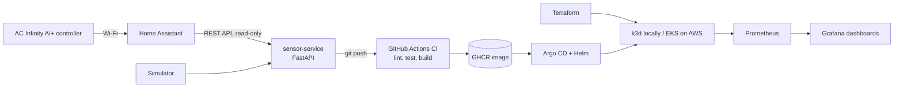

# grow-room-platform

A cloud-native sensor platform for **controlled-environment agriculture**: it collects
grow-room climate data (temperature, humidity, VPD, CO2), exposes it as an API and as
Prometheus metrics, and ships through a full DevOps pipeline: CI, container registry,
infrastructure as code, Kubernetes, GitOps, and monitoring.

## Why this exists

I've done controlled-environment growing at home since 2018, currently a 4x4 tent with
AC Infinity environment controls, spectrum-tunable LED lighting, and no-till living soil.
By day I build and run Kubernetes platforms. This project brings the two together: the
same platform engineering used in production, applied to the data growers actually watch.

## Architecture (5-week target)



## Roadmap

- [x] **Week 1 (starter):** sensor service, tests, Dockerfile
- [ ] **Week 1:** GitHub Actions CI (lint, test, build and push to GHCR), written by hand; see [docs/WEEK1_CI_GUIDE.md](docs/WEEK1_CI_GUIDE.md)
- [ ] **Week 2:** Terraform: VPC + EKS (with remote state and a budget alert)
- [ ] **Week 3:** Helm chart + Argo CD GitOps on k3d, then EKS
- [ ] **Week 4:** Prometheus scraping `/metrics`, Grafana VPD dashboard, alerts
- [ ] **Week 5:** Hardening, docs, Terraform Associate exam
- [ ] **Optional:** K3s on a Raspberry Pi next to the tent (edge)

## API

| Endpoint    | Description |
|-------------|-------------|
| `/healthz`  | Liveness check |
| `/readings` | Latest temp (°C/°F), humidity %, VPD kPa, CO2 ppm |
| `/metrics`  | Prometheus metrics (`grow_temperature_celsius`, `grow_vpd_kpa`, ...) |
| `/docs`     | Interactive OpenAPI docs |

VPD uses the Tetens equation. Set `LEAF_TEMP_OFFSET_C` (e.g. `-2.0`) for leaf VPD.

## Run locally

```bash
python3.12 -m venv .venv && source .venv/bin/activate
pip install -e '.[dev]'
ruff check . && pytest --cov=sensor_service
uvicorn sensor_service.main:app --reload    # http://localhost:8000/readings
```

With Docker:

```bash
docker compose up --build
curl localhost:8000/readings
```

## Real tent data (AC Infinity via Home Assistant)

AC Infinity has no official public API. The community
[homeassistant-acinfinity](https://github.com/dalinicus/homeassistant-acinfinity)
integration pulls controller data into Home Assistant (the AI+ is supported over Wi-Fi).
This service then **reads** those entities through HA's REST API. It only sends GET
requests and never changes your tent settings.

1. Run Home Assistant (HA OS, or uncomment the service in `docker-compose.yml`).
2. Install [HACS](https://hacs.xyz/), then add the AC Infinity integration and sign in
   with your AC Infinity app account.
3. In HA: profile, then Security, then **Long-lived access tokens**; create one.
4. Find your entity IDs under Settings, Devices & services, AC Infinity.
5. `cp .env.example .env` and set:
   ```
   SENSOR_SOURCE=homeassistant
   HA_URL=http://homeassistant.local:8123
   HA_TOKEN=<your token>
   HA_TEMP_ENTITY=sensor.<your_controller>_temperature
   HA_HUMIDITY_ENTITY=sensor.<your_controller>_humidity
   ```
6. `docker compose up`. `.env` is git-ignored; never commit your token.

The simulator stays the default, so CI and demos never need your network.

## License

MIT © 2026 Cole Miller
