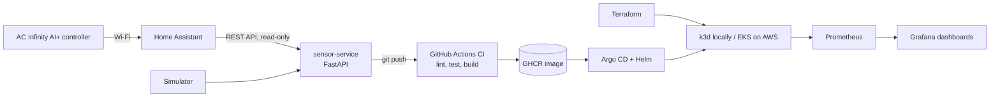

# grow-room-platform

A cloud-native sensor platform for **controlled-environment agriculture**: it collects
grow-room climate data (temperature, humidity, VPD, CO2), exposes it as an API and as
Prometheus metrics, and ships through a full DevOps pipeline: CI, container registry,
infrastructure as code, Kubernetes, GitOps, and monitoring.

## Why this exists

I've done controlled-environment growing at home since 2018, currently a 4x4 tent with
AC Infinity environment controls, spectrum-tunable LED lighting, and no-till living soil.
By day I build and run Kubernetes platforms. This project brings the two together: the
same platform engineering used in production, applied to the data growers actually watch.

## Architecture (5-week target)



## Roadmap

- [x] **Week 1 (starter):** sensor service, tests, Dockerfile
- [x] **Week 1:** GitHub Actions CI (lint, test, build and push to GHCR, Trivy)
- [x] **Week 2:** Terraform modules authored from scratch (`infra/modules/network`, `infra/modules/cluster`); `fmt` / `validate` / `tflint` in CI; remote-state stub; AWS Budgets $20 alert before any paid apply — see [docs/WEEK2_TERRAFORM_GUIDE.md](docs/WEEK2_TERRAFORM_GUIDE.md)
- [x] **Week 3:** Helm chart + Argo CD GitOps on k3d (`charts/sensor-service`, `gitops/` app-of-apps); CI→GitOps `image.tag` bump — see [docs/WEEK3_GITOPS_GUIDE.md](docs/WEEK3_GITOPS_GUIDE.md)
- [ ] **Week 4:** Prometheus + Grafana on k3d (kube-prometheus-stack via Argo); ServiceMonitor scrape of `/metrics`; VPD dashboard; alerts; two SLOs — see [docs/WEEK4_OBSERVABILITY_GUIDE.md](docs/WEEK4_OBSERVABILITY_GUIDE.md)
- [ ] **Week 5:** Hardening, docs, Terraform Associate exam
- [ ] **Optional:** K3s on a Raspberry Pi next to the tent (edge)

## Infrastructure (Week 2+)

Terraform under [`infra/`](infra/):

| Path | Purpose |
|------|---------|
| `infra/modules/network` | VPC, public/private subnets, IGW, optional NAT |
| `infra/modules/cluster` | `local` (k3d outputs) or `eks` (IAM + SG stubs) |
| `infra/backend.tf.example` | S3 + DynamoDB remote state template |

Daily work defaults to **`cluster_mode = "local"`** (no AWS cost). Set an
AWS Budgets alert at **$20/month** before enabling NAT or `cluster_mode = "eks"`.

## GitOps (Week 3+)

Helm + Argo CD under [`charts/`](charts/) and [`gitops/`](gitops/):

| Path | Purpose |
|------|---------|
| `charts/sensor-service` | Helm chart for the FastAPI sensor service (GHCR image, `/healthz`, simulator default) |
| `gitops/root-app.yaml` | Argo CD app-of-apps entrypoint |
| `gitops/apps/sensor-service.yaml` | Application → Helm chart into namespace `grow-room` |
| `scripts/bootstrap-k3d.sh` | Create `grow-room-dev` k3d cluster + install Argo CD |

Daily CD work defaults to **k3d** (no AWS cost). Promote by changing `image.tag`
in Git; Argo syncs. Extend CI yourself later to open that bump as a PR
([docs/WEEK3_CI_NOTE.md](docs/WEEK3_CI_NOTE.md)).

## Observability (Week 4+)

kube-prometheus-stack under [`monitoring/`](monitoring/) + Argo Application
[`gitops/apps/monitoring.yaml`](gitops/apps/monitoring.yaml):

| Path | Purpose |
|------|---------|
| `monitoring/values-k3d.yaml` | Small-footprint Helm values for k3d |
| `monitoring/manifests/` | ServiceMonitor, PrometheusRule, Grafana dashboard ConfigMap |
| `monitoring/dashboards/grow-room-vpd.json` | Temp / humidity / VPD / scrape health |
| `monitoring/docs-slo.md` | Ingest availability + data freshness SLOs; scrape-down runbook |

Prometheus scrapes the sensor Service via a **ServiceMonitor** (operator-native).
Pod `prometheus.io/*` annotations from Week 3 remain as documentation. Daily lab
work stays on **k3d** (no AWS cost).

## API

| Endpoint    | Description |
|-------------|-------------|
| `/healthz`  | Liveness check |
| `/readings` | Controller air temp (°C/°F), humidity %, computed VPD kPa, CO2 ppm, plus `controller`, `probe`, and `ports` |
| `/metrics`  | Prometheus metrics (`grow_temperature_celsius`, `grow_vpd_kpa`, probe gauges, ...) |
| `/docs`     | Interactive OpenAPI docs |

VPD uses the Tetens equation. Set `LEAF_TEMP_OFFSET_C` (e.g. `-2.0`) for leaf VPD.

## Run locally

```bash
python3.12 -m venv .venv && source .venv/bin/activate
pip install -e '.[dev]'
ruff check . && pytest --cov=sensor_service
uvicorn sensor_service.main:app --reload    # http://localhost:8000/readings
```

With Docker:

```bash
docker compose up --build
curl localhost:8000/readings
```

## Real tent data (AC Infinity via Home Assistant)

AC Infinity has no official public API. The community
[homeassistant-acinfinity](https://github.com/dalinicus/homeassistant-acinfinity)
integration pulls controller data into Home Assistant (the AI+ is supported over Wi-Fi).
This service then **reads** those entities through HA's REST API (`GET /api/states/<entity_id>` only).

`docker-compose.yml` runs Home Assistant as a sibling service (`./ha-config:/config`,
port 8123). `sensor-service` reaches it at `http://homeassistant:8123`. The audit
database path in compose is `AUDIT_DB_PATH=/tmp/audit.db` because the image user
cannot create `./data`. Start the sensor service alone with
`docker compose up sensor-service` when you want the simulator and no HA container.

1. `docker compose up`, then open http://localhost:8123 and finish HA onboarding.
2. Install [HACS](https://hacs.xyz/), then add the AC Infinity integration and sign in
   with your AC Infinity app account.
3. In HA: profile, then Security, then **Long-lived access tokens**; create one.
4. `cp .env.example .env` and set:
   ```
   SENSOR_SOURCE=homeassistant
   HA_URL=http://homeassistant:8123
   HA_TOKEN=<your token>
   ```
5. `docker compose up` again. `.env` and `ha-config/` are git-ignored; never commit the token.

The Garden (UIS Controller AI+ and the internal probe) is the default entity map
when `HA_DEVICE_PREFIX=the_garden`:

| Reading | Entity |
|---------|--------|
| Controller air temp / humidity | `sensor.the_garden_controller_temperature`, `sensor.the_garden_controller_humidity` |
| Controller VPD and status | `sensor.the_garden_controller_vpd`, `binary_sensor.the_garden_status` |
| Internal probe temp / humidity / VPD | `sensor.the_garden_probe_sensor_probe_temperature`, `sensor.the_garden_probe_sensor_probe_humidity`, `sensor.the_garden_probe_sensor_probe_vpd` |
| Active devices (`port_1`, `humidifier`, `oscillating_fans`, `ventilation_fan`) | `binary_sensor.the_garden_<device>_status`, `binary_sensor.the_garden_<device>_state`, `sensor.the_garden_<device>_current_power`, `select.the_garden_<device>_active_mode` |

Ports 4–7 stay off the default list. Add a slug to `HA_PORT_DEVICES` when
one of those ports is in use. Blank an `HA_*_ENTITY` variable to skip that sensor.
Number triggers, enable switches, and schedules stay in Home Assistant.

`/readings` keeps the original top-level fields (`temperature_c`, `humidity_percent`,
computed `vpd_kpa`, `co2_ppm`, …). Home Assistant's controller and probe VPD are
often reported in **psi**; those values are converted to `controller.vpd_kpa` and
`probe.vpd_kpa`, and the original number and unit are returned as `vpd_raw` /
`vpd_unit`. Computed `vpd_kpa` still comes from air temperature, humidity, and
`LEAF_TEMP_OFFSET_C`. Prometheus adds `grow_probe_temperature_celsius`,
`grow_probe_humidity_percent`, `grow_probe_vpd_kpa`, `grow_controller_vpd_kpa`,
`grow_controller_status`, `grow_port_current_power`, and `grow_port_status` when
those readings exist.

The simulator stays the default, so CI and demos never need your network.

## License

MIT © 2026 Cole Miller
