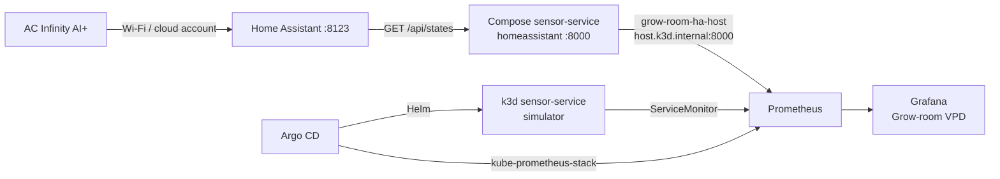

# grow-room-platform

I built this capstone to get hands-on experience with tools I kept seeing in
cloud, infrastructure, and DevOps job postings: Python, Docker, GitHub Actions,
Terraform, Kubernetes, Helm, Argo CD, Prometheus, and Grafana. I wanted more
than a tutorial I could say I finished. I wanted a project I could set up,
break, troubleshoot, and explain.

The use case is a 4x4 grow tent I run at home. The service reads climate data
from an AC Infinity controller through Home Assistant, provides an API and
Prometheus metrics, and puts the readings on a Grafana dashboard. I also added
an audit API to practice recording state changes and checking data integrity.

**This is a local learning lab, not a production cloud deployment.** Kubernetes
runs in **k3d** on my computer. Terraform is validated in CI but never applied
by a repository workflow. The defaults are `cluster_mode = "local"` and
`enable_eks = false`; there is no `aws_eks_cluster` resource in the repo.

For the longer explanation of the design and what I learned, see
[docs/CAPSTONE.md](docs/CAPSTONE.md).

## Why I built it

My background is in configuration management, systems administration, and
supporting complex IT environments. I wanted to build practical experience
with containers, infrastructure as code, CI/CD, GitOps, and monitoring instead
of only reading about them.

I've also been growing in a controlled environment since 2018. My current
setup uses AC Infinity controls, tunable LEDs, and no-till living soil. Using
my own grow-room data made the project useful to me and gave me real problems
to work through, especially when I started connecting the equipment to the
monitoring stack.

## What I built

| Area | What is in the repo |
|------|---------------------|
| Python API | FastAPI service for climate readings, health checks, metrics, and audit events |
| Data sources | A simulator for repeatable testing and a read-only Home Assistant integration for live tent data |
| Containers and CI | Docker image, Ruff, pytest with an 80% coverage threshold, GHCR publishing, and Trivy scanning |
| Kubernetes and GitOps | k3d cluster, Helm chart, Argo CD app-of-apps, and image-tag update PRs |
| Infrastructure as code | Terraform network and cluster modules checked with `fmt`, `validate`, and `tflint` |
| Observability | Prometheus, Grafana Grow-room VPD dashboard, three alert rules, and two lab SLOs |
| Audit history | SQLite-backed plant/batch events with state-transition checks and a SHA-256 hash chain |

I built this over five milestones, from the initial API and tests to GitOps,
monitoring, and the audit log. The implementation notes are in `docs/`.

## How it fits together

I kept the live grow-room connection separate from the Kubernetes demo:

- **Docker Compose** runs Home Assistant and a sensor-service instance that
  reads the actual controller. It is read-only and uses a token stored outside
  Git.
- **k3d** runs a second sensor-service instance using simulated data, plus
  Argo CD, Prometheus, and Grafana. It can run without my equipment, Home
  Assistant account, or AWS credentials.



The live data path is:

**AC Infinity → Home Assistant → Compose sensor-service → Prometheus → Grafana.**

I also keep a [living platform map](https://cursor.com/canvas/store-6a197a3b-901d-4b50-9079-9a539befde02/debaff3b-9e35-48ab-bab0-59761b62fb09)
with the layout, milestones, and design decisions. The diagram above is the
version kept in the repo.

## Run it locally

### Python service (simulator)

Requires Python 3.12.

```bash
python3.12 -m venv .venv
source .venv/bin/activate
pip install -e '.[dev]'
ruff check . && pytest --cov=sensor_service
uvicorn sensor_service.main:app --reload
```

Open `http://localhost:8000/readings` or `http://localhost:8000/docs`.
`SENSOR_SOURCE` defaults to `simulator`, so no physical sensors are needed.

### Docker Compose

```bash
docker compose up --build sensor-service  # API with simulated readings
curl localhost:8000/readings
```

Running `docker compose up` without a service name also starts Home Assistant
on port 8123. The sensor service is published on port 8000 so Prometheus in
k3d can scrape it through the Docker host.

### Connect the live controller

The AC Infinity AI+ does not have an official public API. I use the community
[homeassistant-acinfinity](https://github.com/dalinicus/homeassistant-acinfinity)
integration through HACS and read entities from Home Assistant. My code makes
`GET /api/states/<entity_id>` calls only. It does **not** change controller
settings or call Home Assistant services.

1. Run `docker compose up` and finish Home Assistant setup at `http://localhost:8123`.
2. Install [HACS](https://hacs.xyz/) and the AC Infinity integration, then connect the AC Infinity account.
3. Create a long-lived access token in Home Assistant.
4. Copy `.env.example` to `.env` and set `SENSOR_SOURCE=homeassistant`, `HA_URL=http://homeassistant:8123`, and `HA_TOKEN`.
5. Run `docker compose up` again.

The default `HA_DEVICE_PREFIX=the_garden` maps controller temperature,
humidity, VPD and status; the internal probe; and the devices `port_1`,
`humidifier`, `oscillating_fans`, and `ventilation_fan`. Ports 4–7 are not
included until added to `HA_PORT_DEVICES`. `HA_CO2_ENTITY` is optional and
empty by default; a blank `HA_*_ENTITY` value skips that reading.

`.env`, `ha-config/`, and `data/` are gitignored. The Home Assistant token is
not stored in the Helm values or monitoring configuration.

## API and sensor data

| Endpoint | Purpose |
|----------|---------|
| `GET /healthz` | Health check |
| `GET /readings` | Temperature (°C/°F), humidity, computed VPD (kPa), optional CO2, controller/probe details, and device ports |
| `GET /metrics` | Prometheus metrics |
| `GET /docs` | FastAPI OpenAPI documentation |
| `/audit/...` | Batches, plants, state changes, event history, and integrity checks |

The service calculates VPD with the Tetens equation. `LEAF_TEMP_OFFSET_C`
(default `-2.0` in the lab configuration) adjusts the calculation for leaf
temperature. When Home Assistant reports controller or probe VPD in psi, the
API provides a converted kPa value and preserves the original value and unit
as `vpd_raw` and `vpd_unit`.

Prometheus always has the simulator's climate gauges, including
`grow_temperature_celsius` and `grow_vpd_kpa`. Additional controller, probe,
and port gauges are created only after a successful Home Assistant sample:

- `grow_probe_temperature_celsius`, `grow_probe_humidity_percent`, `grow_probe_vpd_kpa`
- `grow_controller_vpd_kpa`, `grow_controller_status`
- `grow_port_current_power`, `grow_port_status` (labeled by device)

## Run the Kubernetes lab

Requires Docker, k3d, kubectl, and Helm.

```bash
./scripts/bootstrap-k3d.sh
kubectl apply -n argocd -f gitops/root-app.yaml
kubectl -n argocd get applications
```

The script creates `grow-room-dev` with two agents and installs Argo CD.
To reach the Argo CD UI:

```bash
kubectl -n argocd port-forward svc/argocd-server 8080:80
```

Open `http://localhost:8080` (HTTP). Port 443 with HTTPS resets TLS on this
lab; the HTTP port on the service is the path that works. The bootstrap
script prints the initial admin password while the secret is available.

The `grow-room-root` Application manages two child Applications:

| Application | Responsibility |
|-------------|----------------|
| `sensor-service` | Helm chart in the `grow-room` namespace, using simulated readings |
| `monitoring` | kube-prometheus-stack `92.13.1`, ServiceMonitor, alerts, and dashboard |

Argo CD is configured to prune and self-heal resources based on the Git
configuration. For a Helm-only smoke test without Argo:

```bash
helm upgrade --install sensor ./charts/sensor-service -n grow-room --create-namespace \
  -f charts/sensor-service/values.yaml -f charts/sensor-service/values-k3d.yaml
```

## CI/CD and Terraform

**GitHub Actions CI** (`.github/workflows/ci.yml`) runs Ruff and pytest with a
coverage threshold of 80%. A Buildx job creates the container image. Pushes
to `main` publish the commit-SHA and `latest` tags to
`ghcr.io/tontoblanco/grow-room-platform`. Trivy scans the `latest` image and
fails the job on unfixed HIGH or CRITICAL findings.

**GitOps deployment** (`.github/workflows/gitops-bump.yml`) runs after a
successful CI workflow on `main`. It opens a PR to update `image.tag` in
`charts/sensor-service/values.yaml` to `sha-<7-char>`. Merging that PR changes
the desired state; Argo CD then synchronizes the cluster. It is not an
unreviewed automatic deployment.

**Terraform** lives in `infra/`. The workflow runs `terraform fmt -check`,
`terraform init -backend=false`, `terraform validate`, and `tflint` using
Terraform 1.9.8. It does not run `plan` or `apply`.

| Variable | Repo default | Meaning |
|----------|--------------|---------|
| `cluster_mode` | `local` | Local cluster output rather than the EKS branch |
| `enable_eks` | `false` | Leaves the EKS-related IAM/security-group branch disabled |
| `enable_nat_gateway` | `false` | Does not include the hourly-billed NAT gateway |

The EKS branch is **not** a working EKS deployment: it has an IAM role and a
security group but no `aws_eks_cluster` resource. The Terraform network
module does define real AWS VPC, subnet, and internet-gateway resources.
**Running `terraform apply` against the root module can create AWS resources,
even with the local cluster default.** I left the apply step out of CI and
included a reminder to configure a $20/month AWS Budgets alert before trying
a paid deployment.

More detail: [Terraform guide](docs/WEEK2_TERRAFORM_GUIDE.md) and
[GitOps guide](docs/WEEK3_GITOPS_GUIDE.md).

## Monitoring

Prometheus and Grafana run in the `monitoring` namespace. The laptop-oriented
configuration uses 24-hour retention, a 30-second scrape interval, and single
replicas.

Prometheus has two scrape targets:

| Job | Data source |
|-----|-------------|
| `sensor-service` | In-cluster simulator through a ServiceMonitor |
| `grow-room-ha-host` | Compose service on `host.k3d.internal:8000` using `additionalScrapeConfigs` |

The second job has `sensor_source="homeassistant"` and
`instance="docker-compose-sensor-service"` labels. The dashboard uses those
labels to keep the live controller and probe readings separate from simulated
readings. It also groups scrape health by job so an old pod does not leave
extra DOWN tiles after a rollout. Tests in `tests/test_grafana_dashboard.py`
check the queries.

```bash
kubectl -n monitoring port-forward svc/monitoring-prometheus 9090:9090
kubectl -n monitoring port-forward svc/monitoring-grafana 3000:80
```

Prometheus targets: `http://127.0.0.1:9090/targets`.
Grafana: `http://127.0.0.1:3000` (lab credentials `admin` / `grow-room-lab`).
The dashboard is **Grow-room VPD**, uid `grow-room-vpd`. Live-only panels show
**No HA sample** until Home Assistant has supplied readings and the host
scrape is UP.

This lab defines two starting-point SLOs for the in-cluster simulator:

- **Scrape availability:** 99% successful scrapes over seven days.
- **Prometheus sample freshness:** `grow_vpd_kpa` samples no older than 120
  seconds for 99% of observations over seven days. This checks sample age,
  not whether a physical sensor has stopped changing its value.

There are also alerts for sensor scrape failures (2 minutes), humidity outside
30–80% (5 minutes), and more than two sensor container restarts in 15 minutes.
The humidity rule applies to any matching series, including live and
simulated readings. See [monitoring/docs-slo.md](monitoring/docs-slo.md) and
the [observability guide](docs/WEEK4_OBSERVABILITY_GUIDE.md).

## Audit log

The `/audit` routes let me practice event history and integrity checks using
a plant/batch model. This is **not** a state compliance system or a METRC
integration.

A plant follows these states:

`seedling` → `vegetative` → `flowering` → `harvested` → `packaged`

`destroyed` is allowed from any non-terminal state. Invalid transitions
return 409. The API rejects `PUT`, `PATCH`, and `DELETE` requests against
stored events with 405 responses.

Each event records its previous event's hash and its own SHA-256 hash.
`GET /audit/integrity` recomputes the chain to detect inconsistencies. The
plant table holds the current state; the event table holds the history.

```bash
curl -s localhost:8000/audit/batches -X POST -H 'content-type: application/json' \
  -d '{"name":"tent-a","strain":"demo"}'
```

By default the local database is `./data/audit.db`. Docker Compose and the
Helm chart use `/tmp/audit.db` so the non-root container can write to it. In
k3d, that database is on an `emptyDir` and **does not survive replacement of
the pod**. There is an example PVC at
`charts/snippets/audit-sqlite-pvc.yaml`, but it is not wired into the chart.
The hash chain is useful for learning and checking consistency; it is not
immutable storage or proof of who performed an action.

See the [audit guide](docs/WEEK5_AUDIT_LOG_GUIDE.md) and
[compliance notes](docs/WEEK5_COMPLIANCE_NOTES.md).

## Security and scope

The Helm chart uses a non-root user (uid 10001), a read-only root filesystem,
`allowPrivilegeEscalation: false`, dropped Linux capabilities, seccomp
`RuntimeDefault`, resource limits, health probes, and a ServiceAccount with
token automount disabled.

Those settings are a starting point for learning container hardening. This
project has no ATO, STIG assessment, FedRAMP authorization, production EKS
cluster, external state traceability integration, or durable multi-node audit
store. I would rather show exactly what I implemented than claim controls I
didn't test.

## Repository layout

| Path | Contents |
|------|----------|
| `sensor_service/` | FastAPI app, data sources, VPD math, and audit implementation |
| `tests/` | API, math, Home Assistant fixture, audit, and dashboard tests |
| `charts/sensor-service/` | Helm chart |
| `gitops/` | Argo CD root and child Applications |
| `monitoring/` | Prometheus/Grafana configuration, SLOs, dashboard, and alerts |
| `infra/` | Terraform modules and examples |
| `scripts/bootstrap-k3d.sh` | Local k3d bootstrap |
| `docs/` | Build guides, compliance notes, and the [capstone write-up](docs/CAPSTONE.md) |

## License

MIT © 2026 Cole Miller
