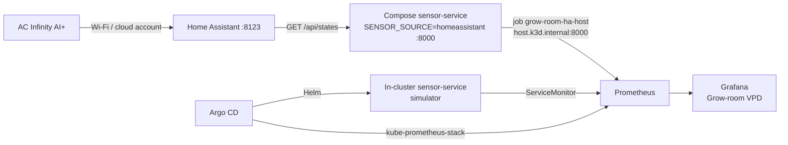

# grow-room-platform

A cloud-native sensor platform for a home cannabis grow: controlled-environment
agriculture on a 4x4 tent, delivered with the same CI, GitOps, and
observability habits used for production Kubernetes. It reads climate data
(temperature, humidity, VPD, and CO2 when a sensor reports it), exposes an API
and Prometheus metrics, and keeps an append-only seed-to-sale style audit log.

Daily work runs on a laptop. The cluster is **k3d**. Terraform stays at
`cluster_mode = "local"` and `enable_eks = false`. Nothing in this repo applies
an EKS cluster.

**Architecture write-up:** [docs/CAPSTONE.md](docs/CAPSTONE.md) (interview notes
and a blog draft).

**Living diagram:** [Grow-room Platform Map](https://cursor.com/canvas/store-6a197a3b-901d-4b50-9079-9a539befde02/debaff3b-9e35-48ab-bab0-59761b62fb09)
— edge flow, cluster layout, milestone status, and the decision log. Atlas
keeps that page current. The mermaid in this README is the in-repo snapshot
for GitHub.

## Why this exists

I have grown in a controlled environment at home since 2018. The tent today is
a 4x4 with AC Infinity controls, spectrum-tunable LEDs, and no-till living
soil. By day I build and run Kubernetes platforms. This project puts those
together: platform engineering applied to the numbers a grower actually watches.

## Architecture

Two planes. Docker Compose on the host carries the live tent. k3d carries
GitOps, the simulator, and the monitoring stack.



Live path:

**AC Infinity AI+ → Home Assistant → Docker Compose sensor-service
(`SENSOR_SOURCE=homeassistant`) → Prometheus job `grow-room-ha-host`
(`host.k3d.internal:8000`) → Grafana dashboard Grow-room VPD**
(uid `grow-room-vpd`).

The in-cluster Deployment stays on the simulator. CI and demos never need the
tent, a Home Assistant token, or AWS.

## What shipped

| Week | In the repo |
|------|-------------|
| 1 | FastAPI service, tests, Dockerfile, GitHub Actions (lint, test, GHCR, Trivy) |
| 2 | Terraform modules under `infra/`; CI runs `fmt`, `validate`, `tflint` only |
| 3 | Helm chart, Argo CD app-of-apps on k3d, image-tag bump PRs |
| 4 | kube-prometheus-stack, ServiceMonitor, Grow-room VPD, alerts, two lab SLOs |
| 5 | `/audit` hash-chained event log, this README, [docs/CAPSTONE.md](docs/CAPSTONE.md) |

Host scrape of the Compose sensor, Home Assistant panels on the VPD board,
legend collapse, and scrape-up collapse are on `main` (PRs
[#25](https://github.com/TontoBlanco/grow-room-platform/pull/25),
[#29](https://github.com/TontoBlanco/grow-room-platform/pull/29),
[#32](https://github.com/TontoBlanco/grow-room-platform/pull/32)).
An optional Raspberry Pi next to the tent is still an idea, not a manifest.

## API

| Endpoint | Description |
|----------|-------------|
| `GET /healthz` | Liveness |
| `GET /readings` | Controller air temp (°C/°F), humidity, computed VPD (kPa), CO2, plus `controller`, `probe`, and `ports` |
| `GET /metrics` | Prometheus gauges (`grow_temperature_celsius`, `grow_vpd_kpa`, and Home Assistant gauges after a real sample) |
| `GET /docs` | OpenAPI |
| `/audit/...` | Batches, plants, transitions, history, hash-chain check — see [Audit log](#audit-log) |

Computed VPD uses the Tetens equation. `LEAF_TEMP_OFFSET_C` (k3d values and
`.env.example` use `-2.0`) shifts leaf temperature for leaf VPD. Home Assistant
often reports controller and probe VPD in psi; those values are converted to
`controller.vpd_kpa` and `probe.vpd_kpa`, and the original number and unit come
back as `vpd_raw` / `vpd_unit`.

## Run locally

### Process (simulator)

```bash
python3.12 -m venv .venv && source .venv/bin/activate
pip install -e '.[dev]'
ruff check . && pytest --cov=sensor_service
uvicorn sensor_service.main:app --reload    # http://localhost:8000/readings
```

`SENSOR_SOURCE` defaults to `simulator`.

### Docker Compose

```bash
docker compose up --build sensor-service   # simulator only
curl localhost:8000/readings
```

`docker compose up` also starts Home Assistant (`ghcr.io/home-assistant/home-assistant:stable`,
port 8123, config in `./ha-config`). The sensor container reaches it at
`http://homeassistant:8123`. Compose publishes sensor-service as `8000:8000`
so k3d can scrape the host. The image runs as uid 10001, so the default audit
path is `AUDIT_DB_PATH=/tmp/audit.db`.

### Live tent (AC Infinity via Home Assistant)

AC Infinity has no official public API. The community
[homeassistant-acinfinity](https://github.com/dalinicus/homeassistant-acinfinity)
integration (AI+ over Wi-Fi) lands entities in Home Assistant. This service
**reads** them with `GET /api/states/<entity_id>` only. It never calls HA
services or changes tent setpoints.

1. `docker compose up`, open http://localhost:8123, finish onboarding.
2. Install [HACS](https://hacs.xyz/), add the AC Infinity integration, sign in
   with the AC Infinity app account.
3. Create a long-lived access token (profile → Security).
4. `cp .env.example .env` and set `SENSOR_SOURCE=homeassistant`,
   `HA_URL=http://homeassistant:8123`, and `HA_TOKEN`.
5. `docker compose up` again.

`.env`, `ha-config/`, and `data/` are gitignored. The token never goes in Git
or in `monitoring/values-k3d.yaml`.

The Garden (UIS Controller AI+ and the internal probe) is the default map when
`HA_DEVICE_PREFIX=the_garden`:

| Reading | Entity |
|---------|--------|
| Controller air temp / humidity | `sensor.the_garden_controller_temperature`, `sensor.the_garden_controller_humidity` |
| Controller VPD and status | `sensor.the_garden_controller_vpd`, `binary_sensor.the_garden_status` |
| Internal probe temp / humidity / VPD | `sensor.the_garden_probe_sensor_probe_temperature`, `sensor.the_garden_probe_sensor_probe_humidity`, `sensor.the_garden_probe_sensor_probe_vpd` |
| Active devices | `port_1`, `humidifier`, `oscillating_fans`, `ventilation_fan` |

Ports 4–7 stay off the default list. Add a slug to `HA_PORT_DEVICES` when one
is in use. Blank an `HA_*_ENTITY` variable to skip that sensor. `HA_CO2_ENTITY`
is empty unless you set it.

Prometheus gauges that exist only after a Home Assistant sample:
`grow_probe_temperature_celsius`, `grow_probe_humidity_percent`,
`grow_probe_vpd_kpa`, `grow_controller_vpd_kpa`, `grow_controller_status`,
`grow_port_current_power`, `grow_port_status` (label `device`). The simulator
does not export them.

### k3d + Argo CD

Requires Docker, k3d, kubectl, and Helm.

```bash
./scripts/bootstrap-k3d.sh
# creates k3d cluster grow-room-dev (2 agents) and installs Argo CD
kubectl apply -n argocd -f gitops/root-app.yaml
kubectl -n argocd get applications
```

Port-forward Argo CD with `kubectl -n argocd port-forward svc/argocd-server 8080:443`
and open https://localhost:8080. The script prints the initial admin password
when the secret still exists.

`grow-room-root` syncs every Application under `gitops/apps/`
(automated prune and self-heal):

| Application | What Argo applies |
|-------------|-------------------|
| `sensor-service` | Helm chart `charts/sensor-service` into namespace `grow-room` (`SENSOR_SOURCE=simulator`) |
| `monitoring` | kube-prometheus-stack `92.13.1` with `monitoring/values-k3d.yaml`, plus `monitoring/manifests/` |

Smoke without Argo:

```bash
helm upgrade --install sensor ./charts/sensor-service -n grow-room --create-namespace \
  -f charts/sensor-service/values.yaml -f charts/sensor-service/values-k3d.yaml
```

## CI, GitOps, Terraform

**CI** (`.github/workflows/ci.yml`) on pull requests and pushes to `main`:
Ruff, pytest with coverage fail-under 80, then a Buildx image. Pushes to
`main` publish `ghcr.io/tontoblanco/grow-room-platform` tagged with the commit
SHA and `latest`. The same job runs Trivy against
`ghcr.io/tontoblanco/grow-room-platform:latest` at CRITICAL and HIGH
(`ignore-unfixed`, exit code 1).

**GitOps bump** (`.github/workflows/gitops-bump.yml`) runs after CI succeeds on
`main` and opens a PR that sets `image.tag` in
`charts/sensor-service/values.yaml` to `sha-<7-char>`. Merging that PR is the
deploy. Argo tracks `HEAD` of this repo.

**Terraform** (`infra/`, `.github/workflows/terraform.yml`) is authorship and
review, not a running cloud account. The workflow runs `terraform fmt`,
`terraform init -backend=false`, `terraform validate`, and `tflint`
(Terraform 1.9.8). It does not plan or apply.

Checked-in defaults (`infra/variables.tf`, `infra/terraform.tfvars.example`):

| Variable | Default | Effect |
|----------|---------|--------|
| `cluster_mode` | `local` | Cluster module emits a k3d command and creates no AWS objects |
| `enable_eks` | `false` | `true` forces the EKS branch even if `cluster_mode` is `local` |
| `enable_nat_gateway` | `false` | NAT Gateway is the paid network piece; it stays off |

The EKS branch is an IAM role and a security group (`count` is 0 on the local
path). There is no `aws_eks_cluster` resource. The network module is real VPC,
subnet, and internet-gateway code; CI validates it and no workflow applies it.
`infra/backend.tf.example` is a commented S3 + DynamoDB stub. `budget_reminder`
tells you to set an AWS Budgets alert at $20/month before any apply that turns
on NAT or the EKS branch. This lab does not do that apply.

Details: [docs/WEEK2_TERRAFORM_GUIDE.md](docs/WEEK2_TERRAFORM_GUIDE.md),
[docs/WEEK3_GITOPS_GUIDE.md](docs/WEEK3_GITOPS_GUIDE.md).

## Observability

kube-prometheus-stack in namespace `monitoring`, values tuned for a laptop
(24h retention, 30s scrape, single replicas, control-plane scrapes that k3d
does not expose turned down).

Two scrapes:

| Job | Target | Labels that matter |
|-----|--------|--------------------|
| ServiceMonitor `sensor-service` | In-cluster Service, namespace `grow-room`, `/metrics` | `job="sensor-service"` (simulator) |
| `grow-room-ha-host` | `host.k3d.internal:8000` via `additionalScrapeConfigs` | `instance="docker-compose-sensor-service"`, `sensor_source="homeassistant"` |

k3d injects `host.k3d.internal` into CoreDNS, so Prometheus pods reach the
Compose port on the Docker host. Pod `prometheus.io/*` annotations stay on the
chart as documentation. Annotation-based pod discovery is off; the operator
uses the ServiceMonitor plus that one static job.

`sensor_source=homeassistant` is how the board stays readable. Controller,
probe, and port panels select that label and aggregate with `max by
(sensor_source)` or `max by (device)`, so each line is one series. The Scrape
up stat uses `max by (job)` on `sensor-service|grow-room-ha-host`, so a rolled
pod does not leave its own DOWN tile. Tests in `tests/test_grafana_dashboard.py`
lock both queries. Panels that need a Home Assistant sample show **No HA
sample** until `grow-room-ha-host` is UP.

```bash
kubectl -n monitoring port-forward svc/monitoring-prometheus 9090:9090
kubectl -n monitoring port-forward svc/monitoring-grafana 3000:80
```

Grafana login for this lab is `admin` / `grow-room-lab` (localhost only; it is
set in `monitoring/values-k3d.yaml`). Prometheus targets:
`http://127.0.0.1:9090/targets`. Confirm job `grow-room-ha-host` is UP, then
`grow_probe_temperature_celsius{job="grow-room-ha-host"}`.

The dashboard ConfigMap is
`monitoring/manifests/grafana-dashboard-grow-room-vpd.yaml` (same JSON as
`monitoring/dashboards/grow-room-vpd.json`). The Grafana sidecar loads
ConfigMaps labeled `grafana_dashboard=1`. Lab steps, DNS fallbacks, and reload
notes: [docs/WEEK4_OBSERVABILITY_GUIDE.md](docs/WEEK4_OBSERVABILITY_GUIDE.md)
Steps 4e and 5.

**SLOs** (lab starting points, in-cluster simulator job):
[monitoring/docs-slo.md](monitoring/docs-slo.md).

- Ingest availability: 99% of scrapes of `up{job="sensor-service"}` over 7 days.
  The host job is a different series and does not burn this budget.
- Data freshness: `grow_vpd_kpa` timestamp within 120 seconds for 99% of
  samples over 7 days.

**Alerts** (`monitoring/manifests/grow-room-prometheusrule.yaml`):
`GrowRoomSensorScrapeDown` (`up{job="sensor-service"} == 0` for 2m),
`GrowRoomHumidityOutOfRange` (under 30% or over 80% for 5m),
`GrowRoomSensorPodRestarts` (more than 2 restarts in 15m). The humidity rule
matches the gauge with no job filter, so both scrapes can fire it. Runbook:
[monitoring/docs-slo.md](monitoring/docs-slo.md) and the anchor in the Week 4 guide.

## Audit log

`/audit` is a personal model of seed-to-sale evidence on the same FastAPI
process. It is not a METRC client and it does not call a state traceability
API.

- Batches and plants. A new plant starts in `seedling` and writes a birth event.
- Finite state machine: `seedling` → `vegetative` → `flowering` → `harvested` →
  `packaged`. `destroyed` is reachable from any live state and then terminal.
  Illegal edges return 409.
- Events are insert-only. `PUT`, `PATCH`, and `DELETE` on `/audit/events/{id}`
  return 405.
- Each event stores `prev_hash` and a SHA-256 `event_hash`. `GET /audit/integrity`
  recomputes the chain.
- The plant row is the current projection. The event table is the record.

Default file is `./data/audit.db`. Compose and the Helm chart point
`AUDIT_DB_PATH` at `/tmp/audit.db` because the container is non-root with a
read-only root filesystem (`emptyDir` on `/tmp`). That file does not survive
a new container. `charts/snippets/audit-sqlite-pvc.yaml` is an optional PVC
snippet; the chart does not mount it.

```bash
curl -s localhost:8000/audit/batches -X POST -H 'content-type: application/json' \
  -d '{"name":"tent-a","strain":"demo"}'
```

Guide: [docs/WEEK5_AUDIT_LOG_GUIDE.md](docs/WEEK5_AUDIT_LOG_GUIDE.md).
Interview limits (no STIG claim, no ATO): [docs/WEEK5_COMPLIANCE_NOTES.md](docs/WEEK5_COMPLIANCE_NOTES.md).

## Where to look

| Path | Role |
|------|------|
| `sensor_service/` | FastAPI app, VPD math, Home Assistant and simulator sources, `audit/` |
| `tests/` | API, VPD, HA fixtures, audit chain, dashboard query locks |
| `charts/sensor-service/` | Helm chart (non-root, read-only root, dropped capabilities, `/healthz` probes) |
| `gitops/` | Argo CD root app and child Applications |
| `monitoring/` | k3d Helm values, ServiceMonitor, PrometheusRule, VPD dashboard, SLOs |
| `infra/` | Terraform network + cluster modules |
| `scripts/bootstrap-k3d.sh` | Local cluster and Argo CD install |
| `docs/` | Week guides and [CAPSTONE.md](docs/CAPSTONE.md) |

The chart runs as uid 10001, `readOnlyRootFilesystem: true`,
`allowPrivilegeEscalation: false`, capabilities dropped, seccomp
`RuntimeDefault`, and a ServiceAccount with token automount off. The image is
`python:3.12-slim`.

## License

MIT © 2026 Cole Miller
