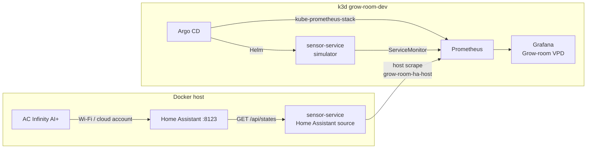
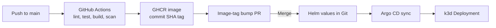
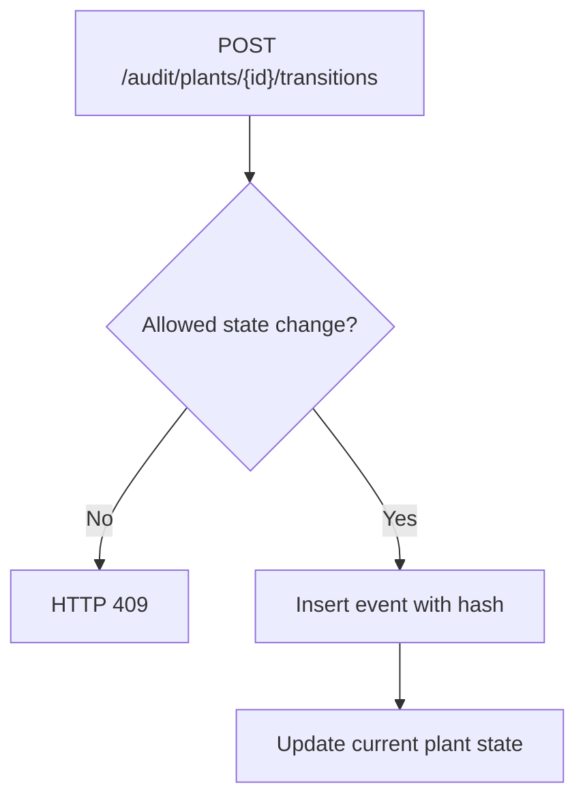

# Capstone: Building a Grow Room Monitoring Platform

## Why I built this

I put this project together because I kept seeing the same tools show up in
cloud, infrastructure, and DevOps job descriptions: Docker, Terraform,
Kubernetes, GitHub Actions, Helm, Argo CD, Prometheus, and Grafana. My
professional background is in configuration management, systems
administration, virtualization, and supporting complex IT systems. I wanted
to move beyond knowing what those tools were and actually work through how
they fit together.

I needed a use case that meant something to me. I've been growing indoors
since 2018, and my current 4x4 tent has an AC Infinity controller, adjustable
LED lighting, and no-till living soil. Climate data is something I already
pay attention to, so it made sense to build around it.

The result is `grow-room-platform`: a FastAPI service for grow-room sensor
data, a local Kubernetes and GitOps lab, and a small event-history system.
The growing setup is a personal home cannabis project. The software is not a
commercial cultivation platform, a state traceability integration, or a
production-authorized system.

My goal wasn't to build the biggest architecture I could draw. It was to
build something I could run, test, break, fix, and explain without overstating
what I had done.

[README and setup instructions](../README.md) ·
[Living platform map](https://cursor.com/canvas/store-6a197a3b-901d-4b50-9079-9a539befde02/debaff3b-9e35-48ab-bab0-59761b62fb09)

## What I completed

| Milestone | Work |
|-----------|------|
| Week 1: Application and CI | FastAPI endpoints, VPD calculations, pytest, Ruff, Dockerfile, GitHub Actions, GHCR image publishing, Trivy scanning |
| Week 2: Terraform | Network and cluster modules, CI validation, local defaults, example backend configuration |
| Week 3: Kubernetes and GitOps | k3d, Helm chart, Argo CD app-of-apps, PR-based image-tag updates |
| Week 4: Monitoring | Prometheus, Grafana Grow-room VPD dashboard, simulator and Home Assistant scrape targets, alerts, two lab SLOs |
| Week 5: Audit history | Plant/batch API, state-machine transitions, hash-chained SQLite events, integrity check, documentation |

Everything runs locally for the lab. The Kubernetes environment is k3d, not
EKS. Terraform files are checked in CI, but there is no Terraform plan or
apply in the workflows. Keeping the lab local gave me room to experiment
without leaving cloud resources running or treating a partly built EKS
configuration as a completed deployment.

## Architecture: separating the real sensors from the lab

I ended up with two paths: one for the actual grow-room readings and one for
repeatable application and platform testing.



**Live path:** AC Infinity AI+ → Home Assistant → Docker Compose
sensor-service → Prometheus → Grafana.

**Lab path:** simulator → FastAPI service on k3d → Prometheus → Grafana.
Argo CD manages the cluster applications from Git.

That separation was deliberate. I didn't want my CI tests or Kubernetes
deployments to depend on a controller in my house, my local network, or a
Home Assistant access token. The simulator keeps the cluster reproducible.
The Compose instance lets me use real readings without putting household
credentials into the GitOps configuration.

### Reading the AC Infinity controller

The AC Infinity AI+ does not have an official public API. I use the community
[homeassistant-acinfinity](https://github.com/dalinicus/homeassistant-acinfinity)
integration through HACS. `HomeAssistantSource` reads entities with
`GET /api/states/<entity_id>`. I intentionally kept it read-only: no calls to
Home Assistant services and no automated changes to the controller's
setpoints.

The default `HA_DEVICE_PREFIX=the_garden` maps controller temperature,
humidity, VPD, and status; internal-probe temperature, humidity, and VPD; and
the devices `port_1`, `humidifier`, `oscillating_fans`, and
`ventilation_fan`. Unused ports stay out of the default mapping. CO2 is
optional and disabled until `HA_CO2_ENTITY` is configured.

The access token goes in a gitignored `.env` file. Docker Compose passes it
as `HA_TOKEN`. The k3d Helm values do not set the Home Assistant source or
include the token. The chart supports a reference to an existing Secret,
but the k3d configuration does not use one.

The service returns controller and probe details through `/readings` and
exports gauges through `/metrics`. Computed VPD uses the Tetens equation and
a configurable leaf-temperature offset (`LEAF_TEMP_OFFSET_C=-2.0` in the lab
values). When Home Assistant returns VPD in psi, I convert it to kPa and
preserve the original value and unit in the response.

## Why the monitoring stack scrapes the Docker host

This was one of the more useful design problems in the project.

The Kubernetes Deployment uses the simulator. Its ServiceMonitor can scrape
standard climate gauges, but it cannot supply the controller, probe, and
port-specific gauges. Those only appear after the Compose service receives a
Home Assistant sample.

The Compose sensor-service publishes port `8000`. k3d exposes the Docker
host to cluster pods using `host.k3d.internal`, so I added a separate
Prometheus static scrape job under
`prometheus.prometheusSpec.additionalScrapeConfigs`:

| Setting | Value |
|---------|-------|
| Job | `grow-room-ha-host` |
| Target | `host.k3d.internal:8000` |
| Metrics path | `/metrics` |
| Interval | 30 seconds |
| Labels | `instance=docker-compose-sensor-service`, `sensor_source=homeassistant` |

I used `additionalScrapeConfigs` instead of another ServiceMonitor because
the Compose service is not a Kubernetes Service. A ServiceMonitor is useful
for selecting endpoints managed inside the cluster. The host job has a
static target outside it.

The port is bound to the Docker host, not just `127.0.0.1`, so the cluster
network can reach it. The monitoring values also document fallback addresses
if `host.k3d.internal` fails to resolve. No Home Assistant credentials are
stored in the Prometheus configuration.

This change is in [PR #25](https://github.com/TontoBlanco/grow-room-platform/pull/25).

### Cleaning up the Grafana queries

Once both data sources were being scraped, the Grafana dashboard needed some
work. A panel that queries every matching metric can mix the simulator with
the live tent or show a separate series for each old pod after a rollout.
Those extra lines made the dashboard harder to read.

I handled that by giving the host scrape a `sensor_source=homeassistant`
label and selecting it only on the controller, probe, and port panels.
Those queries aggregate with `max by (sensor_source)` or `max by (device)`.
The scrape-health panel uses:

```promql
max by (job) (up{job=~"sensor-service|grow-room-ha-host"})
```

That gives me one status per scrape job instead of a separate status for
every instance. I added tests in `tests/test_grafana_dashboard.py` to keep
the queries from drifting during future changes. The dashboard shows
**No HA sample** when the live source hasn't produced data. A working
simulator does not hide a failed host scrape.

Those refinements are in [PR #29](https://github.com/TontoBlanco/grow-room-platform/pull/29)
and [PR #32](https://github.com/TontoBlanco/grow-room-platform/pull/32).

## GitOps: making Git the deployment decision

The local cluster is `grow-room-dev` with two k3d agents.
`scripts/bootstrap-k3d.sh` installs Argo CD using chart version `7.7.12`.
The `grow-room-root` Application points to `gitops/apps/` and manages two
children:

- **`sensor-service`:** deploys the Helm chart into the `grow-room`
  namespace with the simulator enabled.
- **`monitoring`:** deploys kube-prometheus-stack `92.13.1`, the lab values,
  and the ServiceMonitor, alert rules, and dashboard manifests into
  `monitoring`.

Prune and self-heal are enabled. Argo CD reconciles the merged version of
Git, not whatever is sitting in an open pull request.

I also wanted to understand how a built image becomes a controlled release.
The pipeline works like this:



CI runs Ruff and pytest with an 80% coverage threshold, builds an image with
Buildx, and publishes to GHCR on `main`. Trivy checks the `latest` image and
fails on unfixed HIGH and CRITICAL findings. After CI succeeds,
`.github/workflows/gitops-bump.yml` opens a pull request changing
`image.tag` to `sha-<7-char>`. The merge is the deployment approval; Argo CD
handles reconciliation.

That workflow gave me practice with a key configuration-management idea:
there should be a reviewable record of what version the environment is
supposed to run. I don't need to describe the lab as fully automated
production delivery to show that principle.

### Container settings I actually configured

The Helm chart specifies a non-root uid/gid/fsGroup of 10001, seccomp
`RuntimeDefault`, `allowPrivilegeEscalation: false`, a read-only root
filesystem, dropped capabilities, resource requests/limits, `/healthz`
liveness and readiness checks, and a ServiceAccount with automatic token
mounting disabled.

The image uses `python:3.12-slim` with a non-root application user. HPA
manifests exist, but autoscaling is disabled. The repo does not include a
NetworkPolicy. Prometheus scrapes through a ServiceMonitor, not through the
pod's `prometheus.io/*` annotations; those annotations are kept for context.

These are useful hardening exercises. They are not evidence of a completed
security authorization or an assessed compliance baseline.

## Terraform: useful practice without pretending I deployed EKS

Terraform lives under `infra/`:

- `infra/modules/network` defines an AWS VPC, public/private subnets, an
  internet gateway, and an optional NAT gateway.
- `infra/modules/cluster` provides local k3d output or an EKS-related IAM
  role and security-group branch.
- The root module connects the modules and defines their inputs and outputs.

The Terraform GitHub Actions workflow runs:

```bash
terraform fmt -check
terraform init -backend=false
terraform validate
tflint
```

The configuration uses Terraform 1.9.8 and defaults to:

```hcl
cluster_mode       = "local"
enable_eks         = false
enable_nat_gateway = false
```

Those are the repository defaults, not proof that an AWS apply would cost
nothing. The network module is still real AWS resource code: **running
`terraform apply` against the root could create a VPC, subnets, and an
internet gateway even with the cluster set to local**. The EKS-related
branch has an IAM role and security group, but no `aws_eks_cluster` resource.
There is no deployed EKS cluster in this project.

I left the backend as a commented example and did not put state management
or an apply step into the workflow. A `budget_reminder` output tells me to
configure a $20/month AWS Budgets alert before enabling chargeable resources;
it does not create an alert for me.

That distinction matters to me. I can show the modules, explain what
`validate` checks, and point out what I would still need to implement before
a cloud deployment. I don't need to claim an EKS environment I didn't build.

[Terraform build notes](WEEK2_TERRAFORM_GUIDE.md) ·
[GitOps build notes](WEEK3_GITOPS_GUIDE.md)

## SLOs, alerts, and what the metrics actually prove

I used kube-prometheus-stack to practice writing monitoring rules instead of
stopping at a dashboard. The configuration uses 30-second scrapes and 24-hour
retention to fit a laptop lab.

I documented two **starting-point lab SLOs** for the simulator service:

| SLO | Target | What it measures |
|-----|--------|------------------|
| Ingest availability | 99% successful `up{job="sensor-service"}` scrapes over seven days | Whether Prometheus can scrape the in-cluster service |
| Prometheus sample freshness | `grow_vpd_kpa` sample age ≤ 120 seconds for 99% of observations over seven days | Whether Prometheus is receiving recent samples |

The first intentionally excludes `grow-room-ha-host`. A bad Home Assistant
token or a host networking problem should not be counted as downtime for
the simulator service.

The second has an important limitation: Prometheus can attach a fresh scrape
timestamp to an unchanged sensor value. This metric does not by itself prove
that the physical controller reported a new measurement. A stronger
end-to-end freshness check would need a source-observation timestamp.

Three alert rules are included:

| Alert | Condition |
|-------|-----------|
| `GrowRoomSensorScrapeDown` | Simulator job DOWN for 2 minutes |
| `GrowRoomHumidityOutOfRange` | Humidity under 30% or above 80% for 5 minutes |
| `GrowRoomSensorPodRestarts` | More than two container restarts in 15 minutes |

The humidity expression does not filter by job, so both simulator and live
series can trigger it. I documented that behavior rather than suggesting the
rule is more selective than it is. Runbook notes and SLO definitions are in
[monitoring/docs-slo.md](../monitoring/docs-slo.md).

## Audit history: practicing state and integrity checks

I added `/audit` because configuration and traceability are areas I work
with professionally, and I wanted to apply some of those ideas to an API.
The goal was to record events and check consistency, not build a regulated
seed-to-sale product.

The API tracks batches and plants. A new plant gets a birth event and starts
in `seedling`. The normal progression is:

`seedling` → `vegetative` → `flowering` → `harvested` → `packaged`

`destroyed` is allowed from non-terminal states and then has no outgoing
transition. Invalid changes return HTTP 409. The API refuses `PUT`, `PATCH`,
and `DELETE` on `/audit/events/{id}` with HTTP 405.

Every event includes `prev_hash` and an SHA-256 `event_hash`. The hash input
uses canonical JSON with the sequence, plant, batch, state change, reason,
actor, metadata, timestamp, and previous hash. `GET /audit/integrity` walks
the sequence and recalculates the chain, starting from a 64-zero genesis
hash. The plants table holds current state for straightforward reads; the
events table retains the history.



There are limits here worth being clear about:

- The API rejects event updates, but SQLite is not write-once storage.
  Someone with database access could rewrite events and recompute the chain.
  There is no independent signature or external hash anchor.
- The `actor` field is recorded, but the project does not implement strong
  identity verification or non-repudiation.
- The application does not integrate with METRC or any state traceability
  service.
- Locally, the database defaults to `./data/audit.db`. The container uses
  `/tmp/audit.db`, backed by `emptyDir` in k3d, so its history disappears
  when the pod is replaced. The optional PVC example is not deployed.

This gave me a way to practice state validation, event ordering, and
integrity checks, while learning where an audit trail stops being credible
without persistent storage and external trust controls.

[Audit implementation notes](WEEK5_AUDIT_LOG_GUIDE.md) ·
[Compliance scope and gaps](WEEK5_COMPLIANCE_NOTES.md)

## What I intentionally did not implement

I kept a list of things that would change the scope from a practical lab to
a much larger project:

- An EKS cluster, a NAT gateway, RDS, an active remote-state backend, or a
  Terraform apply workflow.
- Running the Home Assistant token inside an Argo-managed pod.
- METRC, Leaf Data, or another state traceability API.
- Image signing with Cosign/Sigstore; the current flow is CI → GHCR → PR → Argo.
- A mounted PVC or durable multi-node audit database.
- A Raspberry Pi installation beside the tent.
- SSO, mTLS, WORM storage, external timestamps, or an independently anchored
  audit chain.
- A security authorization, STIG assessment, or FedRAMP claim.

Those are gaps, not hidden features. The repository documents the work I
completed and leaves clear places to extend it.

## What I learned from the project

The biggest benefit wasn't any one tool. It was seeing the dependencies
between them. Building the API was one problem; packaging it, testing it,
releasing a specific image, reconciling Kubernetes resources, and deciding
what to monitor were different problems.

A few things stood out to me:

- **The environment matters.** The simulator let me test the application
  consistently while the Home Assistant connection exposed real networking,
  credentials, and missing-data problems.
- **GitOps is configuration control in practice.** The image-tag pull request
  makes the desired release reviewable, and Argo CD handles drift after merge.
- **Dashboards need deliberate queries.** Two working Prometheus targets can
  still produce confusing panels if labels and aggregation aren't thought
  through.
- **Validation is not deployment.** Passing Terraform checks shows the
  configuration can be parsed and validated; it does not show the AWS
  resources exist or behave correctly.
- **An audit trail needs an honest threat model.** Hash chaining can detect
  inconsistencies, but it isn't immutable storage or verified attribution.

I'm comfortable explaining the architecture and tradeoffs because I worked
through the pieces together. I also know what I would need to test or build
before calling any part of it production-ready.

## How I demonstrate it

When I walk someone through the capstone, I use this order:

1. Start with the architecture diagram and explain why the live connection is
   outside the Kubernetes demo.
2. Show the Grow-room VPD dashboard and the difference between simulated
   readings and the `grow-room-ha-host` source.
3. Open Prometheus targets and show the `sensor-service` and
   `grow-room-ha-host` scrape jobs.
4. Demonstrate `/audit/plants/{id}/history`, `/audit/integrity`, an invalid
   transition returning 409, and an event deletion returning 405.
5. Open the Terraform defaults and GitHub Actions workflow to explain what
   is validated, what is deployed to k3d, and what has **not** been deployed
   to AWS.

The supporting commands are in the Week 2–5 guides. If I expand the project,
my priorities are durable audit storage, a true source-timestamp freshness
metric, and stronger release integrity checks—changes that solve specific
gaps rather than just add more tools to the diagram.
