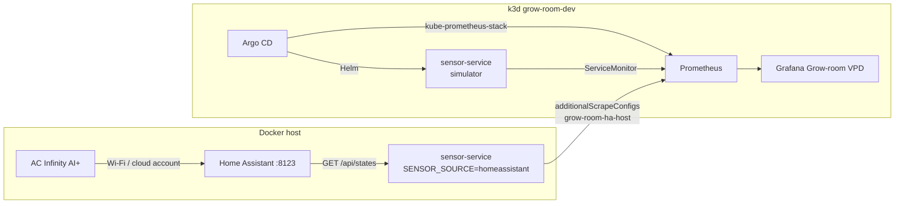
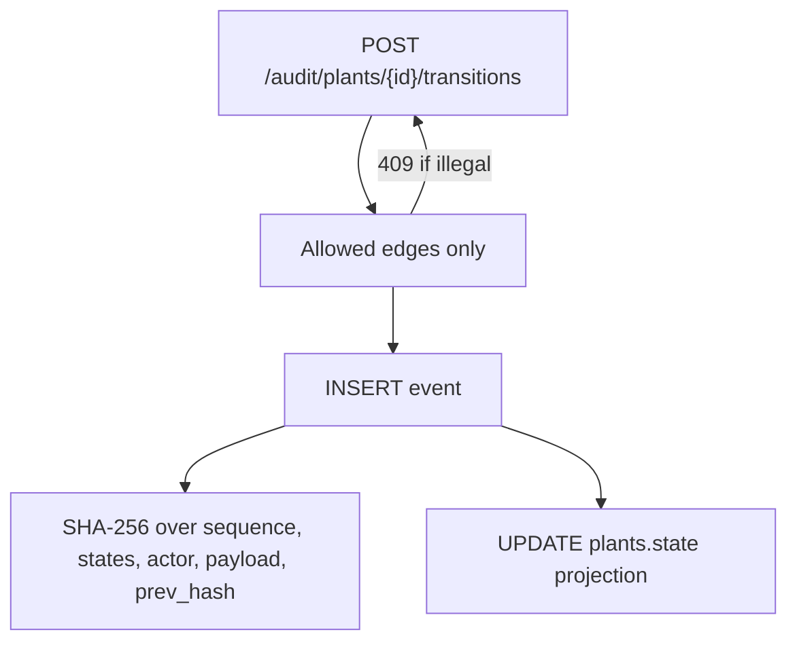

# Capstone: architecture of grow-room-platform

Climate telemetry and a seed-to-sale style audit log, on one FastAPI service,
delivered with GitOps on k3d. Cloud spend for the lab is zero because the
cluster never leaves the laptop: `cluster_mode = "local"`, `enable_eks = false`,
and no workflow runs `terraform apply`.

This is the long version of the [README](../README.md). It is written so it
can go on a portfolio page or into a blog with light editing. The lab is a
legal home cannabis grow (controlled-environment agriculture). It is a
personal project. It is not a licensee integration, a METRC client, or a
production authorization package.

**Living diagram:** [Grow-room Platform Map](https://cursor.com/canvas/store-6a197a3b-901d-4b50-9079-9a539befde02/debaff3b-9e35-48ab-bab0-59761b62fb09).
That page is the current picture: edge data flow, the host-versus-cluster
layout, component inventory, milestone status, and the decision log. Atlas
owns the page and updates it outside this git history. The mermaid diagrams
below are the snapshot GitHub can render without leaving the repo. If they
disagree, trust the page for status and trust this file for design rationale
tied to commits.

## What I built

A 4x4 tent at home (AC Infinity controller, tunable LEDs, living soil) and a
day job on Kubernetes. The platform in this repo is the overlap.

| Layer | Artifact |
|-------|----------|
| Readings | `sensor_service/` — `/healthz`, `/readings`, `/metrics` |
| Live tent | Docker Compose: Home Assistant + sensor-service with `SENSOR_SOURCE=homeassistant` |
| CI | `.github/workflows/ci.yml` — Ruff, pytest (fail under 80% coverage), GHCR, Trivy |
| GitOps | `charts/sensor-service`, `gitops/`, `.github/workflows/gitops-bump.yml` |
| Cluster lab | `scripts/bootstrap-k3d.sh` → k3d cluster `grow-room-dev` |
| Observability | `monitoring/` — kube-prometheus-stack, Grow-room VPD, three alerts, two SLOs |
| Evidence | `sensor_service/audit/` — SQLite hash chain |
| IaC | `infra/` — modules validated in CI, applied nowhere by this repo |

Weeks 1–4 and the audit log are on `main`. This document is the Week 5
publish piece.

## Two planes

**Edge** is the tent. The AC Infinity AI+ has no official public API. The
[homeassistant-acinfinity](https://github.com/dalinicus/homeassistant-acinfinity)
integration (HACS) pulls the controller into Home Assistant over the AC
Infinity account. `HomeAssistantSource` issues `GET /api/states/<entity_id>`
and nothing else: no HA service calls, no setpoint writes. The default entity
map is The Garden (`HA_DEVICE_PREFIX=the_garden`): controller air, controller
VPD and status, the internal probe, and four UIS devices (`port_1`,
`humidifier`, `oscillating_fans`, `ventilation_fan`). Ports 4–7 stay off the
list until a slug is added to `HA_PORT_DEVICES`. CO2 is optional
(`HA_CO2_ENTITY` empty).

The token lives in gitignored `.env`. Compose passes it as `HA_TOKEN`. The
Helm values for k3d do not set `SENSOR_SOURCE=homeassistant` and do not embed
a token. The chart *can* mount `HA_TOKEN` from an existing Secret
(`homeAssistant.existingSecret`); the k3d Application leaves that empty.

**Cluster** is the platform demo. Argo CD reconciles Git into k3d. The
sensor Deployment runs the simulator so a recruiter, CI, and a laptop with no
tent all get `/metrics`. Prometheus and Grafana run beside it.

I kept the live path on Compose on purpose. Putting the Home Assistant token
and the tent read into the same pod Argo rolls would mix a household
credential into a GitOps demo, and it would make every CI run depend on my
LAN. The simulator is the contract the cluster keeps. The tent is a second
scrape target.

## Why Prometheus scrapes the host

The gauges a grower cares about on this tent — probe temperature, probe
humidity, probe VPD, controller VPD, controller on/off, per-device power and
status — are created on the first successful Home Assistant sample
(`sensor_service/main.py`, `_optional_gauge`). The simulator never exports
them. A ServiceMonitor on the in-cluster Service therefore cannot fill the
controller, probe, or port panels.

The Compose service publishes `8000:8000` (all interfaces, not loopback).
k3d, since 3.1.0, injects `host.k3d.internal` into the node hosts file and
into CoreDNS. `scripts/bootstrap-k3d.sh` does not disable that.
`monitoring/values-k3d.yaml` adds one static job under
`prometheus.prometheusSpec.additionalScrapeConfigs`:

| Field | Value |
|-------|--------|
| `job_name` | `grow-room-ha-host` |
| Target | `host.k3d.internal:8000` |
| Path / interval | `/metrics`, 30s |
| Static labels | `instance=docker-compose-sensor-service`, `sensor_source=homeassistant` |

That is the whole live data path:

**AC Infinity AI+ → Home Assistant → Compose sensor-service
(`SENSOR_SOURCE=homeassistant`) → Prometheus `grow-room-ha-host`
(`host.k3d.internal:8000`) → Grafana Grow-room VPD.**

`additionalScrapeConfigs` is the right hook because the target is not a
Kubernetes Service. A ServiceMonitor selects Endpoints. This process listens
on the Docker host, outside the cluster's service proxy. A static job says
that plainly. The comments in the values file list fallbacks if the name does
not resolve: `host.docker.internal` only after the Prometheus pod can resolve
it, or the k3d bridge gateway IP from `docker network inspect k3d-grow-room-dev`.
Binding Compose to `127.0.0.1:8000` is reachable from the host and not from
that gateway. No token goes in the values file.

This landed in [PR #25](https://github.com/TontoBlanco/grow-room-platform/pull/25).

Kubernetes analogy: a ServiceMonitor is an Ingress that routes to a Service
in another namespace (the monitor lives in `monitoring` and selects
`grow-room`). The host job is a NodePort you typed by hand because the
backend is not in etcd.

## Scrape label hygiene

Once both jobs export `grow_temperature_celsius` and `up`, a naive panel
draws one series per pod IP, per instance, and per scrape. After an Argo
roll the dead pod IP stays on the legend as a DOWN line. Home Assistant
charts duplicated the simulator series beside the tent series.

Two labels and two aggregations fix that. Both are locked by
`tests/test_grafana_dashboard.py`.

1. The static job sets `sensor_source=homeassistant`. Controller, probe, and
   port panels select `{sensor_source="homeassistant"}` and collapse with
   `max by (sensor_source)` (one line per metric) or `max by (device)` (one
   line per UIS device). In-cluster simulator series have no such label, so
   they stay on the top-row climate charts and off the tent section.
   [PR #29](https://github.com/TontoBlanco/grow-room-platform/pull/29).
2. Scrape up and the scrape-health `up` query are
   `max by (job) (up{job=~"sensor-service|grow-room-ha-host"})`. One tile per
   job. Read errors on that panel are `sum by (job)`.
   [PR #32](https://github.com/TontoBlanco/grow-room-platform/pull/32).

Empty tent panels use Grafana `noValue: "No HA sample"`. That empty state is
expected until the host target is UP. A green in-cluster simulator does not
clear it. A down host target does not, by itself, fail the in-cluster SLO
below.

`instance=docker-compose-sensor-service` replaces whatever address Prometheus
would have stored, so the host series stays recognizable in the targets UI
after a DNS fallback changes the IP.

## Who owns the cluster

Git is the desired state. Argo CD is the controller.

`scripts/bootstrap-k3d.sh` creates `grow-room-dev` with two agents and
installs the Argo CD Helm chart (pinned `7.7.12`, server insecure for
localhost). `gitops/root-app.yaml` is the parent Application `grow-room-root`.
It syncs the directory `gitops/apps/` with prune and self-heal. Children:

- **`sensor-service`** renders `charts/sensor-service` with `values.yaml` and
  `values-k3d.yaml` into namespace `grow-room`. Simulator, LoadBalancer via
  k3d's servicelb, leaf offset `-2.0`, audit DB on `/tmp`.
- **`monitoring`** is multi-source. Source 1 is the upstream
  kube-prometheus-stack chart pinned at `92.13.1`. Source 2 is this repo's
  `monitoring/values-k3d.yaml`. Source 3 is the plain manifests
  (ServiceMonitor, PrometheusRule, Grafana dashboard ConfigMap). Destination
  namespace `monitoring`. Server-side apply is on because the CRDs are large.
  CRD CA bundle and a terminating-replicas status field are ignored so
  self-heal does not fight the apiserver.

Humans merge pull requests. Argo applies them. The image tag is the release
pointer: CI pushes `ghcr.io/tontoblanco/grow-room-platform` on `main`, then
`gitops-bump.yml` opens a PR that sets `image.tag` to `sha-<7-char>`. Merging
that PR is the deploy. Argo's `targetRevision: HEAD` means a branch you have
not merged is invisible to the cluster, which is what you want.

Argo does not own Compose, Home Assistant, or the `.env` token. Those stay
on the host. Argo also does not own Terraform state. There is no cloud
controller loop in this lab.

Pod annotations `prometheus.io/scrape`, `prometheus.io/port`, and
`prometheus.io/path` document the metrics port. kube-prometheus-stack does
not scrape annotations. The ServiceMonitor does. I left the annotations so
the chart still reads clearly if someone inspects the pod template.

Chart posture that is actually set in `charts/sensor-service/values.yaml`:
non-root uid/gid/fsGroup 10001, seccomp `RuntimeDefault`,
`allowPrivilegeEscalation: false`, `readOnlyRootFilesystem: true`,
capabilities `drop: ["ALL"]`, resource requests and limits, `/healthz`
liveness and readiness, ServiceAccount automount off. The image is
`python:3.12-slim` with `USER appuser` (uid 10001). HPA YAML exists and
`autoscaling.enabled` is false in both values files. There is no
NetworkPolicy in the repo.

## SLOs and alerts

Written down in [monitoring/docs-slo.md](../monitoring/docs-slo.md). Numbers
are lab starting points for one simulator-backed service, not a customer
contract.

**SLO 1 — ingest availability.** 99% of scrapes of `up{job="sensor-service"}`
succeed over a rolling 7 days (about 1.68 hours of error budget). The
indicator is the in-cluster job on purpose. `up{job="grow-room-ha-host"}` is
a different target: my apartment network, Home Assistant, and the Compose
process. Folding that into the platform SLO would page the cluster for a
token typo on the host.

**SLO 2 — freshness.** A target can be `up` while gauges freeze. The proxy
is `time() - timestamp(grow_vpd_kpa)`, target ≤ 120 seconds (30-second scrape
plus slack) for 99% of samples over 7 days.

Alerts in `monitoring/manifests/grow-room-prometheusrule.yaml` (the file under
`monitoring/alerts/` is the same rules, kept for reading):

| Alert | Expression | For |
|-------|------------|-----|
| `GrowRoomSensorScrapeDown` | `up{job="sensor-service"} == 0` | 2m, critical |
| `GrowRoomHumidityOutOfRange` | `grow_humidity_percent` < 30 or > 80 | 5m, warning |
| `GrowRoomSensorPodRestarts` | restarts of container `sensor-service` in `grow-room` > 2 in 15m | warning |

`GrowRoomSensorScrapeDown` matches SLO 1: host-job downtime does not fire it.
The humidity rule has no job label, so a simulator series and a tent series
can each fire it. That is what the YAML does today. The scrape-down checks
live in `monitoring/docs-slo.md` and under "Runbook anchor" in
[docs/WEEK4_OBSERVABILITY_GUIDE.md](WEEK4_OBSERVABILITY_GUIDE.md).

Grafana admin password `grow-room-lab` is a localhost lab default in the
values file. The dashboard uid is `grow-room-vpd`. Git stores the JSON twice
on purpose: `monitoring/dashboards/grow-room-vpd.json` and the ConfigMap the
sidecar loads (`grafana_dashboard=1`, search all namespaces). A test asserts
they match.

## Audit log

Mutable "current state" is what operators look at. It is a weak compliance
record. `/audit` adds a second model next to the gauges.

States: `seedling` → `vegetative` → `flowering` → `harvested` → `packaged`.
`destroyed` is allowed from every non-terminal state and then has no exits.
Creating a plant writes a birth event (`seedling` → `seedling`, actor
`system`, reason `plant_created`) so the chain starts at insert time, not at
the first human transition.

`AuditStore` has no update or delete helper that succeeds. The API routes
`PUT` / `PATCH` / `DELETE` on `/audit/events/{id}` return 405. `GET
/audit/integrity` walks events in global sequence order, recomputes each
hash, and checks `prev_hash` against the previous row. Genesis is 64 zeros.
The hash material is canonical JSON (sorted keys) of sequence, plant, batch,
states, reason, actor, metadata, timestamp, and `prev_hash`.

Batches and plants tables are projections for cheap reads. The `events` table
is the record. Same split as GitOps: Git (or the log) is the source of truth,
the live object is a cache.

Storage is SQLite at `AUDIT_DB_PATH`. The process default is `./data/audit.db`
(`data/` is gitignored). Compose and the chart set `/tmp/audit.db` because
uid 10001 cannot create `./data` and the root filesystem is read-only. The
chart mounts an `emptyDir` at `/tmp`, so the in-cluster log disappears with
the pod. `charts/snippets/audit-sqlite-pvc.yaml` shows a 1Gi PVC and is not
wired into the Deployment. I left it unwired so Week 5 did not pretend to be
durable multi-node storage.

This is practice for identification (batch and plant ids), attribution
(`actor` on every transition), integrity (the hash chain), and a narrow
non-repudiation story (the API refuses mutation). Gaps I will say out loud:
no mutual TLS, no SSO, no WORM bucket, no external timestamp, SQLite is one
file on one node. Naming the gaps is the point. Interview notes:
[WEEK5_COMPLIANCE_NOTES.md](WEEK5_COMPLIANCE_NOTES.md).

### Kubernetes analogies I actually use

| Grow-room idea | Cluster idea |
|----------------|--------------|
| FSM rejects an illegal phase before insert | ValidatingAdmissionWebhook |
| Append-only events vs `plants.state` | Git history vs the live object |
| `/audit/integrity` | `git fsck` / a checksum a controller recomputes |
| Argo self-heal | A controller resetting drift |
| ServiceMonitor in `monitoring` selecting `grow-room` | Ingress in one namespace, Service in another |
| `additionalScrapeConfigs` | A static Endpoint you registered because there is no Service |
| Terraform root module | Umbrella chart; child modules are subcharts |
| `image.tag` bump PR | The deploy artifact; merge is the release |
| SLO error budget | What a PodDisruptionBudget is for availability |

## Terraform, and the spend line

I authored `infra/modules/network` (VPC, public and private subnets, internet
gateway, optional NAT) and `infra/modules/cluster` (local outputs, or IAM and
a security group). The root module composes them. CI
(`.github/workflows/terraform.yml`) runs on changes under `infra/`:

`terraform fmt -check`, `init -backend=false`, `validate`, `tflint`.

No plan. No apply. No committed backend. `infra/backend.tf.example` is a
commented S3 + DynamoDB sketch. Provider comments say AWS API calls happen
on plan/apply, which this workflow does not run.

Defaults, also copied in `infra/terraform.tfvars.example`:

- `cluster_mode = "local"`
- `enable_eks = false`
- `enable_nat_gateway = false`

`enable_eks = true` forces the EKS branch even when `cluster_mode` is
`local` (`local.effective_cluster_mode` in `infra/main.tf`). On the local
path every EKS resource has `count = 0`. The EKS branch, if it were applied,
would create a security group and an IAM role with the two AWS-managed EKS
policies. The file comments a future `aws_eks_cluster`. That resource is not
in the tree. **This repo has no EKS cluster to apply, and I have not applied
one.**

The network module is not behind that flag. An apply of the default root
would create a VPC, subnets, and an internet gateway, and it would call
`aws_availability_zones`. NAT stays at count 0 unless
`enable_nat_gateway` is flipped; that is the hourly cost. `output.budget_reminder`
says to create an AWS Budgets alert at $20/month before any such apply. There
is no Budgets resource in the module. The reminder is the control I actually
shipped.

Daily cluster work is `k3d cluster create`, which the cluster module also
prints as `k3d_create_command`. The bootstrap script is the path I use.

## What I left out on purpose

- A live EKS apply, NAT, RDS, and remote state with a real bucket.
- Running the tent token inside the Argo-managed pod.
- METRC, Leaf Data, or any state API.
- Cosign / Sigstore. Trust today is GitHub Actions → GHCR → a tag bump PR →
  Argo. Trivy fails the CI job on unfixed HIGH and CRITICAL for
  `ghcr.io/tontoblanco/grow-room-platform:latest`.
- A wired PVC. The snippet is documentation until the log needs to outlive
  the pod.
- A Raspberry Pi beside the tent. k3d on the PC is the faster loop.
- Annotation-based Prometheus scrape discovery.
- Claiming a STIG, an ATO, or FedRAMP. The chart and CI are a short
  executable checklist. [WEEK5_COMPLIANCE_NOTES.md](WEEK5_COMPLIANCE_NOTES.md)
  is the vocabulary, with the boxes I will not tick in public.

## How I demo it

1. README diagram, then the [living map](https://cursor.com/canvas/store-6a197a3b-901d-4b50-9079-9a539befde02/debaff3b-9e35-48ab-bab0-59761b62fb09) if I want the decision log.
2. Grafana Grow-room VPD: simulator series on the top row, tent series only
   where `sensor_source=homeassistant` is selected. Scrape up shows one tile
   per job.
3. Prometheus targets: `sensor-service` and `grow-room-ha-host`.
4. `GET /audit/plants/{id}/history` and `GET /audit/integrity`, then a 409 on
   an illegal transition and a 405 on event delete.
5. `infra/` defaults and the Terraform workflow file, and the sentence: local
   mode, EKS flag off, validate in CI, no cluster apply.

Lab commands for each of those live in the Week 2–5 guides linked from the
README. Publishing this write-up, and booking the Terraform Associate exam,
are the remaining personal steps. They are not more YAML.
