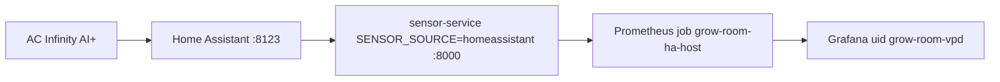
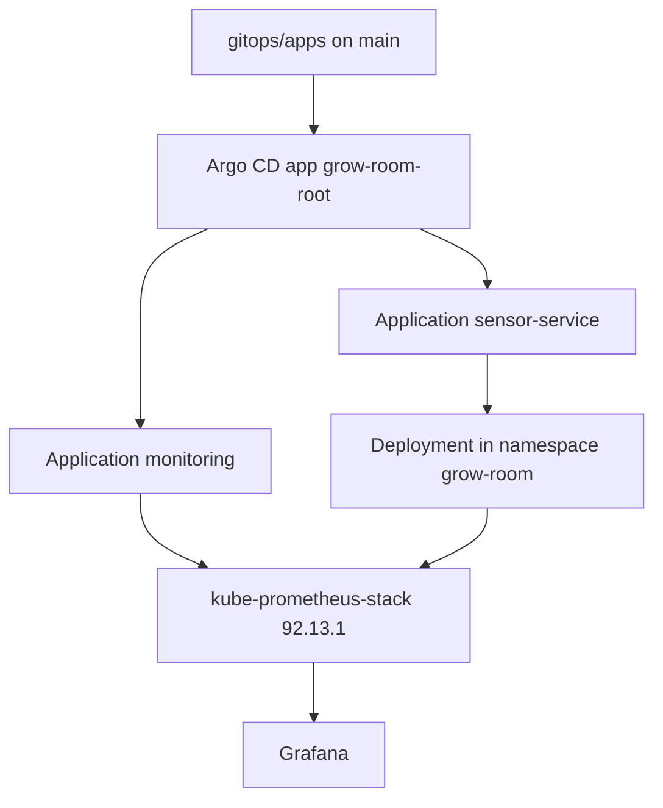
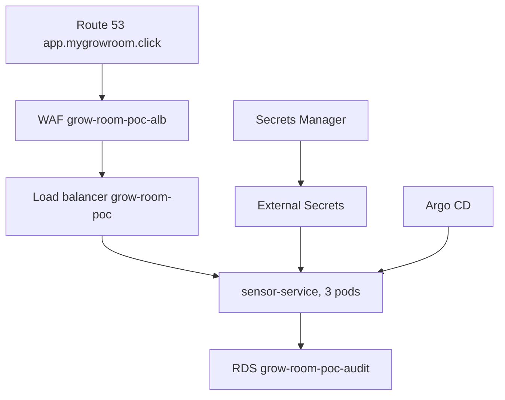
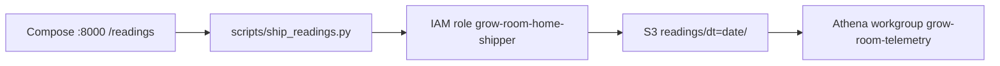

# Architecture

I kept three environments, because they fail in different ways and they cost different amounts.

| Environment | Lives where | Data source | When I use it |
| --- | --- | --- | --- |
| Docker Compose | The PC, next to the tent | Home Assistant | Live charts |
| k3d cluster `grow-room-dev` | The same PC | Simulator, plus a scrape of Compose | GitOps and dashboards |
| EKS cluster `grow-room-poc` | `us-west-2` | Simulator | A paid session, then destroy |

k3d is a local Kubernetes cluster that runs inside Docker. EKS is the managed Kubernetes service I used for the proof of concept. Kubernetes here means the cluster that runs the containers.

## Live path

The AC Infinity AI+ does not publish an API I am willing to depend on. I installed Home Assistant in Docker, added HACS, and added the community integration `homeassistant-acinfinity`. HACS is the Home Assistant Community Store. The integration logs into the AC Infinity account and stores entities. My service only calls `GET /api/states/<entity_id>`.

The Compose file publishes `8000:8000` on all interfaces. Prometheus inside k3d reaches that port at `host.k3d.internal:8000`. That name is the Docker host, as seen from the cluster. The scrape job is not a ServiceMonitor, because Compose is not a Kubernetes Service. The job is a static target under `prometheus.prometheusSpec.additionalScrapeConfigs` in `monitoring/values-k3d.yaml`.

| Setting | Value |
| --- | --- |
| Job name | `grow-room-ha-host` |
| Target | `host.k3d.internal:8000` |
| Path | `/metrics` |
| Interval | 30 seconds |
| Extra labels | `instance=docker-compose-sensor-service`, `sensor_source=homeassistant` |

The default device prefix is `the_garden`. That maps the controller temperature, humidity, VPD, and status; the internal probe; and the ports `port_1`, `humidifier`, `oscillating_fans`, and `ventilation_fan`. Ports 4 through 7 stay out until I add them to `HA_PORT_DEVICES`. `HA_CO2_ENTITY` is empty, so CO₂ is skipped until I set it.

VPD is vapor pressure deficit. It is the gap between how much water the air could hold and how much it is holding. The service computes leaf VPD with the Tetens equation and `LEAF_TEMP_OFFSET_C`. In `.env.example` that offset is `-2.0`. When Home Assistant sends VPD in psi, the API converts it to kilopascals and also returns the original number and unit.

The token is `HA_TOKEN` in `.env`. That file is gitignored. The Helm values for k3d do not set `SENSOR_SOURCE=homeassistant` and do not contain the token.

When the laptop sleeps, Compose and k3d sleep with it. The `grow-room-ha-host` scrape stops, and the live charts go flat until the machine wakes. That is the host, not a Grafana defect. An always-on machine by the tent would keep the scrape up. I have not built that. See [ADR-0011](adr/0011-k3d-instead-of-a-pi.md).

## Lab path

`scripts/bootstrap-k3d.sh` creates cluster `grow-room-dev` with two agents and installs Argo CD chart `7.7.12`. I then apply `gitops/root-app.yaml`. That root Application syncs everything under `gitops/apps/`:

| Application | What it installs |
| --- | --- |
| `sensor-service` | Helm chart `charts/sensor-service`, values `values.yaml` and `values-k3d.yaml`, simulator, namespace `grow-room` |
| `monitoring` | kube-prometheus-stack chart `92.13.1`, `monitoring/values-k3d.yaml`, and the manifests in `monitoring/manifests` |

Prune and self-heal are on. Argo CD follows the Git commit it is pointed at. An open pull request does not change the cluster until it is merged.

CI on `main` builds the image, scans it, and pushes `ghcr.io/tontoblanco/grow-room-platform`. The workflow `gitops-bump.yml` then opens a pull request that sets `image.tag` in `charts/sensor-service/values.yaml` to `sha-` plus the first seven characters of the commit. Merging that pull request is the deploy. As I write this, the committed tag is `sha-8b294a9`. The next green build on `main` will open another bump.

## AWS proof of concept

On 1 November 2026 I applied `infra/aws-poc` in `us-west-2` and destroyed the expensive resources the same day. The public name was `app.mygrowroom.click`. Pods ran the simulator. The tent stayed on Compose.

Request path: ExternalDNS writes the alias record. The record points at a regional web ACL, then an internet-facing Application Load Balancer. The listener on 443 uses the ACM certificate and policy `ELBSecurityPolicy-TLS13-1-2-2021-06`. Port 80 returns 301 to HTTPS.

The cluster is `grow-room-poc`, Kubernetes 1.36, in VPC `10.60.0.0/16`, three availability zones. The managed node group asks for three `t3.large` nodes. Karpenter can add nodes and then consolidate them. Pods call AWS with EKS Pod Identity, not with access keys. External Secrets builds `AUDIT_DATABASE_URL` from the RDS master secret.

The EKS Application is `gitops/eks/sensor-service.yaml`. It selects `values-eks.yaml`: three replicas, the ingress, and ExternalSecret `audit-db`. The k3d root app only syncs `gitops/apps/`, so that EKS Application is not applied to the laptop cluster.

`monitoring/values-eks.yaml` replaces `additionalScrapeConfigs` with an empty list. Helm replaces lists, so the EKS Prometheus does not scrape `host.k3d.internal:8000`. That address does not exist in the VPC, and on 3 November it produced a `TargetDown` email until this file was in place.

## Telemetry path

Phase 3 is separate from the proof of concept. `down` keeps it.

The home PC gets short-lived credentials from IAM Roles Anywhere. The role may `s3:PutObject` under `readings/*` and may use the telemetry KMS key. It cannot list the bucket or delete objects. The Glue database is `grow_room_telemetry`, table `readings`. The workgroup stops a query at 1 GB scanned.

On EKS, CronJob `sensor-exporter` runs the same script with prefix `raw` into the proof-of-concept sensor bucket. That bucket is destroyed with the stack. The home bucket is not.

## Audit data

`GET /audit` records batches and plants. A plant moves `seedling` → `vegetative` → `flowering` → `harvested` → `packaged`. `destroyed` is allowed from a non-terminal state. A bad move returns 409. `PUT`, `PATCH`, and `DELETE` on a stored event return 405.

Each event stores the previous hash and its own SHA-256 hash. `GET /audit/integrity` recomputes the chain. The default store is SQLite. `AUDIT_DATABASE_URL` switches the same API to Postgres. See [ADR-0007](adr/0007-sqlite-and-postgres.md).

Someone who can write the database can rewrite a row and recompute the hash. The `actor` field is recorded. It is not authenticated.

## What I left out on purpose

- A Raspberry Pi beside the tent.
- The Home Assistant token inside an Argo-managed pod.
- A network policy.
- Kyverno set to Enforce. The policy is Audit until a report shows only passes.
- A second AWS region.
- WAF logging. It was off during the proof of concept.
- An apply role narrower than `AdministratorAccess`. The bootstrap file calls that a demo shortcut.
