# AWS proof of concept

This page is the 1 November 2026 gallery. I apply `infra/aws-poc` in
`us-west-2` for a session and destroy the expensive resources before I
stop. The screenshots below are from that first day. The cluster in those
pictures is gone, and `app.mygrowroom.click` does not resolve between
sessions.

As of 3 November 2026, phases 3 through 7 are done. The paid test session
that day passed, and teardown was clean. I am not retelling it here. See
the [test session](../test-session/2026-11-03.md) and the
[phase pages](../index.md). The telemetry stack in `infra/telemetry` stays
up and costs about 1 USD per month. `down` does not remove it.

Terraform for the session stack is [`infra/aws-poc`](https://github.com/TontoBlanco/grow-room-platform/tree/main/infra/aws-poc).
Cluster extras that are not in the Helm chart are in
[`k8s/aws-poc`](https://github.com/TontoBlanco/grow-room-platform/tree/main/k8s/aws-poc).

The public name was `app.mygrowroom.click`. The account id stays in the
Terraform backend and the up script. I do not repeat it here.

This did not replace the local k3d lab. Live tent readings still come from
Home Assistant on Docker Compose. The pods in AWS used the simulator.

## Architecture

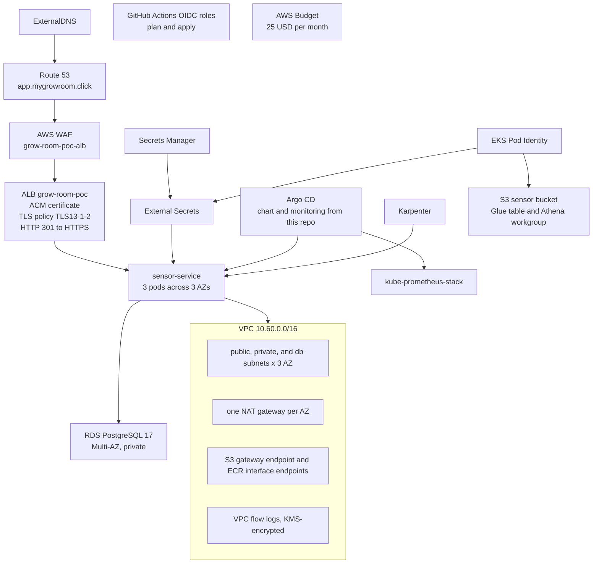

Request path: Route 53 (the alias record is written by ExternalDNS, not by
the ALB resource in Terraform) to a regional WAF web ACL, to an
internet-facing ALB. The ALB presents an ACM certificate for
`app.mygrowroom.click`, uses security policy
`ELBSecurityPolicy-TLS13-1-2-2021-06` (TLS 1.3 and TLS 1.2), and answers
HTTP on port 80 with a 301 to HTTPS.

The ALB targets three `sensor-service` pods on EKS 1.36. Nodes and the API
endpoint sit in private subnets. Karpenter can add nodes. Pods reach AWS
APIs with EKS Pod Identity, not with access keys. The audit database URL is
built from the RDS master secret in Secrets Manager by External Secrets.

Argo CD synced `sensor-service` and `monitoring` (kube-prometheus-stack
`92.13.1`) from this repo. The VPC is `10.60.0.0/16` with public, private,
and database subnets in three AZs, a NAT gateway in each AZ, an S3 gateway
endpoint, ECR interface endpoints, and KMS-encrypted VPC flow logs. A sensor
bucket, Glue table, and Athena workgroup are defined for JSON readings.
GitHub Actions can assume plan and apply roles through OIDC. A monthly
budget is capped at $25.

## Live endpoint & HTTPS

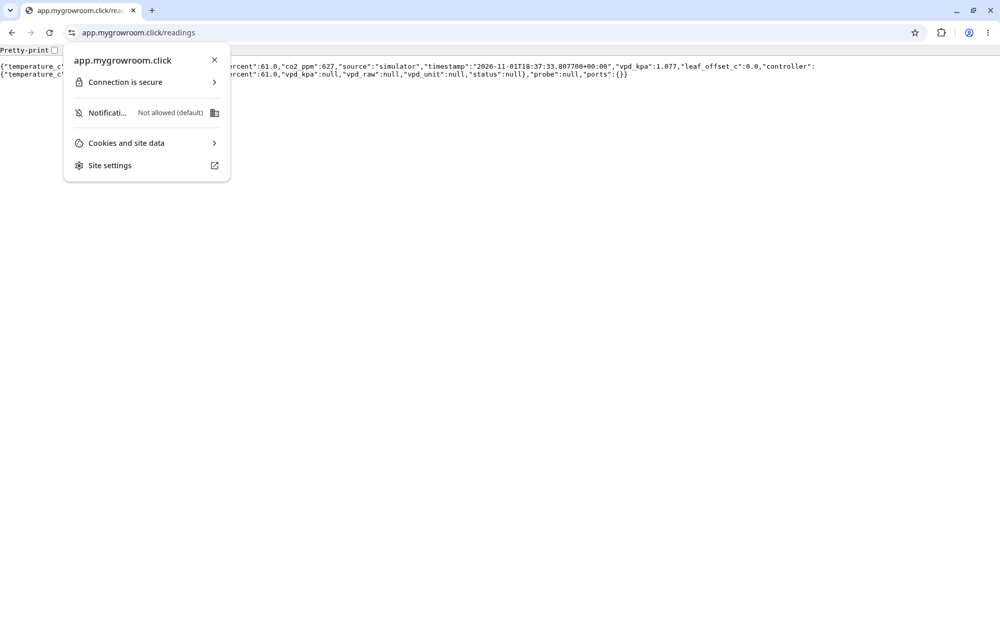

`https://app.mygrowroom.click/readings` on November 1, 2026. Chrome reports
"Connection is secure". The JSON `source` is `simulator`.

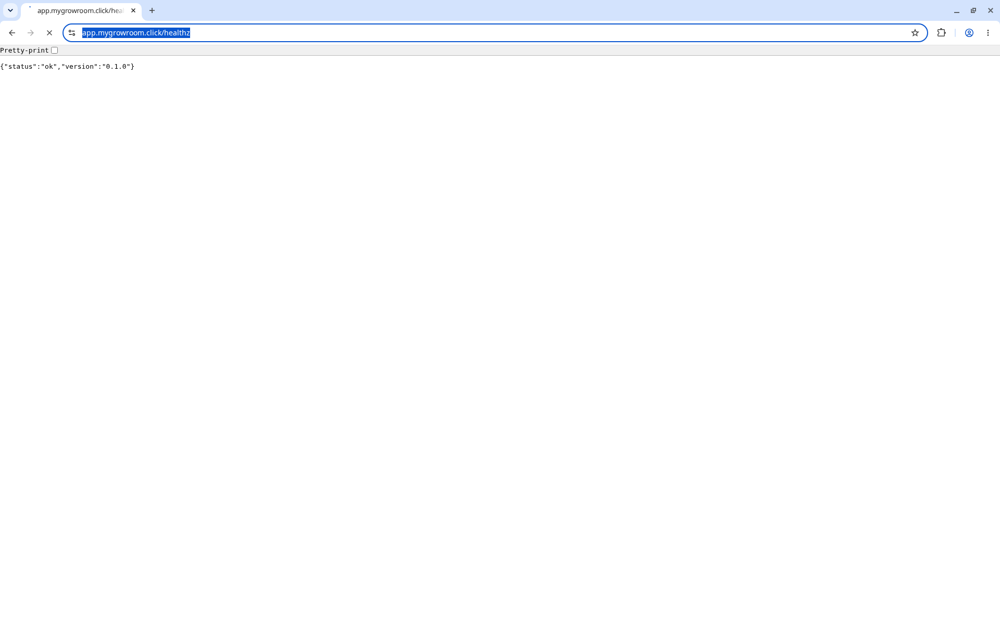

`/healthz` returned `{"status":"ok","version":"0.1.0"}`. That version is
`sensor_service/__init__.py`.

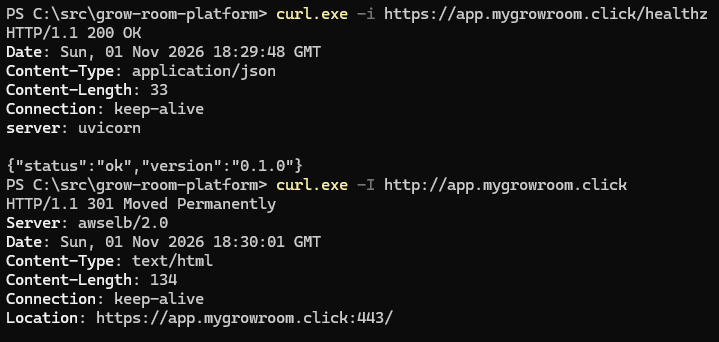

`curl -i https://app.mygrowroom.click/healthz` returned HTTP 200 from
uvicorn at 18:29:48 GMT. `curl -I http://app.mygrowroom.click` returned
HTTP 301 from `awselb/2.0`, with `Location: https://app.mygrowroom.click:443/`.

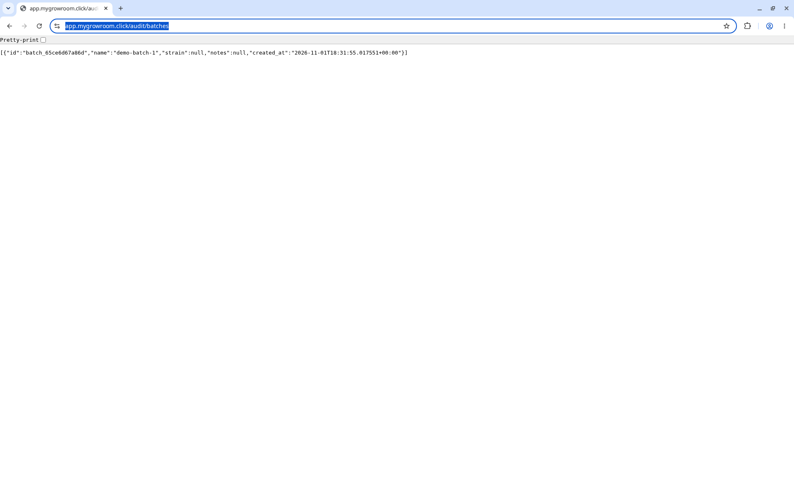

`/audit/batches` in the browser returned batch `demo-batch-1`
(`batch_65ce6d67a86d`), created `2026-11-01T18:31:55Z`.

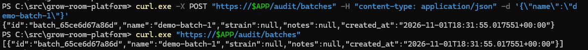

The same batch was created with `POST /audit/batches` and read back with
`GET /audit/batches`. The body only sent `name`, so `strain` and `notes`
are null. The row lived in RDS, not in the local SQLite file.

## GitOps

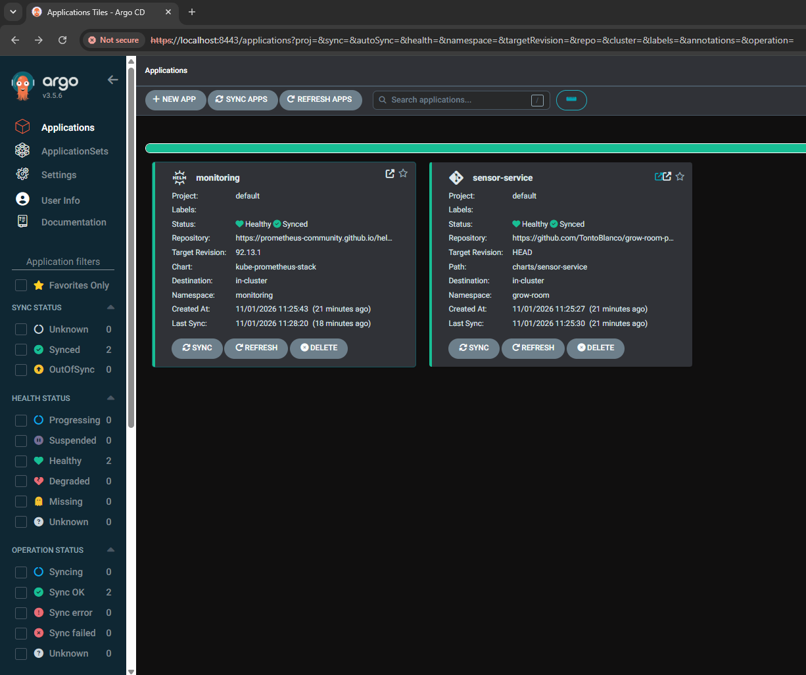

Argo CD v3.5.6 on the cluster. `monitoring` (kube-prometheus-stack `92.13.1`,
namespace `monitoring`) and `sensor-service` (`charts/sensor-service` at
`HEAD`, namespace `grow-room`) were both Healthy and Synced. Auto-sync was
on. Last sync of `sensor-service` was commit `4793576` on November 1, 2026.

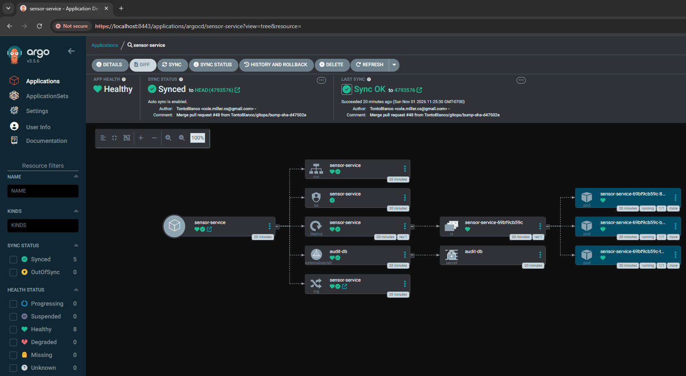

The `sensor-service` tree: Service, ServiceAccount, Deployment to a
ReplicaSet to three pods, ExternalSecret `audit-db` to Secret `audit-db`,
and an Ingress. The chart image tag at that commit is
`ghcr.io/tontoblanco/grow-room-platform:sha-d47502e`.

The EKS Application is
[`gitops/eks/sensor-service.yaml`](https://github.com/TontoBlanco/grow-room-platform/blob/main/gitops/eks/sensor-service.yaml).
It renders `charts/sensor-service` with `values.yaml` and
`values-eks.yaml`. That is what was live: three replicas, an Ingress for
`app.mygrowroom.click` carrying the ACM certificate and WAF ACL
annotations, and ExternalSecret `audit-db`. Preferred pod anti-affinity
on `topology.kubernetes.io/zone` asks for one pod per AZ.

The k3d Application in `gitops/apps/sensor-service.yaml` is a different
file and still selects `values-k3d.yaml`. The k3d root app only syncs
`gitops/apps/`, so the EKS Application is not applied to the local cluster.

## Cluster & HA

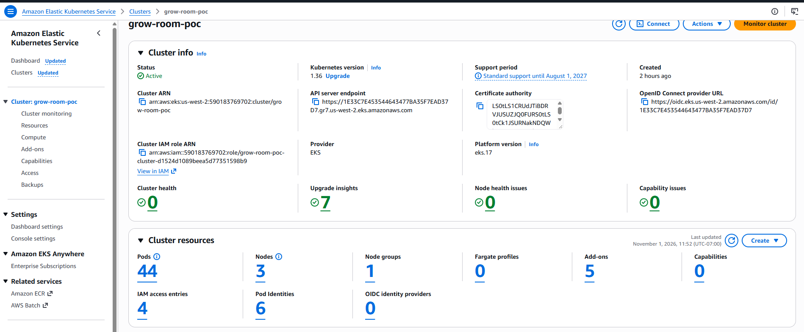

Console for cluster `grow-room-poc` on November 1, 2026: status Active,
Kubernetes `1.36`, 44 pods, 3 nodes, 1 node group, 0 Fargate profiles,
5 add-ons, 4 IAM access entries, 6 pod identities, 1 OIDC identity provider.

Terraform configures those five add-ons: `vpc-cni`, `kube-proxy`, `coredns`,
`eks-pod-identity-agent`, and `amazon-cloudwatch-observability`. The six pod
identities are Karpenter, the AWS Load Balancer Controller, External Secrets,
ExternalDNS, a `sensor-exporter` service account, and the CloudWatch agent.
The access entry defined in the stack is the SSO administrator role.
`enable_cluster_creator_admin_permissions` is false. The console total was
4; this page does not invent names for the other three.

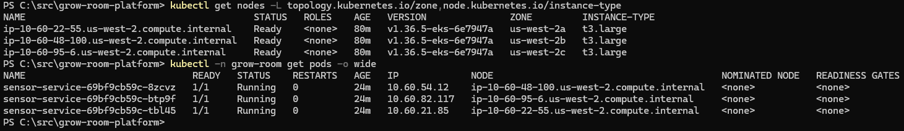

Three nodes, all Ready, kubelet `v1.36.5-eks-6e7947a`, instance type
`t3.large`, one in each of `us-west-2a`, `us-west-2b`, and `us-west-2c`.
The managed node group requests that: `desired_size` 3, `min_size` 3,
`max_size` 4, AMI `AL2023_x86_64_STANDARD`. Three `sensor-service` pods were
Running `1/1` with 0 restarts, one on each node.

EBS root volumes on that node group are 20 GiB gp3, encrypted with the
`grow-room-poc/ebs` key. Kubernetes Secrets are envelope-encrypted with
`grow-room-poc/eks-secrets`. Both keys rotate yearly.

During the demo, Karpenter launched 2 nodes for 10 pending pods, then
consolidated back to zero. The node list above is after that, so only the
three managed nodes remain. The NodePool allows spot and on-demand, families
`t`/`m`/`c`, sizes medium through xlarge, generation greater than 4, a CPU
ceiling of 16, and consolidation when empty or underutilized after one
minute. Karpenter disks use the same EBS key.

The API endpoint is private for nodes and public only from `my_ip_cidr`.
Control-plane logs (`api`, `audit`, `authenticator`) go to CloudWatch for
one day, encrypted with `grow-room-poc/logs`.

## Networking

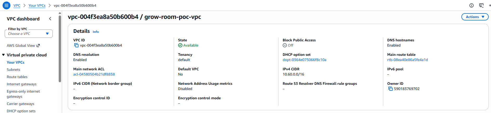

`grow-room-poc-vpc` (`vpc-004f3ea8a50b600b4`), state Available, IPv4 CIDR
`10.60.0.0/16`, DNS resolution and DNS hostnames enabled. It is not the
default VPC.

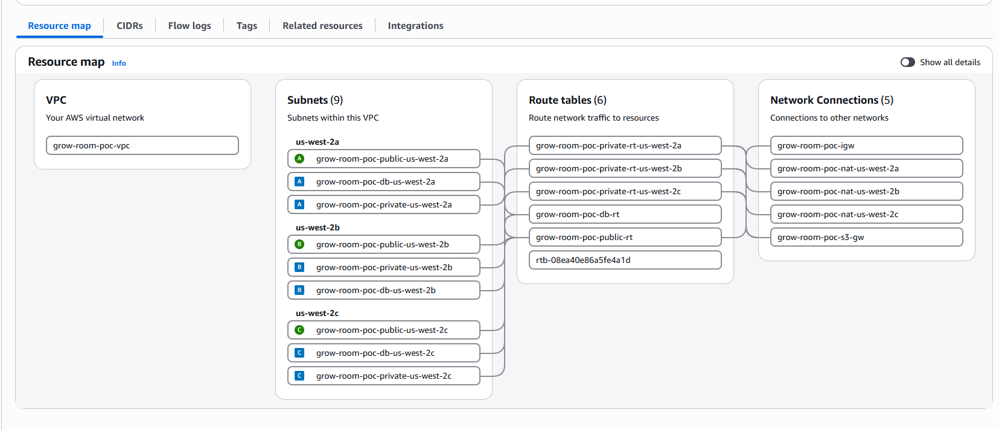

The resource map: 9 subnets (public, private, and db in `us-west-2a`,
`us-west-2b`, and `us-west-2c`), 6 route tables, internet gateway
`grow-room-poc-igw`, one NAT gateway per AZ, and S3 gateway endpoint
`grow-room-poc-s3-gw`.

Terraform sizes those subnets out of `10.60.0.0/16` as three private `/19`s
(`10.60.0.0/19`, `10.60.32.0/19`, `10.60.64.0/19`), three public `/24`s
(`10.60.96.0/24` through `10.60.98.0/24`), and three database `/24`s
(`10.60.100.0/24` through `10.60.102.0/24`). Each private route table sends
`0.0.0.0/0` to the NAT in the same AZ. The database route table has no
internet route. The sixth route table on the map is the VPC main table.

ECR interface endpoints (`ecr.api` and `ecr.dkr`) are in the private subnets
with private DNS. They are not drawn as boxes on this resource map. The S3
gateway is associated with the private route tables so image-layer downloads
from S3 do not have to use NAT. Flow logs for all traffic go to CloudWatch
log group `/vpc/grow-room-poc/flow-logs`, retained one day, encrypted with
`grow-room-poc/logs`.

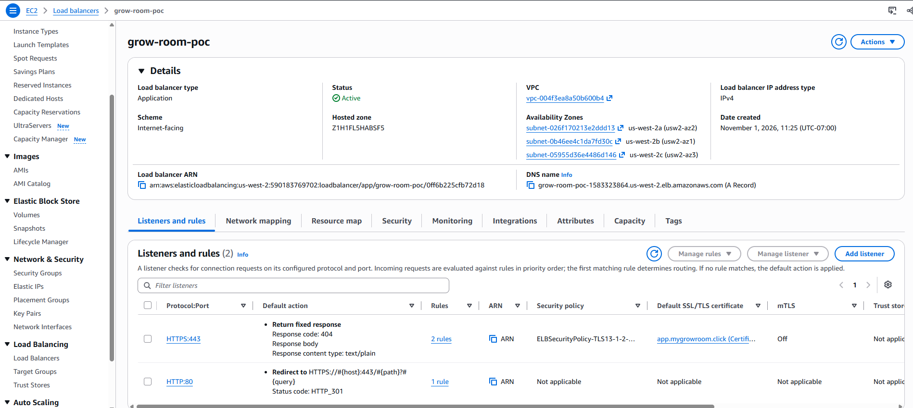

ALB `grow-room-poc`, type Application, scheme internet-facing, state Active,
in the same VPC, with one subnet in each of the three AZs. Created
November 1, 2026, 11:25 AM PT. HTTPS:443 uses
`ELBSecurityPolicy-TLS13-1-2-2021-06` and the ACM certificate for
`app.mygrowroom.click`. HTTP:80 has one rule, redirect, status HTTP 301.
The load balancer name, ports, certificate, policy, and WAF ACL come from
the ingress annotations in `values-eks.yaml`. The controller creates the
ALB. Terraform does not.

## Security

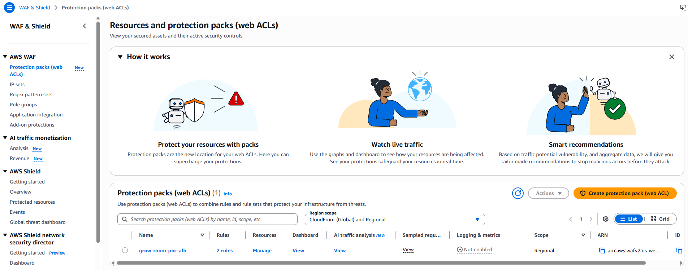

Regional web ACL `grow-room-poc-alb`, 2 rules. On this list, logging and
metrics were not enabled.

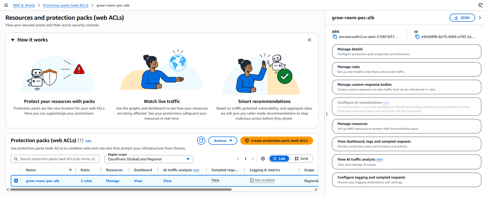

The same ACL open in the console. Scope is regional. The id matches the
`alb.ingress.kubernetes.io/wafv2-acl-arn` annotation in `values-eks.yaml`.

The two rules in Terraform are `AWSManagedRulesCommonRuleSet` and a per-IP
rate limit of 500 requests per five minutes (action block). The default
action is allow. `enable_waf` defaults to true.

Other controls that were in the applied stack, and that the screenshots do
not all show:

- RDS `publicly_accessible` is false. The security group allows TCP 5432
  only from the EKS node security group. The ExternalSecret URL sets
  `sslmode=require`.
- Node EBS volumes and Kubernetes Secrets use customer managed keys, as
  noted above. RDS storage uses `grow-room-poc/rds`. The master password
  is generated by RDS into Secrets Manager and encrypted with
  `grow-room-poc/secrets-manager`. No database password is in Terraform
  state.
- S3 buckets for sensor data, Athena results, and Terraform state block
  public access and use SSE-KMS.
- The EKS API is public only from `my_ip_cidr`.
- GitHub Actions OIDC roles are `grow-room-gha-plan` (read-only, plus write
  to the state prefix) and `grow-room-gha-apply` (AdministratorAccess, and
  only for the `aws-poc` GitHub environment). The bootstrap file calls the
  admin policy a demo shortcut.

WAF logging was off. Flow-log and control-plane log retention were one day.
That is what this demo configured.

## Data

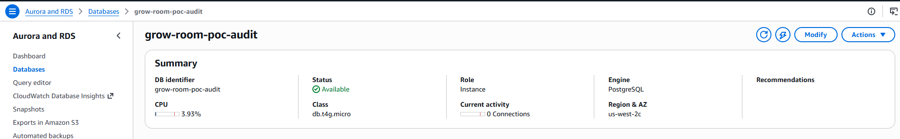

`grow-room-poc-audit`, status Available, class `db.t4g.micro`, engine
PostgreSQL, Region and AZ `us-west-2c`. The summary showed 0 connections
at capture.

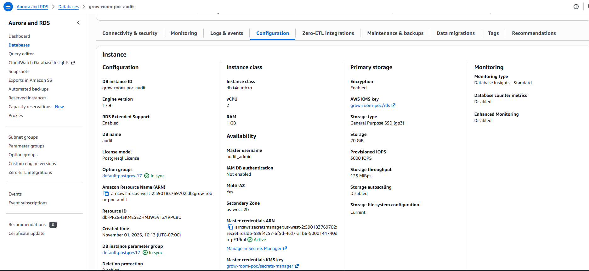

Configuration tab: engine 17.9 (Terraform requests Postgres 17), database
name `audit`, master user `audit_admin`, Multi-AZ Yes, secondary zone
`us-west-2b`, storage encryption enabled with KMS key `grow-room-poc/rds`,
20 GiB gp3. Master credentials are in Secrets Manager, status Active, with
KMS key `grow-room-poc/secrets-manager`. Deletion protection was disabled.
The instance was created November 1, 2026, 10:13 AM PT.

Terraform also sets a one-day backup retention, `skip_final_snapshot`, and
`deletion_protection = false`, because the database was meant to be destroyed
the same day. The primary landed in `us-west-2c` and the standby in
`us-west-2b`.

`k8s/aws-poc/cluster-secret-store.yaml` is a ClusterSecretStore named
`aws-secrets-manager` for region `us-west-2`. It has no access keys. External
Secrets uses its pod identity. The chart template turns the secret's username
and password plus `dbHost` into `AUDIT_DATABASE_URL`.

Separate from RDS, `infra/aws-poc/data.tf` defines an S3 bucket
`grow-room-poc-sensor-<account>`, a Glue database `grow_room_poc`, an
external table `readings` with date partition projection, and an Athena
workgroup whose results are KMS-encrypted. A pod identity for service
account `grow-room/sensor-exporter` may `s3:PutObject` under `raw/*`.
These 1 November screenshots do not show objects in the bucket or an Athena
query. The CronJob manifest is now `k8s/aws-poc/sensor-exporter.yaml`, and
the 3 November session reported that path working. The table's `stage` column is
optional: `scripts/ship_readings.py` adds it when `/readings` includes
`growth_stage`, older objects omit it, and Athena returns null. Queries
that do not select `stage` are unchanged. The EKS chart sets the stage with
`env.GROW_STAGE` in `charts/sensor-service/values-eks.yaml` (default `veg`).

## Cost

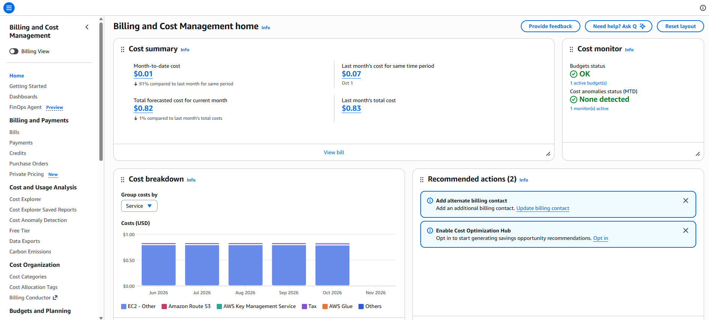

Billing home on the demo day: month-to-date cost $0.01, one budget OK, no
cost anomalies. The same screen showed a forecast of $0.82 for the month
and last month's total of $0.83. The June–October bars are older account
spend, not this stack.

$0.01 is the console at capture time. EKS, three NAT gateways, and Multi-AZ
RDS do not show up in month-to-date the hour they are created. I destroyed
the stack the same day so those charges would not run overnight. The budget
in `infra/aws-poc/bootstrap` is `grow-room-monthly`, limit $25, with email
at $10 actual, at 100% of the limit, and when the forecast exceeds the
limit.

The original `infra/` module still only prints a reminder to create a
$20 budget. It does not create one. The $25 budget is in the proof-of-concept
bootstrap.

## Failure drills

Pod delete, node drain, RDS failover, and scale-to-zero are written up in
[DRILLS.md](DRILLS.md). On November 3, 2026, scaling `sensor-service` to 0
emailed `SensorDataStale` first. `SensorAvailabilityBudgetBurnFast` needs the
1-hour burn window, so it is later when it fires at all. The same session saw
one HTTP 502 on a pod delete and on a node drain; the chart's preStop sleep,
termination grace period, ALB deregistration delay, and PodDisruptionBudget
are the follow-up for the next session.

## Image signatures

`ci.yml` signs the pushed digest with keyless cosign (GitHub OIDC, Fulcio,
public Rekor) and checks this identity:

`https://github.com/TontoBlanco/grow-room-platform/.github/workflows/ci.yml@refs/heads/main`

issuer `https://token.actions.githubusercontent.com`.

That string is also the subject on
[`k8s/aws-poc/kyverno-verify-images.yaml`](https://github.com/TontoBlanco/grow-room-platform/blob/main/k8s/aws-poc/kyverno-verify-images.yaml).
The policy stays in **Audit**. `mutateDigest` is false while the failure
action is Audit (Kyverno rejects `true`). `verifyDigest` is false because the
chart deploys a tag. After a PolicyReport pass on a `sha-*` image, switch
`failureAction` to `Enforce` and set `mutateDigest` and `verifyDigest` to
true. Signing uses cosign 2.6 legacy `sha256-<digest>.sig` tags. Cosign 3
referrer bundles were invisible to Kyverno 1.19 (`no signatures found`).

`ClusterPolicy` `verifyImages` is deprecated in Kyverno 1.19 in favor of
`ImageValidatingPolicy` (`policies.kyverno.io/v1`), with removal planned for
1.20. Migrating this policy is a later task.
<https://kyverno.io/docs/guides/migration-to-cel/>

## Limits / next steps

- There is no standing EKS cluster between sessions. These screenshots are
  the 1 November record. The 3 November session is a separate page, and
  teardown that day was clean.
- One region, `us-west-2`. No second region. The 3 November session did
  include an RDS Multi-AZ failover, about 30 seconds. That drill is in
  [DRILLS.md](DRILLS.md).
- Cloud pods ran `SENSOR_SOURCE=simulator`. Live AC Infinity readings stayed
  on the Docker Compose path. I did not put the Home Assistant token in the
  cluster.
- The k3d monitoring Application still uses `monitoring/values-k3d.yaml`,
  including a scrape of `host.k3d.internal`. On EKS, `monitoring/values-eks.yaml`
  replaces that list with an empty one so the laptop address is not a target.
- Argo CD, the load balancer controller, ExternalDNS, External Secrets, and
  Karpenter are installed by `scripts/aws-poc.ps1` during `up`. `k8s/aws-poc/`
  contains the Karpenter NodePool, the ClusterSecretStore, the Kyverno
  policy, and the sensor-exporter CronJob. The controller install commands
  live in the script, not as extra manifests.
- The checked-in Terraform workflow still runs `fmt`, `validate`, and
  `tflint` in `infra/` with Terraform 1.9.8. It does not plan or apply
  `infra/aws-poc`. The OIDC apply role is AdministratorAccess, limited by
  the GitHub environment subject. That is wider than a production apply
  role should be.
- WAF logging was not enabled. VPC flow logs and EKS control-plane logs
  were kept for one day. RDS backup retention was one day, deletion
  protection was off, and the final snapshot was skipped.
- S3, Glue, and Athena for the session bucket are defined here. The
  persistent telemetry stack is a different root, `infra/telemetry`, and it
  stays up at about 1 USD per month. I do not have an Athena screenshot in
  this 1 November gallery. The 3 November session reported the exporter path
  working.
- The bootstrap root is written so the state bucket, its KMS key, the
  Route 53 zone, the budget, and the OIDC roles can outlive a session.
  The expensive pieces (EKS, NAT, the load balancer, RDS) are what `down`
  removes.
- This was not a security authorization. No ATO, STIG, or FedRAMP claim,
  and the audit hash chain is still not an external trust anchor.

## Decisions
- [Cost record](COSTS.md)
- [ADR-0001: NAT gateway per AZ](../adr/0001-nat-gateway-per-az.md)
- [ADR-0002: Karpenter for node scaling](../adr/0002-karpenter-for-node-scaling.md)
- [ADR-0003: EKS Pod Identity](../adr/0003-eks-pod-identity.md)
- [ADR-0004: External Secrets Operator](../adr/0004-external-secrets-operator.md)
- [ADR-0005: AWS WAF on the ALB](../adr/0005-aws-waf-on-alb.md)
- [ADR-0006: RDS Multi-AZ](../adr/0006-rds-multi-az.md)

Code: [`infra/aws-poc`](https://github.com/TontoBlanco/grow-room-platform/tree/main/infra/aws-poc),
[`k8s/aws-poc`](https://github.com/TontoBlanco/grow-room-platform/tree/main/k8s/aws-poc), and
[`gitops/eks/sensor-service.yaml`](https://github.com/TontoBlanco/grow-room-platform/blob/main/gitops/eks/sensor-service.yaml).
Local lab:
[README](https://github.com/TontoBlanco/grow-room-platform/blob/main/README.md) and [capstone](../CAPSTONE.md).
