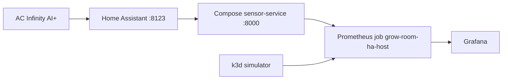

# Grow room platform

I built this so I could point at a real indoor plant grow tent and explain the software behind the Grafana charts. The tent is a 4x4 with an AC Infinity AI+ controller. The service reads climate data. It does not change fan speeds, setpoints, or lights.

If you have only seen the dashboards, start with [Architecture](architecture.md) and then the [Grafana guide](grafana.md). If you want to rebuild the project, follow the phase pages in order. Each one has the commands I actually use.

The day-to-day lab runs on my PC. A separate AWS proof of concept in `us-west-2` comes up for a paid session and goes back down the same day. One smaller telemetry stack stays up between sessions.

## What you are looking at

| Piece | Where it runs | What it is for |
| --- | --- | --- |
| AC Infinity AI+ | The tent, on Wi-Fi | Controller air, an internal probe, and the device ports |
| Home Assistant | Docker Compose, port 8123 | Holds the controller entities. I read them. I do not call services. |
| sensor-service | Docker Compose, port 8000, with `SENSOR_SOURCE=homeassistant` | Turns those entities into JSON and Prometheus metrics |
| Prometheus job `grow-room-ha-host` | k3d cluster `grow-room-dev` | Scrapes `host.k3d.internal:8000` every 30 seconds |
| Grafana | Same cluster, namespace `monitoring` | Dashboards **Grow-room VPD** and **grow-room SLOs** |
| sensor-service simulator | Same cluster, namespace `grow-room` | A second copy that does not need the tent. CI uses this path. |
| Argo CD | Namespace `argocd` | Applies `gitops/apps/` and heals drift |
| AWS proof of concept | `us-west-2`, cluster `grow-room-poc` | A full stack I apply, check, and destroy |
| Telemetry | S3, Glue, and Athena, kept between sessions | A copy of readings for queries that Prometheus does not keep |

Prometheus is the database that scrapes and stores the numbers. Grafana is the set of charts on top of those numbers. Argo CD is the controller that makes the cluster match Git.

## Two paths, on purpose

The live path is:

**AC Infinity AI+ → Home Assistant (HACS) → Docker Compose sensor-service (`SENSOR_SOURCE=homeassistant`, port 8000) → Prometheus job `grow-room-ha-host` → Grafana.**

The lab path is a simulator inside k3d. GitHub Actions tests that path. I did not want a failed Home Assistant token to fail CI, and I did not want the token in Git.



## How the work is split

I built the local project in five weeks, then a one-day AWS stack, then eight numbered phases. The numbered phases are the names I use in the later pull requests.

| Phase | What landed | Main pull requests |
| --- | --- | --- |
| [Week 1](phases/week-1-application-and-ci.md) | FastAPI service, tests, Docker, GitHub Actions | First commits, before PR #1 |
| [Week 2](phases/week-2-terraform.md) | Terraform modules, checked in CI, not applied | Week 2 commits |
| [Week 3](phases/week-3-gitops.md) | Helm, k3d, Argo CD app-of-apps | PR #1 |
| [Week 4](phases/week-4-observability.md) | Prometheus, Grafana, the live scrape | PR #4, #12, #14, #25, #29, #32 |
| [Week 5](phases/week-5-audit.md) | Plant and batch history, then optional Postgres | PR #7, #38 |
| [AWS proof of concept](phases/aws-proof-of-concept.md) | Session stack in `us-west-2`. First apply 1 November 2026. Test session 3 November 2026 passed, then teardown. Not left running. | PR #47, #50, #51, #75 |
| [Phase 1](phases/phase-1-oidc.md) | Terraform plan on pull requests, apply only when I approve | PR #54, #66 |
| [Phase 2](phases/phase-2-up-verify-down.md) | `scripts/aws-poc.ps1` with `up`, `verify`, and `down` | PR #56 |
| [Phase 3](phases/phase-3-telemetry.md) | Home shipper, S3, Glue, Athena, and the EKS exporter | PR #71, #73 |
| [Phase 4](phases/phase-4-slos-and-drills.md) | Service level objectives, email alerts, four drills | PR #64, #75 |
| [Phase 5](phases/phase-5-supply-chain.md) | Trivy gate, SBOM, keyless signing, Kyverno in Audit | PR #62, #75 |
| [Phase 6](phases/phase-6-costs-and-adrs.md) | Cost record template and the first decision records | PR #58 |
| [Phase 7](phases/phase-7-ansible.md) | Ansible for the WSL2 workstation | PR #69 |
| [Phase 8](aws-poc/PHASE8_HA_MIGRATION.md) | Home Assistant moves with `up -WithHA` and comes home on `down`. Paid verify 7 November 2026, then the hotfixes from that run. | PR #95, #97, #99, #101, #103 |

A service level objective is a target I chose, such as "99 percent of scrapes succeed." It is not a contract with a customer.

When something fails in a way I have already seen, start with [Troubleshooting](troubleshooting.md). Phases 3 through 8 are done. The paid test session on 3 November 2026 passed, and teardown was clean. Phase 8 is the Home Assistant move. On 7 November 2026 I ran `up -WithHA`, `verify -WithHA` ended `ALL CHECKS PASSED`, and `down` destroyed 161 resources. The leftover sweep was 0 for EKS clusters, load balancers, NAT gateways, Elastic IPs, running instances, unattached EBS volumes, available ENIs, RDS instances, and EKS log groups. Home Assistant was back on container `grow-room-platform-homeassistant-1`, and kubectl was on `k3d-grow-room-dev`. The run hit problems I fixed by hand. Those fixes are pull request [#101](https://github.com/TontoBlanco/grow-room-platform/pull/101) ("Fix the Nov 7 Home Assistant migration session failures"), merged 5:45 PM MST that day, commit `56c95d87`: `restore.sh` uses `sha256sum` and installs `tar` and `gzip` with `dnf`, then `yum`, then `microdnf`; the deployment checksums the scripts ConfigMap and sets `progressDeadlineSeconds` to 900; `kubectl cp` goes to a relative leaf and is piped to `Out-Null`; `ha_migration.py` uses a direct `mv`, with rollback `mv -T`; and `aws-poc.ps1` treats a null `Start-Process` `ExitCode` as a warning so the leftover sweep still runs. The same pull request upgrades `zlib1g` for DSA-6613-1. The code before that session was pull requests [#95](https://github.com/TontoBlanco/grow-room-platform/pull/95) ("Move Home Assistant onto EKS with aws-poc up -WithHA", merged 3 November 2026 at 6:08 PM MST), [#97](https://github.com/TontoBlanco/grow-room-platform/pull/97) ("Fix PowerShell 5.1 $HOME collision on aws-poc -WithHA", merged 3 November 2026 at 6:27 PM MST), and [#99](https://github.com/TontoBlanco/grow-room-platform/pull/99) ("Find the Home Assistant config when Compose runs from WSL", merged 4 November 2026 at 7:33 AM MST).

On 8 November I pulled `main` through `6f41afa` and ran `up -WithHA` again. I typed `no` at `Type yes to continue:`. The script printed `You did not type yes. The paid stack will not change.`, started `grow-room-platform-homeassistant-1` again, and threw `Stopped by you.` Terraform apply did not run. That is pull request [#103](https://github.com/TontoBlanco/grow-room-platform/pull/103) ("Restart home Home Assistant when the paid up prompt is declined"), merged 7 November 2026 at 10:04 PM MST, commit `6f41afa`. The record for both days is the [7 November test session](test-session/2026-11-07.md). There is no screenshot of either day in the repo.

Cost Explorer UnblendedCost from the 8 November read is pasted in [COSTS.md](aws-poc/COSTS.md), commit `2774570` at 8:32 AM MST. The commands use profile `GrowRoom`, the Cost Explorer API in `us-east-1`, daily granularity, and period `Start=2026-11-06,End=2026-11-09`. They do not pass `file://ce-filter.json`. The cluster was still `us-west-2`. Cost Explorer can lag up to 24 hours. Daily totals: 2026-11-06 0.0672586299 USD, 2026-11-07 2.6880926014 USD, 2026-11-08 0.0170460668 USD. For 7 November, service groups greater than 0.01 USD: AWS Key Management Service 0.0986111119, AWS WAF 0.0315379174, EC2 - Other 0.7230693192, Amazon Elastic Compute Cloud - Compute 0.7643948866, Amazon Elastic Container Service for Kubernetes 0.318104639, Amazon Elastic Load Balancing 0.0225053118, Amazon Relational Database Service 0.1199012534, Amazon Virtual Private Cloud 0.241474528, and AmazonCloudWatch 0.36555855. The session and service tables in that file are still mostly blank. The 1 November and 3 November dollar cells are blank. The script's about 0.70 USD per hour line is a planning warning, not that read.

The telemetry stack stays up at about 1 USD per month. `GROW_STAGE` landed on 3 November in pull request [#77](https://github.com/TontoBlanco/grow-room-platform/pull/77). Athena in local Grafana landed in pull request [#80](https://github.com/TontoBlanco/grow-room-platform/pull/80), and the health check was fixed in pull request [#86](https://github.com/TontoBlanco/grow-room-platform/pull/86). The steps are in [Athena in Grafana](ATHENA_GRAFANA.md). The grow alerts the controller cannot see are in [Grow alerts](GROW_ALERTS.md). Each one is off until its Helm switch is turned on. What is still ahead on the [roadmap](project-management/roadmap.md) is Dependabot or Renovate. I have not started that.

## What this is not

This is not a standing production cluster. The expensive AWS pieces are destroyed after a session. The audit log is practice at recording state changes. It is not a state traceability integration, and it is not an authorization package.

The [roadmap](project-management/roadmap.md) still has Dependabot or Renovate, which I have not started. The [3 November test session](test-session/2026-11-03.md) is the paid run that day. The [7 November test session](test-session/2026-11-07.md) is the Phase 8 paid verify. The 8 November check, where I typed `no` and Terraform did not apply, is on that same page.

## Commands I assume

Git commands are PowerShell, from `C:\src\grow-room-platform`.

```powershell
Set-Location C:\src\grow-room-platform
```

The k3d bootstrap script is bash, so I run that part in WSL2. The AWS session script is Windows PowerShell 5.1. Profile name is `GrowRoom`. Region is `us-west-2`. Do not name a PowerShell variable `$Profile` or `$Host`. Those names are already taken by the shell.
