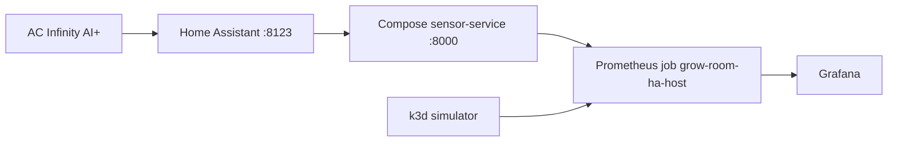

# Grow room platform

I built this so I could point at a real indoor plant grow tent and explain the software behind the Grafana charts. The tent is a 4x4 with an AC Infinity AI+ controller. The service reads climate data. It does not change fan speeds, setpoints, or lights.

If you have only seen the dashboards, start with [Architecture](architecture.md) and then the [Grafana guide](grafana.md). If you want to rebuild the project, follow the phase pages in order. Each one has the commands I actually use.

The day-to-day lab runs on my PC. A separate AWS proof of concept in `us-west-2` comes up for a paid session and goes back down the same day. One smaller telemetry stack stays up between sessions.

## What you are looking at

| Piece | Where it runs | What it is for |
| --- | --- | --- |
| AC Infinity AI+ | The tent, on Wi-Fi | Controller air, an internal probe, and the device ports |
| Home Assistant | Docker Compose, port 8123 | Holds the controller entities. I read them. I do not call services. |
| sensor-service | Docker Compose, port 8000, with `SENSOR_SOURCE=homeassistant` | Turns those entities into JSON and Prometheus metrics |
| Prometheus job `grow-room-ha-host` | k3d cluster `grow-room-dev` | Scrapes `host.k3d.internal:8000` every 30 seconds |
| Grafana | Same cluster, namespace `monitoring` | Dashboards **Grow-room VPD** and **grow-room SLOs** |
| sensor-service simulator | Same cluster, namespace `grow-room` | A second copy that does not need the tent. CI uses this path. |
| Argo CD | Namespace `argocd` | Applies `gitops/apps/` and heals drift |
| AWS proof of concept | `us-west-2`, cluster `grow-room-poc` | A full stack I apply, check, and destroy |
| Telemetry | S3, Glue, and Athena, kept between sessions | A copy of readings for queries that Prometheus does not keep |

Prometheus is the database that scrapes and stores the numbers. Grafana is the set of charts on top of those numbers. Argo CD is the controller that makes the cluster match Git.

## Two paths, on purpose

The live path is:

**AC Infinity AI+ → Home Assistant (HACS) → Docker Compose sensor-service (`SENSOR_SOURCE=homeassistant`, port 8000) → Prometheus job `grow-room-ha-host` → Grafana.**

The lab path is a simulator inside k3d. GitHub Actions tests that path. I did not want a failed Home Assistant token to fail CI, and I did not want the token in Git.



## How the work is split

I built the local project in five weeks, then a one-day AWS stack, then seven numbered phases. The numbered phases are the names I use in the later pull requests.

| Phase | What landed | Main pull requests |
| --- | --- | --- |
| [Week 1](phases/week-1-application-and-ci.md) | FastAPI service, tests, Docker, GitHub Actions | First commits, before PR #1 |
| [Week 2](phases/week-2-terraform.md) | Terraform modules, checked in CI, not applied | Week 2 commits |
| [Week 3](phases/week-3-gitops.md) | Helm, k3d, Argo CD app-of-apps | PR #1 |
| [Week 4](phases/week-4-observability.md) | Prometheus, Grafana, the live scrape | PR #4, #12, #14, #25, #29, #32 |
| [Week 5](phases/week-5-audit.md) | Plant and batch history, then optional Postgres | PR #7, #38 |
| [AWS proof of concept](phases/aws-proof-of-concept.md) | Session stack in `us-west-2`. First apply 1 November 2026. Test session 3 November 2026 passed, then teardown. Not left running. | PR #47, #50, #51, #75 |
| [Phase 1](phases/phase-1-oidc.md) | Terraform plan on pull requests, apply only when I approve | PR #54, #66 |
| [Phase 2](phases/phase-2-up-verify-down.md) | `scripts/aws-poc.ps1` with `up`, `verify`, and `down` | PR #56 |
| [Phase 3](phases/phase-3-telemetry.md) | Home shipper, S3, Glue, Athena, and the EKS exporter | PR #71, #73 |
| [Phase 4](phases/phase-4-slos-and-drills.md) | Service level objectives, email alerts, four drills | PR #64, #75 |
| [Phase 5](phases/phase-5-supply-chain.md) | Trivy gate, SBOM, keyless signing, Kyverno in Audit | PR #62, #75 |
| [Phase 6](phases/phase-6-costs-and-adrs.md) | Cost record template and the first decision records | PR #58 |
| [Phase 7](phases/phase-7-ansible.md) | Ansible for the WSL2 workstation | PR #69 |

A service level objective is a target I chose, such as "99 percent of scrapes succeed." It is not a contract with a customer.

As of 3 November 2026, phases 3 through 7 are done. The paid test session that day passed, and teardown was clean. The telemetry stack stays up at about 1 USD per month. `GROW_STAGE` landed the same day in pull request [#77](https://github.com/TontoBlanco/grow-room-platform/pull/77). What is still ahead is the [roadmap](project-management/roadmap.md).

## What this is not

This is not a standing production cluster. The expensive AWS pieces are destroyed after a session. The audit log is practice at recording state changes. It is not a state traceability integration, and it is not an authorization package.

The [roadmap](project-management/roadmap.md) is the work I have not done yet. The [test session](test-session/2026-11-03.md) is the paid run on 3 November 2026.

## Commands I assume

Git commands are PowerShell, from `C:\src\grow-room-platform`.

```powershell
Set-Location C:\src\grow-room-platform
```

The k3d bootstrap script is bash, so I run that part in WSL2. The AWS session script is Windows PowerShell 5.1. Profile name is `GrowRoom`. Region is `us-west-2`. Do not name a PowerShell variable `$Profile` or `$Host`. Those names are already taken by the shell.
