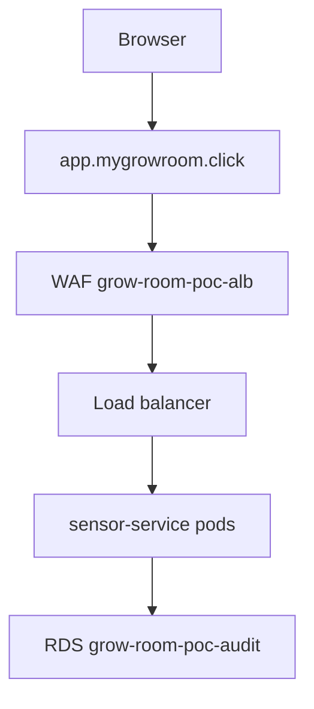

# AWS proof of concept

On 1 November 2026 I applied a separate Terraform root in `us-west-2`, checked `https://app.mygrowroom.click/healthz`, and destroyed the expensive resources the same day. The gallery is [the proof-of-concept notes](../aws-poc/README.md). This page is the rebuild story.

## What I built

Root `infra/aws-poc`, Terraform `>= 1.11`, AWS provider `~> 6.71`. The workflows pin Terraform `1.17.1`.

| Area | Names I use |
| --- | --- |
| Bootstrap, kept | State bucket, KMS alias `alias/grow-room/tfstate`, GitHub OIDC roles, budget `grow-room-monthly` at 25 USD, Route 53 zone for `mygrowroom.click` |
| Network | VPC `grow-room-poc-vpc`, `10.60.0.0/16`, three availability zones, one NAT gateway per zone |
| Cluster | EKS `grow-room-poc`, Kubernetes `1.36`, managed node group of three `t3.large` |
| Edge | ACM certificate, WAF `grow-room-poc-alb`, load balancer created by the AWS Load Balancer Controller from ingress annotations |
| Data | RDS `grow-room-poc-audit`, Postgres 17, Multi-AZ, class `db.t4g.micro`, not public |
| Keys | `grow-room-poc/eks-secrets`, `grow-room-poc/rds`, `grow-room-poc/s3-sensor`, `grow-room-poc/secrets-manager`, `grow-room-poc/logs`, `grow-room-poc/ebs` |

The pods ran `SENSOR_SOURCE=simulator`. I did not put `HA_TOKEN` in the cluster.

## Why

I wanted one real apply, with Multi-AZ, a private database, and a public HTTPS name, and I wanted it gone the same day. The local root was the wrong place for that. Its EKS resource is still commented out, and its workflow does not plan.

## Data flow



## Rebuild

Use Phase 2. The supported command is `scripts/aws-poc.ps1`, not a hand-written apply.

!!! warning "This creates a bill the hour it comes up"
    The script's own prompt says about 0.70 USD per hour while the stack is up. That figure is a warning in the script. It is not a Cost Explorer measurement. The measured table in `docs/aws-poc/COSTS.md` is still blank. The budget `grow-room-monthly` emails you. It does not stop spending. NAT gateways, the EKS control plane, the load balancer, and Multi-AZ RDS are the lines that move. Destroy with `down` before you leave the machine.

```powershell
Set-Location C:\src\grow-room-platform
```

```powershell
$env:AWS_PROFILE = "GrowRoom"
```

```powershell
$env:AWS_REGION = "us-west-2"
```

```powershell
.\scripts\aws-poc.ps1 up
```

Type `yes` only when you mean to start the bill. Then:

```powershell
.\scripts\aws-poc.ps1 verify
```

When you are finished:

```powershell
.\scripts\aws-poc.ps1 down
```

`down` keeps the state bucket, the state KMS key, the OIDC roles, the budget, the hosted zone, and the Phase 3 telemetry stack. It removes the cluster, the NAT gateways, the load balancer, and the database.

Details of what `up` installs, including Helm chart versions, are in [Phase 2](phase-2-up-verify-down.md).

## Cost

See the warning above. Also:

- Three NAT gateways, not one. That was a deliberate availability choice. [ADR-0001](../adr/0001-nat-gateway-per-az.md).
- RDS backup retention on this stack is one day, deletion protection is off, and the final snapshot is skipped, because the database is meant to be destroyed the same day.
- `enable_health_check` defaults to false. Turning it on adds a Route 53 health check charge.
- The hosted zone and the state KMS key bill a small amount every month even after `down`.

## What I learned

The console's month-to-date number on the hour I created the stack was not the cost of the stack. EKS, NAT, and RDS show up later. I destroyed the same day so those hours would not become a night.

I also left gaps on purpose and wrote them down: WAF logging off, log retention of one day, the apply role still `AdministratorAccess`, and simulator data in the cloud. The tent path never moved to EKS.
