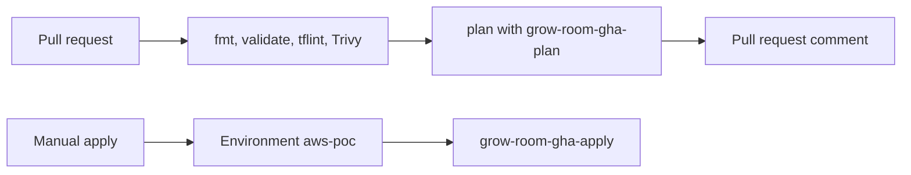

# Phase 1 — GitHub Actions OIDC for Terraform

Pull request [#54](https://github.com/TontoBlanco/grow-room-platform/pull/54) added the plan, apply, and destroy workflows. Pull request [#66](https://github.com/TontoBlanco/grow-room-platform/pull/66) made apply manual. I wanted a plan on every infrastructure pull request, and I did not want a long-lived AWS key in GitHub.

OIDC here is OpenID Connect. GitHub issues a short-lived token. AWS accepts that token for one role. There is no access key to rotate.

## What I built

| Workflow | When it runs | Role |
| --- | --- | --- |
| `aws-poc-plan.yml` | Pull request that touches `infra/aws-poc/**` or the aws-poc workflows | `grow-room-gha-plan` |
| `aws-poc-apply.yml` | Manual `workflow_dispatch` only | `grow-room-gha-apply`, environment `aws-poc` |
| `aws-poc-destroy.yml` | Manual `workflow_dispatch` only | `grow-room-gha-apply`, environment `aws-poc` |

The plan job's permissions include `id-token: write`. That is what lets the job request the OIDC token. The plan role can read, and it can write the state prefix so the lock file works. The apply role is `AdministratorAccess`, and only for a job whose token subject is the `aws-poc` environment. The bootstrap file calls that admin policy a demo shortcut. I have not replaced it.

Repository variables, not secrets: `MY_IP_CIDR`, `DOMAIN`, `ADMIN_PRINCIPAL_ARN`, `ALERT_EMAIL`. CI has no `terraform.tfvars`, because that file is gitignored. The workflows pass the variables in as `TF_VAR_` values.

The plan workflow also runs `terraform fmt`, `validate`, `tflint` `v0.65.0`, and a Trivy config scan. Accepted findings are listed with reasons in `infra/aws-poc/.trivyignore`: `AWS-0104`, `AWS-0041`, `AWS-0040`, `AWS-0132`, and `AWS-0136`.

## Why

A pull request should show the plan before anyone approves a bill. Storing an AWS key in GitHub would have been the shorter path and the one I did not want. See [ADR-0008](../adr/0008-oidc-for-terraform-ci.md).

## Data flow



## Rebuild

The trust policies already live in `infra/aws-poc/bootstrap/main.tf`. They use an immutable subject, so the token carries GitHub's numeric ids as well as the repository name. If you rebuild the account, plan and apply the bootstrap root before you expect CI to assume a role. Bootstrap itself holds a KMS key and a hosted zone.

!!! warning "Bootstrap is a small monthly bill, and apply is not"
    Applying bootstrap creates the state KMS key and, if you let it, the hosted zone. Those stay up. Approving the `aws-poc` environment on the apply workflow starts the full stack from [the proof of concept](aws-proof-of-concept.md). Reject that approval unless you are in a session you plan to tear down.

```powershell
Set-Location C:\src\grow-room-platform
```

```powershell
gh variable set DOMAIN --repo TontoBlanco/grow-room-platform --body "mygrowroom.click"
```

```powershell
gh variable set MY_IP_CIDR --repo TontoBlanco/grow-room-platform --body ((Invoke-RestMethod https://checkip.amazonaws.com).Trim() + "/32")
```

Set `ADMIN_PRINCIPAL_ARN` to the full SSO role ARN, including the path `aws-reserved/sso.amazonaws.com`. The variable description is on `admin_principal_arn` in `infra/aws-poc/variables.tf`. Do not drop that path. EKS access failed when I did.

```powershell
gh variable set ADMIN_PRINCIPAL_ARN --repo TontoBlanco/grow-room-platform --body $env:ADMIN_PRINCIPAL_ARN
```

```powershell
gh variable set ALERT_EMAIL --repo TontoBlanco/grow-room-platform --body $env:ALERT_EMAIL
```

Put the same IP and the same email in `infra/aws-poc/terraform.tfvars`, which stays uncommitted. When your home IP changes, update both the variable and the tfvars file. Otherwise the next apply flips the EKS API allow list back and forth.

The environment `aws-poc` is what puts `environment:aws-poc` on the token. The apply and destroy jobs set `environment: aws-poc`. Branch policy for that environment is `main`.

## Cost

Plan does not create the cluster. A plan against an empty state still needs the state bucket, which bootstrap created. Approving apply is the expensive step. I do not approve it from a pull request review unless I am ready to run `down`.

## What I learned

The first plan failed with `sts:AssumeRoleWithWebIdentity` even though the trust policy looked right. This repository sets an immutable OIDC subject, so the token does not match a subject written with only the repository name. The bootstrap trust lists both forms. `terraform plan` on bootstrap does not change AWS. I had to apply it.

The second lesson was the apply trigger. A merge that applies by itself is a surprise bill. Apply is a button, and the environment pauses for a person.
