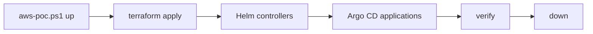

# Phase 2 — Up, verify, and down

Pull request [#56](https://github.com/TontoBlanco/grow-room-platform/pull/56) added `scripts/aws-poc.ps1`. I was typing the same Helm installs from notes. I wanted one script that brings the proof of concept up, checks it, and tears it down in an order that actually finishes.

## What I built

Windows PowerShell 5.1. The file is plain ASCII, because 5.1 misreads UTF-8 without a BOM. Actions are `up`, `verify`, and `down`. Switches are `-SkipTerraform` and `-AutoApprove`.

`up` does this:

1. Checks the caller with profile `GrowRoom` and region `us-west-2`. The expected account is the `$Account` variable in the script. I do not print it here.
2. Refuses to plan if `my_ip_cidr` in `terraform.tfvars` is not your current `/32`.
3. Plans, asks you to type `yes`, and applies.
4. Passes `alert_email` from `$env:ALERT_EMAIL`, then from tfvars, then from `gh variable get ALERT_EMAIL`.
5. Installs controllers: AWS Load Balancer Controller `3.6.2`, Karpenter `1.15.1`, External Secrets `2.14.0`, Argo CD `10.11.6`, ExternalDNS `1.23.0`.
6. Applies the Karpenter NodePool, with the EBS KMS key from Terraform output patched in, and the ClusterSecretStore.
7. Applies the sensor-service Application with the RDS secret, database host, certificate ARN, and WAF ARN injected at runtime. Nothing in that step is committed.
8. Applies `gitops/eks/monitoring.yaml` if that file exists, otherwise `gitops/apps/monitoring.yaml`.
9. Waits until `app.mygrowroom.click` resolves and `https://app.mygrowroom.click/healthz` returns 200.

`verify` checks three ready nodes, Argo CD `Synced/Healthy`, HTTP 301, health JSON, `/readings` 200, a POST to `/audit/batches`, WAF name `grow-room-poc-alb` on the load balancer, and RDS Multi-AZ.

`down` removes Argo CD applications, leftover load balancers, available network interfaces in the proof-of-concept VPC, Helm releases, and then runs `terraform destroy`. It repeats the network-interface delete while destroy runs, because the VPC CNI releases them only after the node group starts terminating.

## Why

The first teardown sat for a long time on a private subnet because an available network interface was still there. I wanted that cleanup in the script, next to the cost prompt, so I would not rediscover it at the end of a session.

## Data flow



## Rebuild

!!! warning "Cost starts when you type yes"
    The prompt says about 0.70 USD per hour while the stack is up. Treat that as the script's warning, not as a measured rate. Plan on 25 to 35 minutes of apply time, mostly EKS and Multi-AZ RDS, and that time is already on the bill. Finish with `down`. The 25 USD budget does not stop the spend.

```powershell
Set-Location C:\src\grow-room-platform
```

```powershell
$env:AWS_PROFILE = "GrowRoom"
```

```powershell
$env:AWS_REGION = "us-west-2"
```

Set `ALERT_EMAIL` in that window before `up` if the script cannot already see it in tfvars or in the GitHub variable. The script will not subscribe an inbox it cannot see.

```powershell
.\scripts\aws-poc.ps1 up
```

```powershell
.\scripts\aws-poc.ps1 verify
```

A passing verify prints `ALL CHECKS PASSED`.

```powershell
.\scripts\aws-poc.ps1 down
```

If Terraform was already applied and you only need the Kubernetes half:

```powershell
.\scripts\aws-poc.ps1 up -SkipTerraform
```

Do not use `-AutoApprove` unless you have already read the plan. It skips the `yes` prompt.

## Cost

While `up` is in progress you are paying. `down` prints what it keeps: state bucket, state KMS key, OIDC roles, budget, hosted zone, and the Phase 3 telemetry stack. Those are the between-session costs. The NAT gateways and the cluster are not among them.

## What I learned

Two appliers can still disagree if they are not running at the same moment. The state lock stops a collision. It does not stop my laptop and GitHub Actions from taking turns and flipping `my_ip_cidr`. For one session I pick one writer: the script, or CI with `-SkipTerraform`.

The email subscription was missing after the first `up`, because `alert_email` was empty. The topic existed and nothing was subscribed, so alerts were dropped. `up` now reads `$env:ALERT_EMAIL`, then `terraform.tfvars`, then the GitHub variable `ALERT_EMAIL`. AWS still waits for the inbox click. Until that click, alerts are dropped. A second `up` does not subscribe again when the status is already `PendingConfirmation`.

`down` once sat for minutes on a private subnet. The blocker was an available network interface in the proof-of-concept VPC, the kind named `aws-K8S-...`. The script now deletes available interfaces in that VPC before destroy and again while destroy runs. It does not touch an interface that is still in use.

After destroy, the resource tagging API can still list things that are already gone. I check the service itself before I call a name a leftover. The script and this phase came in with pull request [#56](https://github.com/TontoBlanco/grow-room-platform/pull/56). The interface cleanup is in pull request [#75](https://github.com/TontoBlanco/grow-room-platform/pull/75).
