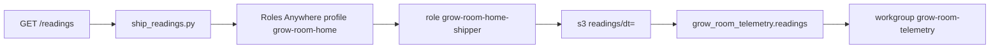

# Phase 3 — Readings in S3 and Athena

Pull request [#71](https://github.com/TontoBlanco/grow-room-platform/pull/71) added `infra/telemetry` and `scripts/ship_readings.py`. Pull request [#73](https://github.com/TontoBlanco/grow-room-platform/pull/73) added the EKS CronJob. I wanted a copy of tent readings that survives the 24 hour Prometheus retention, without putting an AWS access key on the PC.

## What I built

`infra/telemetry/main.tf` creates:

| Name | Purpose |
| --- | --- |
| KMS alias `alias/grow-room/telemetry` | Encrypts the bucket and Athena results. Rotation is on. |
| Bucket `grow-room-telemetry-` plus the account id | Readings under `readings/dt=YYYY-MM-DD/`. Public access blocked. TLS required. |
| Glue database `grow_room_telemetry`, table `readings` | JSON, partition projection on `dt` from 2026-11-01 |
| Athena workgroup `grow-room-telemetry` | Results encrypted. A query stops at 1 GB scanned. Results under `athena-results/` expire after 7 days. |
| Trust anchor `grow-room-home-ca` | The public CA certificate from `ca_cert_file` |
| Profile `grow-room-home` | One hour credentials |
| Role `grow-room-home-shipper` | `s3:PutObject` on `readings/*`, plus `kms:GenerateDataKey` and `kms:Decrypt` on the telemetry key |

The trust requires the certificate subject CN `grow-room-home-shipper` and the trust anchor. The default `ca_cert_file` is `C:/src/grow-room-pki/ca.pem`. The private key stays next to that folder and out of Git.

`scripts/ship_readings.py` reads `/readings`, keeps the columns the Glue table knows, and writes one JSON Lines object per batch. The home prefix is `readings`. The EKS CronJob `sensor-exporter` uses prefix `raw` and the proof-of-concept bucket, which `down` deletes.

The daily query is `analytics/athena/vpd_by_day.sql`. It filters `source = 'homeassistant'`.

## Why

Prometheus on the laptop keeps one day. I wanted to ask "what was VPD last week" without running a database server at home. Roles Anywhere lets the PC exchange a certificate for a short session. See [ADR-0009](../adr/0009-roles-anywhere-shipper.md) and [ADR-0010](../adr/0010-s3-and-athena.md).

## Data flow



## Rebuild

!!! warning "The telemetry KMS key bills every month"
    The file comment prices that key at about 1 USD per month. S3 and Athena are small at this volume, until a query scans more than you meant. The workgroup cuts a query off at 1 GB. `aws-poc.ps1 down` does **not** destroy this stack. Delete it yourself when you want the key to stop billing. There is a 7 day deletion window on the key.

Create a private CA and a client certificate outside the repo. The client subject CN must be exactly `grow-room-home-shipper`. Put the CA certificate, not the private key, at `C:\src\grow-room-pki\ca.pem`. I did not check a CA script into Git.

```powershell
Set-Location C:\src\grow-room-platform
```

```powershell
$env:AWS_PROFILE = "GrowRoom"
```

```powershell
$env:AWS_REGION = "us-west-2"
```

```powershell
terraform -chdir=infra/telemetry init
```

```powershell
terraform -chdir=infra/telemetry apply
```

Read the names back. Use these outputs in the AWS credential helper. Do not paste ARNs into Git.

```powershell
terraform -chdir=infra/telemetry output -raw bucket
```

```powershell
terraform -chdir=infra/telemetry output -raw trust_anchor_arn
```

```powershell
terraform -chdir=infra/telemetry output -raw profile_arn
```

```powershell
terraform -chdir=infra/telemetry output -raw role_arn
```

Point the AWS CLI credential process at the Roles Anywhere helper, the client certificate, the private key, and those three outputs. Then a dry run, which prints and does not upload:

```powershell
.\.venv\Scripts\Activate.ps1
```

```powershell
pip install boto3
```

```powershell
python scripts/ship_readings.py --bucket (terraform -chdir=infra/telemetry output -raw bucket) --dry-run --once
```

Drop `--dry-run` when the credential process works. The default URL is `http://localhost:8000/readings`, the prefix is `readings`, the interval is 60 seconds, and the batch size is 10.

On a paid EKS session, the CronJob manifest is `k8s/aws-poc/sensor-exporter.yaml`. It expects a ConfigMap `ship-readings` in namespace `grow-room` and the Pod Identity role for service account `sensor-exporter`. The bucket name in that manifest is the proof-of-concept sensor bucket, not the telemetry bucket. Apply it only while `grow-room-poc` is up. That path was part of the 3 November session.

## Cost

The standing cost is the KMS key, plus a few cents of S3. Athena charges by data scanned. The 1 GB cutoff is there so a bad query cannot run away. Do not confuse this stack with the EKS hourly cost. They are different state files.

## What I learned

Write-only was a real constraint, not a slogan. The first policy I sketched could list and delete. The policy in Git cannot. `PutObject` on `readings/*` is the whole S3 statement, plus the two KMS actions the encryption needs.

The EKS exporter is a different bucket and a different identity. It ships simulator readings during a session. The home shipper is the one that carries `source=homeassistant`. The Athena query filters on that, so a session full of simulator rows does not look like the tent.
