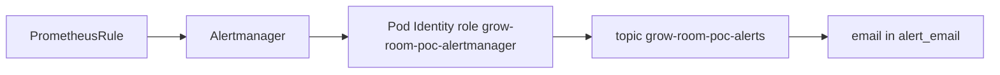

# Phase 4 — Service level objectives, alerts, and drills

Pull request [#64](https://github.com/TontoBlanco/grow-room-platform/pull/64) added the recording rules, the SLO dashboard, the Alertmanager route, and `infra/aws-poc/alerting.tf`. Pull request [#75](https://github.com/TontoBlanco/grow-room-platform/pull/75) wrote down what the 3 November drills actually did. The step-by-step drill commands are in [the drill notes](../aws-poc/DRILLS.md).

A service level objective is the target. The error budget is how much miss that target allows. Burn rate is how fast you are spending the budget.

## What I built

Two objectives for job `sensor-service` only:

| Objective | Target |
| --- | --- |
| Scrape availability | 99 percent of scrapes succeed over seven days |
| Sample freshness | `grow_vpd_kpa` no older than 120 seconds for 99 percent of observations |

Alerts: `SensorAvailabilityBudgetBurnFast`, `SensorAvailabilityBudgetBurnSlow`, and `SensorDataStale`. The older three rules from Week 4 are still there.

SNS topic `grow-room-poc-alerts` uses the AWS-managed key `alias/aws/sns`. The email subscription exists only when `alert_email` is not empty. Alertmanager's service account is `alertmanager` in namespace `monitoring`. Its role may `sns:Publish` and nothing else. Pod Identity attaches that role. The subject template is `[grow-room]` plus the status plus the alert name.

`monitoring/values-eks.yaml` sets `group_wait` to 30 seconds and replaces the extra scrape list with an empty list, so EKS does not scrape the laptop.

## Why

A dashboard I have to watch is not an alert. I wanted one email path, a burn alert, and four drills I could run while the stack was up: delete a pod, drain a node, fail over RDS, and scale to zero.

## Data flow



## Rebuild

The rules and the dashboard ship with the monitoring Application. The topic ships with Terraform. You need the stack up. That is a paid session. Read the cost warning on [Phase 2](phase-2-up-verify-down.md) before `up`.

```powershell
Set-Location C:\src\grow-room-platform
```

```powershell
.\scripts\aws-poc.ps1 up
```

Confirm the inbox once. A second `up` must not send another confirmation if the subscription is already confirmed.

The four drills, with the curl loop, are in [the drill notes](../aws-poc/DRILLS.md). That file wins over any older note that tells you to wait for `SensorAvailabilityBudgetBurnFast` in 5 to 8 minutes. Drill 4's email is `SensorDataStale`. Run the drills from `C:\src\grow-room-platform` while `verify` is green. Restore Argo CD auto-sync after drill 4 before you destroy.

```powershell
.\scripts\aws-poc.ps1 down
```

## Cost

SNS email at this volume sits in the free tier. The cost of this phase is the stack underneath it: EKS, three NAT gateways, the load balancer, and Multi-AZ RDS, for as long as you leave them up. Do not hold the stack overnight to wait for a burn alert to resolve. `SensorAvailabilityBudgetBurnFast`, if it fired, can stay firing until the bad samples leave the one hour window.

## What I learned

I expected the fast burn email about 5 to 8 minutes after scaling to zero. `SensorDataStale` fired first, around 7 minutes: freshness crosses 120 seconds, then the rule waits 5 minutes, then Alertmanager waits 30 seconds. The fast burn needs the one hour window as well, so it is closer to 11 minutes, and it may not fire at all if Prometheus drops the target instead of storing `up=0`. I wrote that into the drill notes so the next session does not fail a drill that behaved correctly.

The other surprise was `TargetDown` for `grow-room-ha-host`. EKS cannot route `host.k3d.internal`. An empty `additionalScrapeConfigs` list in the EKS values file drops that job. The k3d file still has it.

Drills 1 and 2 each returned one HTTP 502. The load balancer was still sending requests after the process had exited. The EKS chart now waits in `preStop` for 30 seconds, allows 45 seconds to terminate, shortens deregistration to 20 seconds, and keeps two pods available. The RDS failover in drill 3 took about 30 seconds. I still tell people the usual window is 60 to 120 seconds, and I report the time I measured. The cleanup is pull request [#75](https://github.com/TontoBlanco/grow-room-platform/pull/75). The same list is on the [troubleshooting page](../troubleshooting.md).
