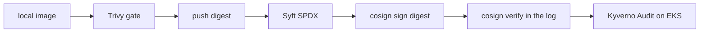

# Phase 5 — Signing, the software bill of materials, and the scan gate

The scan has been in CI since Week 1. This phase pinned the actions, added the bill of materials and keyless signing, and added a Kyverno policy. The policy pull request is [#62](https://github.com/TontoBlanco/grow-room-platform/pull/62). The cosign pin that Kyverno can actually see landed in [#75](https://github.com/TontoBlanco/grow-room-platform/pull/75).

A software bill of materials is the list of what is inside the image. Keyless signing means the signature comes from a short-lived certificate, not from a private key stored in the repository. Kyverno is the admission policy in the cluster.

## What I built

On a push to `main`, job `build` in `.github/workflows/ci.yml`:

1. Builds the image locally and does not push yet.
2. Runs Trivy `v0.36.0`, pinned by commit SHA, severity `CRITICAL,HIGH`, `ignore-unfixed: true`, exit code 1.
3. Pushes the digest and tags.
4. Writes an SPDX JSON bill of materials with Syft `v0.24.3`.
5. Signs the digest with cosign `v2.6.5` and `--registry-referrers-mode=legacy`, then attests the bill of materials.
6. Runs `cosign verify` with certificate identity `https://github.com/TontoBlanco/grow-room-platform/.github/workflows/ci.yml@refs/heads/main` and issuer `https://token.actions.githubusercontent.com`.

The job has `id-token: write` so cosign can get the GitHub token. The signature is on the digest, not on a moving tag.

`k8s/aws-poc/kyverno-verify-images.yaml` is a ClusterPolicy named `verify-grow-room-images`. It matches pods in namespace `grow-room` whose image is `ghcr.io/tontoblanco/grow-room-platform*`. `failureAction` is `Audit`. `mutateDigest` and `verifyDigest` are false. The same identity string as CI is the attestor. Rekor is `https://rekor.sigstore.dev`.

The Terraform Trivy scan is in `aws-poc-plan.yml`, same action pin, with `skip-dirs: "**/examples"` so example YAML inside modules is not the finding list.

## Why

I wanted a failed scan to stop the push, and I wanted a signature a cluster policy could check later. I did not want to store a cosign key. See the supply-chain rows in [Controls](../security/controls.md).

## Data flow



## Rebuild

Signing runs only on a push to `main`. A pull request build scans and does not sign. Merge through a pull request. After the `ci` workflow on `main` is green, the log should contain `verified ghcr.io/tontoblanco/grow-room-platform@sha256:...`.

Kyverno is optional and only while the cluster is up. That is a paid session.

```powershell
helm repo add kyverno https://kyverno.github.io/kyverno/
```

```powershell
helm search repo kyverno/kyverno --versions
```

```powershell
helm upgrade --install kyverno kyverno/kyverno -n kyverno --create-namespace --wait
```

The policy file asks for a 3.x chart. Add `--version` with one version from that search if you do not want the repo default. Then:

```powershell
kubectl apply -f k8s/aws-poc/kyverno-verify-images.yaml
```

Stay on Audit until `kubectl get policyreport -n grow-room` shows a pass for the new `sha-` tag and zero `no signatures found`. Images signed by cosign 3, before the pin, still fail that check. Do not set `failureAction: Enforce` until the pass is real. When you do, the file's comment says to set `mutateDigest: true` and `verifyDigest: true` in the same change. Kyverno rejects `mutateDigest: true` while the action is Audit.

The policy kind `ClusterPolicy` with `verifyImages` is deprecated in Kyverno 1.19 in favor of `ImageValidatingPolicy`. I have not migrated it.

## Cost

GHCR for this public repository, and the public Rekor and Fulcio services, are not an AWS bill. Installing Kyverno requires the EKS session. Do not leave the cluster up only to watch a policy report.

## What I learned

CI said the image was signed. Kyverno on 3 November said `no signatures found`. Both were telling the truth about different lookups. Cosign 3 wrote an OCI referrer. Kyverno 1.19 looked up the legacy tag `sha256-<digest>.sig`. Pinning cosign `v2.6.5` and `--registry-referrers-mode=legacy` publishes the tag Kyverno reads. I am not calling the policy enforced. Audit is the mode in Git today.
