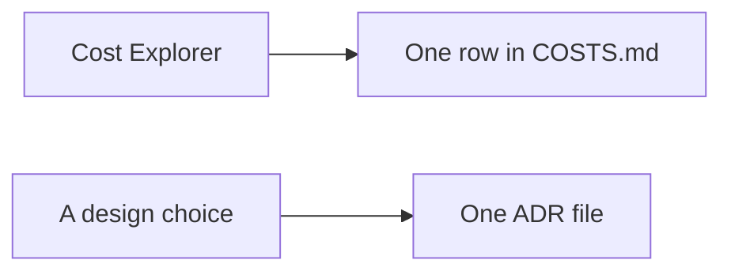

# Phase 6 — Cost record and decision records

Pull request [#58](https://github.com/TontoBlanco/grow-room-platform/pull/58) added `docs/aws-poc/COSTS.md`, the decision-record template, and ADR-0001 through ADR-0006. I wanted a place where a number is either from the bill or clearly blank, and a short record of why the expensive choices exist.

## What I built

The cost file has tables for sessions, services, and the resources that stay up between sessions. Every measured cell is still blank. I have not written a Cost Explorer total into that file yet. The 1 November console screenshot in the gallery showed 0.01 USD month-to-date at the moment of the shot. That is not the session cost. Cost Explorer lags.

The decision records:

| Record | Decision |
| --- | --- |
| [ADR-0001](../adr/0001-nat-gateway-per-az.md) | One NAT gateway in each availability zone |
| [ADR-0002](../adr/0002-karpenter-for-node-scaling.md) | Karpenter for extra nodes |
| [ADR-0003](../adr/0003-eks-pod-identity.md) | Pod Identity instead of access keys |
| [ADR-0004](../adr/0004-external-secrets-operator.md) | External Secrets for the database URL |
| [ADR-0005](../adr/0005-aws-waf-on-alb.md) | A web ACL on the load balancer |
| [ADR-0006](../adr/0006-rds-multi-az.md) | Multi-AZ RDS for the audit database |
| [ADR-0007](../adr/0007-sqlite-and-postgres.md) | SQLite by default, Postgres when a URL is set |
| [ADR-0008](../adr/0008-oidc-for-terraform-ci.md) | GitHub OIDC for Terraform |
| [ADR-0009](../adr/0009-roles-anywhere-shipper.md) | Roles Anywhere for the home shipper |
| [ADR-0010](../adr/0010-s3-and-athena.md) | S3 and Athena for reading history |
| [ADR-0011](../adr/0011-k3d-instead-of-a-pi.md) | k3d on the PC instead of a Pi, for now |

ADR-0007 through ADR-0011 are the records I added with the documentation site. The first six were already in the repository.

## Why

I study for the AWS Solutions Architect exam with this project. A decision record forces the trade I actually made: three NAT gateways cost more and survive a zone loss; one NAT gateway is cheaper and is a single path out. I did not want that trade living only in a diagram.

## Data flow



## Rebuild

There is nothing to deploy. Fill the cost file the day after a session. The API call itself has a charge.

!!! warning "Cost Explorer API"
    Each `get-cost-and-usage` request is about 0.01 USD. Do not loop it. The budget email is not a substitute for this table.

```powershell
Set-Location C:\src\grow-room-platform
```

```powershell
aws ce get-cost-and-usage --time-period Start=2026-11-03,End=2026-11-04 --granularity DAILY --metrics UnblendedCost --group-by Type=DIMENSION,Key=SERVICE
```

Use a profile that can read billing. Write the numbers into `docs/aws-poc/COSTS.md`. Leave a cell blank if you did not measure it. Do not invent the hourly rate.

The tag the file asks for is `Project = grow-room`. The provider default tags in `infra/aws-poc` set `Project` to `grow-room`. The tag has to be activated as a cost allocation tag in Billing before Cost Explorer can filter on it. I have not recorded that activation as done.

## Cost

Writing the files is free. The API request is the warning above. The resources the file is about are the expensive ones. This page does not start them.

## What I learned

A blank cell is more honest than a remembered price. The script says about 0.70 USD per hour. Until Cost Explorer fills the table, that sentence stays a warning, not a result. I would rather show the empty table than a precise number I cannot point at.
