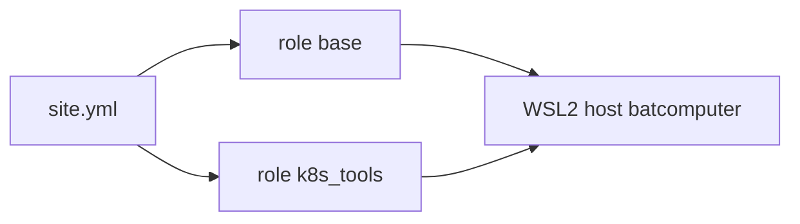

# Phase 7 — Ansible on WSL2

Pull request [#69](https://github.com/TontoBlanco/grow-room-platform/pull/69) added the inventory, two roles, and an ansible-lint job. I wanted the workstation tools in a playbook I can run twice, not in a shell history.

## What I built

| Piece | Value |
| --- | --- |
| Inventory | `ansible/inventories/local/hosts.yml` |
| Host | `batcomputer`, connection `local`, interpreter `/usr/bin/python3` |
| Playbook | `ansible/playbooks/site.yml` |
| Role `base` | Packages `git`, `curl`, `jq`, `htop`, `unzip`. Timezone `America/Denver`. |
| Role `k8s_tools` | kubectl `v1.37.1`, Helm `v3.22.1`, k3d `v5.9.0` |
| Collection | `community.general`, from `ansible/collections/requirements.yml` |
| CI | `.github/workflows/ansible-lint.yml` |

The timezone task uses the `file` module to link `/etc/localtime`. An earlier draft used a module the linter did not want.

This playbook does not install the sensor service and it does not talk to AWS.

## Why

The same roles are what I would run on a small always-on machine later. Today the only host is WSL2 on the PC. Doing it here cost nothing and gave CI a syntax check. See [ADR-0011](../adr/0011-k3d-instead-of-a-pi.md).

## Data flow



## Rebuild

In WSL2:

```bash
cd /mnt/c/src/grow-room-platform
```

```bash
ansible-galaxy collection install -r ansible/collections/requirements.yml
```

```bash
ansible-playbook -i ansible/inventories/local/hosts.yml ansible/playbooks/site.yml
```

Run it a second time. A correct run reports `changed=0` on the second pass. That is the check I used in the pull request.

Then the k3d bootstrap from Week 3 still applies. Ansible installs the tools. It does not create the cluster.

## Cost

This phase runs on the PC. It does not create AWS resources. Do not add an AWS dynamic inventory here without a cost note. There is not one today.

## What I learned

The first lint failure was the path, then unpinned downloads, then a timezone module. Pinning kubectl, Helm, and k3d made the second run boring, which is what I wanted. A role that changes every time is a role I do not trust on a machine I rarely touch.
