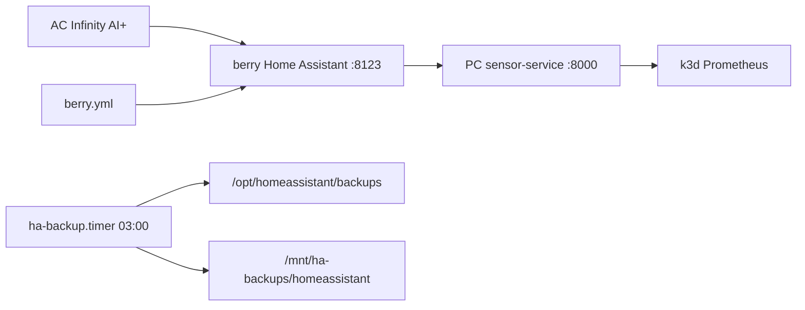

# Phase 9 — Home Assistant on the Pi

On 18 November 2026 I moved Home Assistant off the PC's Docker Compose stack and onto a Raspberry Pi 5. The hostname is `berry`. The address is `10.0.0.62`, reserved in DHCP. The user is `cole`. The OS is Raspberry Pi OS Lite, which is Debian 13 (trixie), arm64. Docker Engine and the Compose plugin were already installed, and sudo does not ask for a password.

k3d stays on the PC. See [ADR-0011](../adr/0011-k3d-instead-of-a-pi.md) and [ADR-0012](../adr/0012-home-assistant-on-the-pi.md).

## What I built

| Piece | Value |
| --- | --- |
| Inventory | `ansible/inventories/pi/hosts.yml` |
| Host | `berry`, `ansible_host` `10.0.0.62`, user `cole` |
| SSH key | `berry_ssh_private_key_file`, default `~/.ssh/id_ed25519`. Override with `BERRY_SSH_PRIVATE_KEY_FILE`. The path is in Git. The key is not. |
| Playbook | `ansible/playbooks/berry.yml` |
| Role `base` | Same role as WSL. Packages include `python3` and `tzdata` so Debian 13 arm64 can set `America/Denver`. |
| Role `docker` | Does nothing when `/usr/bin/docker` is already there. Otherwise installs Engine and the Compose plugin from Docker's Debian apt repository. |
| Role `homeassistant` | Writes `/opt/homeassistant/docker-compose.yml` and runs `docker compose up`. It does not copy or delete anything under `/opt/homeassistant/config`. |
| Role `ha_backup` | Script, systemd service, and a timer at 03:00 America/Denver. |
| USB copy | `host_vars/berry.yml` sets `ha_backup_second_dest` to `/mnt/ha-backups/homeassistant` on the WD drive. |
| PC Compose | Service `homeassistant` is profile `local-ha`. `docker compose up -d` does not start it. |

The image tag defaults to `ghcr.io/home-assistant/home-assistant:stable`. That is the tag already running on the Pi. `stable` moves when Home Assistant publishes a release. The playbook pulls only when the image is missing, so a second run does not upgrade a container that already has it. To freeze a build I set `homeassistant_image` to a dated tag such as `ghcr.io/home-assistant/home-assistant:2026.11.1`.

The container matches the stack I moved: `container_name` `homeassistant`, `network_mode: host`, `restart: unless-stopped`, `TZ=America/Denver`, volumes `./config:/config` and `/etc/localtime:/etc/localtime:ro`. It is not privileged. The AC Infinity integration (3.0.2) already lives in `config/custom_components`. The role leaves that directory alone.

sensor-service on the PC uses `HA_URL=http://10.0.0.62:8123`. I used the address rather than the hostname `berry`, because the sensor-service container may not resolve that name. Prometheus in k3d still scrapes the PC's sensor-service at `host.k3d.internal:8000`, and it still scrapes the host target the same way. I did not move Prometheus.

## Why

A plain `docker compose up -d` at the repo root used to start Home Assistant on the PC. After the move, that would be a second login to the AC Infinity account next to the one on the Pi. Two Home Assistant instances must never run at once. The profile is what stops the accident. The Pi is what stays up when I close the laptop.

The charts still go flat when the laptop sleeps. sensor-service and k3d are on the PC. Home Assistant itself does not stop.

## Data flow



## Run the playbook from WSL

From the WSL checkout, after `main` is pulled:

```bash
cd ~/src/grow-room-platform
git checkout main
git pull
ansible-galaxy collection install -r ansible/collections/requirements.yml
ANSIBLE_CONFIG="$PWD/ansible/ansible.cfg" ansible-playbook --check --diff -i ansible/inventories/pi/hosts.yml ansible/playbooks/berry.yml
ANSIBLE_CONFIG="$PWD/ansible/ansible.cfg" ansible-playbook -i ansible/inventories/pi/hosts.yml ansible/playbooks/berry.yml
```

Those commands are run from the repo root. `ansible/ansible.cfg` sets `roles_path` to `roles:ansible/roles`, so the roles resolve from that directory and from `ansible/`. `ansible.cfg` in the repo root is what a playbook loads when `ANSIBLE_CONFIG` is unset.

Check mode first. It does not stop the container and it does not write into `/opt/homeassistant/config`. The Python probe still runs during check mode. That read is how the playbook sees that the interpreter is already there. The real run is safe against the Pi that is already up: the config directory is only created when it is missing, and nothing under that directory is copied or deleted. The first real run rewrites `/opt/homeassistant/docker-compose.yml` to the templated file. If that changes the project Compose sees, the container is recreated. The config directory stays. A second real run should report `changed=0`.

`ansible.cfg` sets `become_exe` to `sudo.ws` for the WSL playbook. The Pi inventory sets `ansible_become_exe` back to `sudo`.

`k8s_tools` is not on this playbook. Those binaries are amd64. The WSL playbook is still `ansible/playbooks/site.yml`.

## Backups

The timer is `ha-backup.timer`. `OnCalendar` is `*-*-* 03:00:00` and `Timezone` is `America/Denver`. `Persistent=true` runs a missed night after boot. The service is oneshot. Its stdout goes to the journal (`SyslogIdentifier=ha-backup`). A manual run also calls `logger` when systemd did not start it.

```bash
journalctl -u ha-backup.service -n 50
```

The script is `/usr/local/sbin/ha-backup`. It reads `/etc/ha-backup.env`.

I snapshot `home-assistant_v2.db` with `sqlite3 .backup` while the container keeps running. Home Assistant uses WAL mode. A plain tar of the live database file can copy a half-written page, and copying the `-wal` file next to it is a second race. `.backup` uses SQLite's online backup API and writes one consistent database. The archive leaves out `home-assistant_v2.db-wal` and `home-assistant_v2.db-shm`. I did not stop the container for the snapshot. A stop would drop the scrape and make the AC Infinity integration reconnect every night. The yaml and `custom_components` are copied as they are. Those files rarely change at 03:00. The database is the file that cannot be copied safely while it is open.

The archive is `homeassistant-config-YYYYMMDD-HHMMSS.tar.gz`. The default directory is `/opt/homeassistant/backups`, mode `0750`. Retention defaults to 14. Both are variables: `ha_backup_dest` and `ha_backup_retention`.

The role default for `ha_backup_second_dest` is empty, which skips the second copy. On `berry` I set it in `ansible/inventories/pi/host_vars/berry.yml` to `/mnt/ha-backups/homeassistant`.

That folder is on a 2 TB WD drive, ext4, label `ha-backups`. The Pi already mounts it at `/mnt/ha-backups` from `/etc/fstab`: UUID `4f9d54ce-e197-4b40-a80f-e1975a693761`, options `defaults,nofail,x-systemd.device-timeout=10s`. `/mnt/ha-backups/homeassistant` is owned by `cole`. I did not put fstab, partitioning, or formatting in Ansible. The mount was already there.

The script still skips the copy when that path is not on its own mounted filesystem. `nofail` lets the Pi boot with the drive unplugged, and that night the backup logs a line and keeps the copy under `/opt/homeassistant/backups`. An unplugged drive does not fail the timer. I do not send these archives to S3, AWS, or any other cloud. The Phase 8 bucket copy is a different thing, and it is not this timer.

The archive contains `secrets.yaml`, `.storage`, and the long-lived token material. Both copies stay on the Pi: the disk under `/opt/homeassistant/backups`, and the WD drive when it is mounted. The timer runs as root, so the tar files are root-owned. The playbook does not change the owner of `/mnt/ha-backups/homeassistant`.

## Restore

Pick the archive. `STAMP` is the timestamp in the filename. Stop Home Assistant first so nothing writes the database during the extract. Move the live config aside instead of deleting it. Extract into an empty directory so an old `-wal` file cannot sit next to the snapshot.

```bash
ssh cole@10.0.0.62
cd /opt/homeassistant
sudo docker compose stop
sudo mv /opt/homeassistant/config /opt/homeassistant/config.before-restore
sudo mkdir -p /opt/homeassistant/config
sudo tar -xzf /opt/homeassistant/backups/homeassistant-config-STAMP.tar.gz -C /opt/homeassistant/config
sudo docker compose up -d
```

Open `http://10.0.0.62:8123` and confirm the controller entities. When that looks right, remove `config.before-restore`. If it does not, stop the container, move the restored directory out of the way, and move `config.before-restore` back to `config`.

## Rollback to the PC

Stop the Pi container first. Then start the profiled service on the PC and point sensor-service at the Compose name.

On the Pi:

```bash
cd /opt/homeassistant
docker compose stop
```

On the PC, from the repo root:

```bash
docker compose --profile local-ha up -d homeassistant
```

In `.env`:

```bash
HA_URL=http://homeassistant:8123
```

Then `docker compose up -d sensor-service`. From the host browser the PC UI is `http://localhost:8123`. `ha-config/` is the old PC config directory. It is gitignored. It is not the Pi's `/opt/homeassistant/config`.

Starting that profile while `berry` is still running is the two-copy failure. The profile stops the accident. It does not stop me from asking for it.

## Phase 8 scripts

`scripts/ha_migration.py` and `scripts/aws-poc.ps1` still assume Home Assistant is the local Compose service on the PC, with config in `ha-config` or on that container's `/config` mount. `up -WithHA` stops that container and uploads the folder to the telemetry bucket. I did not point those scripts at `/opt/homeassistant` on the Pi. The write-up of the script is still [Phase 8](../aws-poc/PHASE8_HA_MIGRATION.md).

## Cost

This phase does not create AWS resources. The backup is a file on the Pi. Do not aim `ha_backup_second_dest` at a cloud mount.

## What I learned

The dangerous command was the boring one. `docker compose up -d` with no profile was enough to start a second Home Assistant. Putting the service behind `local-ha` is a smaller change than remembering not to run it.

The other lesson was the database. Stopping the container every night would have been easier to explain and worse for the tent. `sqlite3 .backup` is the consistent copy that leaves the process up. I still move the whole config directory aside before a restore, because a snapshot database plus a leftover `-wal` file is how a restore looks fine and then is not.
