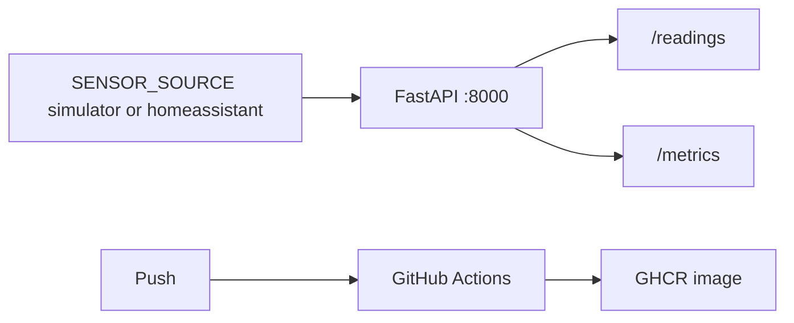

# Week 1 — Application and continuous integration

I wanted a small Python service I could test without the tent, put in a container, and build on every push.

## What I built

The package is `sensor_service`, version `0.1.0`, Python 3.12. FastAPI serves:

| Path | Purpose |
| --- | --- |
| `GET /healthz` | Liveness. Returns `status` and `version`. |
| `GET /readings` | Temperature, humidity, computed VPD, and optional CO₂ |
| `GET /mood` | The leaf-VPD band. Added later, in [PR #43](https://github.com/TontoBlanco/grow-room-platform/pull/43). |
| `GET /metrics` | Prometheus text |
| `GET /docs` | The generated API page |

`SENSOR_SOURCE` defaults to `simulator`. The simulator is a slow wave around 25 °C and 55 percent humidity, so charts move without hardware.

The image is `python:3.12-slim`, user `appuser`, uid 10001. CI is `.github/workflows/ci.yml`: Ruff, pytest with an 80 percent coverage floor, a Docker build, and a Trivy scan that fails the job on unfixed HIGH or CRITICAL findings. On `main`, the same workflow pushes `ghcr.io/tontoblanco/grow-room-platform` with a commit tag and `latest`.

## Why

I kept seeing GitHub Actions, containers, and a vulnerability scan in job posts. I wanted those on a service I could explain. The simulator exists so CI does not need my house, my controller, or a token.

## Data flow



## Rebuild

From PowerShell:

```powershell
Set-Location C:\src\grow-room-platform
```

```powershell
py -3.12 -m venv .venv
```

```powershell
.\.venv\Scripts\Activate.ps1
```

```powershell
pip install -e ".[dev]"
```

```powershell
ruff check .
```

```powershell
pytest --cov=sensor_service --cov-fail-under=80
```

```powershell
uvicorn sensor_service.main:app --reload
```

Open `http://127.0.0.1:8000/readings`. `source` should be `simulator`.

Container path:

```powershell
docker compose up --build sensor-service
```

That publishes port 8000. `docker compose up` with no service name also starts Home Assistant. Leave that for Week 4 if you only want the simulator.

## Cost

Week 1 does not create AWS resources. GitHub Actions minutes and the public GHCR image are on the free tier for a public repository. Do not add a cloud deploy in this week.

## What I learned

The first Trivy run failed the build on findings I had not read. I changed the job so it fails on unfixed HIGH and CRITICAL, and I kept the scan in front of the push. A green test run is not the same thing as a pushed image. The push step runs only when the event is a push to `main`.
