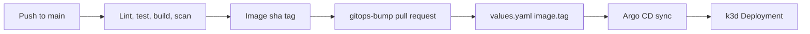

# Week 3 — Kubernetes and GitOps

I wanted a cluster I could delete without a bill, and a path from a merged commit to a running pod that still had a human approval in the middle.

## What I built

- Helm chart `charts/sensor-service`
- k3d cluster name `grow-room-dev`, two agents
- Argo CD chart `7.7.12`, installed by `scripts/bootstrap-k3d.sh`
- Root Application `grow-room-root` in `gitops/root-app.yaml`, which syncs `gitops/apps/`
- Child Applications `sensor-service` and `monitoring`
- Workflow `.github/workflows/gitops-bump.yml`, which opens a pull request to change `image.tag`

The chart runs as uid 10001, read-only root filesystem, `allowPrivilegeEscalation: false`, capabilities dropped, seccomp `RuntimeDefault`, and a service account that does not mount a token. Those are the pod settings. They are not an authorization.

GitOps here means Git is the copy Argo CD reconciles. I do not treat a `kubectl apply` from my laptop as the record.

## Why

I already understood configuration management. I wanted the same idea for containers: a reviewed tag, then a controller that corrects drift. k3d let me practice that every day. See [ADR-0011](../adr/0011-k3d-instead-of-a-pi.md).

## Data flow



## Rebuild

Docker Desktop has to be running. In WSL2, from the repo:

```bash
cd /mnt/c/src/grow-room-platform
```

```bash
./scripts/bootstrap-k3d.sh
```

The script is idempotent enough to re-run. It prints the initial Argo CD admin password while the secret `argocd-initial-admin-secret` still exists. I do not copy that password into Git.

```bash
kubectl apply -n argocd -f gitops/root-app.yaml
```

```bash
kubectl -n argocd get applications
```

Wait until `sensor-service` and `monitoring` show `Synced` and `Healthy`.

The UI on this lab is HTTP. Port 443 resets TLS.

```bash
kubectl -n argocd port-forward svc/argocd-server 8080:80
```

Open `http://127.0.0.1:8080`.

A Helm-only check, without Argo CD:

```bash
helm upgrade --install sensor ./charts/sensor-service -n grow-room --create-namespace -f charts/sensor-service/values.yaml -f charts/sensor-service/values-k3d.yaml
```

## Cost

k3d and Argo CD on the laptop do not create AWS resources. The chart's `image.repository` is `ghcr.io/tontoblanco/grow-room-platform`. Pulling it uses your network, not an AWS account.

Do not point this week's commands at `infra/aws-poc`. That root is a different phase and it does bill.

## What I learned

The bump pull request felt slow the first time. It is the point. CI can publish an image without changing what the cluster runs. The merge is the decision. Argo CD then does the apply, including prune, so a resource I removed from Git does not stay in the cluster.

I also had to ignore `status.terminatingReplicas` on Deployments. Argo CD treated that live field as drift. The ignore is in `gitops/apps/monitoring.yaml`.
