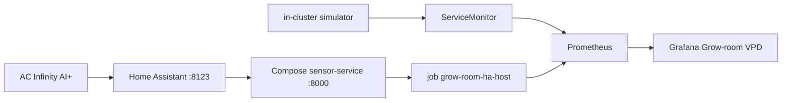

# Week 4 — Observability and the live tent

I wanted the charts to show the tent, and I wanted the cluster tests to keep working when the tent was off.

## What I built

kube-prometheus-stack `92.13.1` in namespace `monitoring`. Retention is 24 hours. The scrape interval is 30 seconds. Replicas stay at one. That fits a laptop.

Two scrape jobs, described in [Architecture](../architecture.md) and panel by panel in the [Grafana guide](../grafana.md).

Three alert rules in `monitoring/alerts/grow-room-rules.yaml`:

| Alert | Condition |
| --- | --- |
| `GrowRoomSensorScrapeDown` | Simulator job down for 2 minutes |
| `GrowRoomHumidityOutOfRange` | Humidity under 30 or over 80 for 5 minutes |
| `GrowRoomSensorPodRestarts` | More than two restarts in 15 minutes |

The live controller work landed after the first monitoring merge:

- [PR #12](https://github.com/TontoBlanco/grow-room-platform/pull/12) exposed probe, controller VPD, and ports
- [PR #14](https://github.com/TontoBlanco/grow-room-platform/pull/14) put those series on the dashboard
- [PR #25](https://github.com/TontoBlanco/grow-room-platform/pull/25) added the host scrape
- [PR #29](https://github.com/TontoBlanco/grow-room-platform/pull/29) collapsed duplicate legends
- [PR #32](https://github.com/TontoBlanco/grow-room-platform/pull/32) made scrape-up one tile per job
- [PR #43](https://github.com/TontoBlanco/grow-room-platform/pull/43) added the plant-mood gauge

## Why

A ServiceMonitor can scrape the simulator, because that pod is a Kubernetes Service. It cannot see the controller. Those gauges appear only after Compose has read Home Assistant. I added a second job instead of pointing the simulator at my token.

## Data flow



## Rebuild

Copy the example env file and edit it outside Git. Set `SENSOR_SOURCE` to `homeassistant`, `HA_URL` to `http://homeassistant:8123`, and `HA_TOKEN` to a Home Assistant long-lived token. Leave the token out of the shell history if you can. The entity defaults in `.env.example` already match prefix `the_garden`.

```powershell
Set-Location C:\src\grow-room-platform
```

```powershell
Copy-Item .env.example .env
```

Start Compose, including Home Assistant. Finish onboarding at `http://127.0.0.1:8123`, install HACS, add the AC Infinity integration, create the token, put it in `.env`, and start again.

```powershell
docker compose up --build
```

In WSL2, with the k3d cluster from Week 3 already up:

```bash
kubectl -n monitoring port-forward svc/monitoring-grafana 3000:80
```

The host job target is `host.k3d.internal:8000`. Compose must publish `8000:8000`, not `127.0.0.1:8000:8000`. The loopback bind is reachable from the host and not from the k3d gateway. If the target stays down, the comments in `monitoring/values-k3d.yaml` list the fallback addresses. Change the single target. Do not add a second `prometheus:` key or YAML will drop the block.

## Cost

This week is local. No AWS resources. The 24 hour retention is a disk choice on the laptop, not an S3 bill.

## What I learned

Two healthy scrapes can still make a bad dashboard. The first live panels mixed the simulator with the tent, and every old pod left a DOWN tile. The fix was labels plus `max by`, and a test so the queries do not drift.

The other lesson was the laptop lid. I spent time looking for a scrape bug that was just sleep. I wrote that down next to the dashboard so I would not chase it again.
