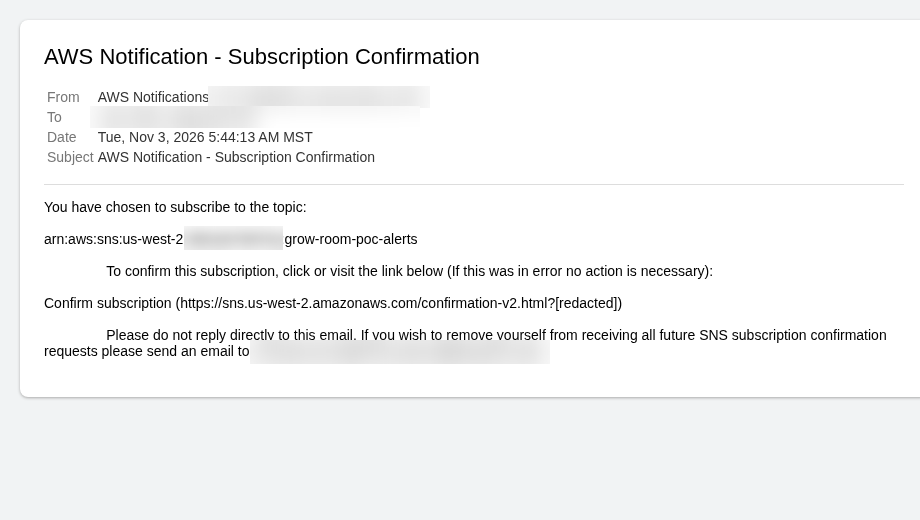
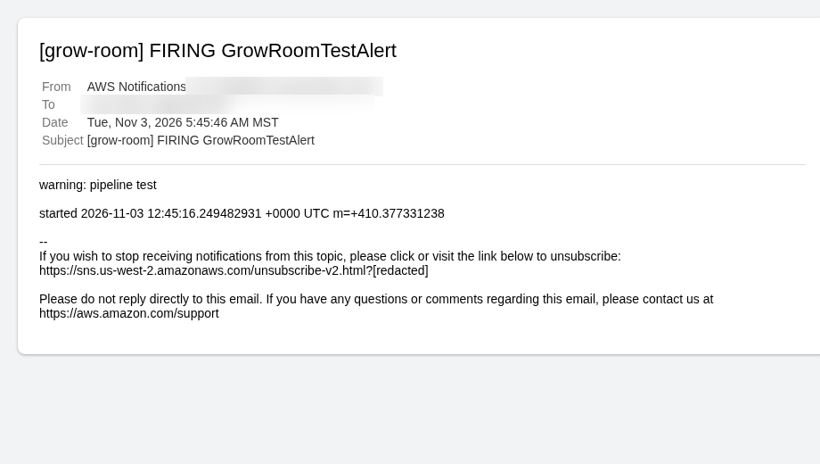
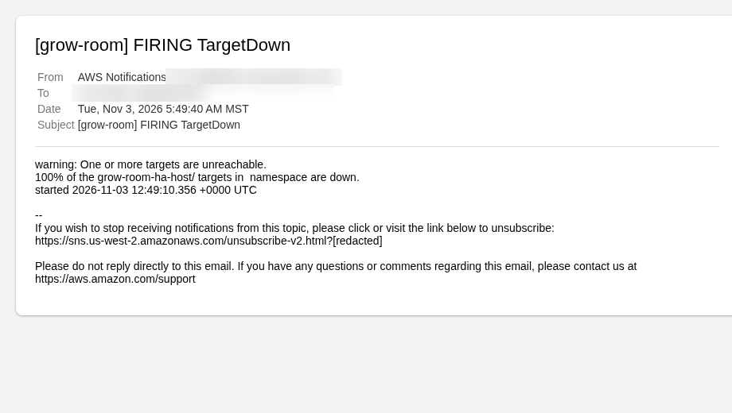
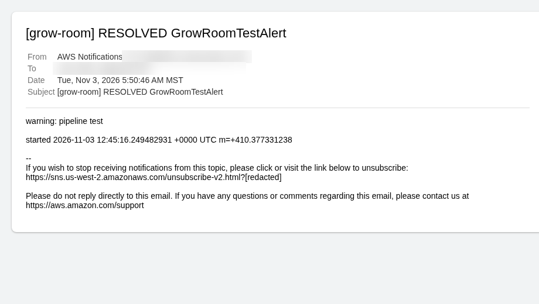
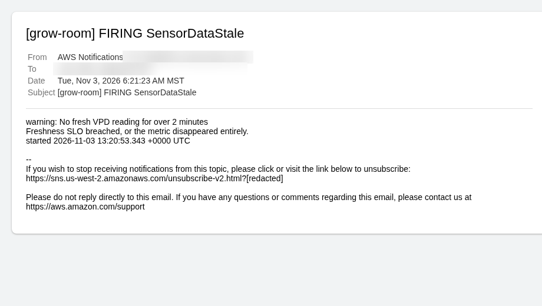
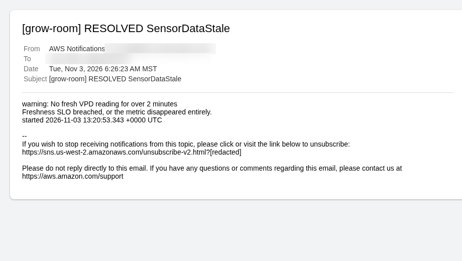

# Test session, 3 November 2026

This was a paid run of cluster `grow-room-poc` in `us-west-2`. I brought it up, ran `verify`, checked the email path, checked the exporter, ran the four drills, and tore it down.

## Results I am recording

| Check | Result |
| --- | --- |
| `scripts/aws-poc.ps1 verify` | Passed |
| Alert path, SNS email | Worked. Confirmation, a test alert, `TargetDown`, and `SensorDataStale` are below. |
| EKS exporter to S3 to Athena | Worked. I do not have a query screenshot in this folder. The result is the session record. |
| Drill 1, delete a pod | Passed |
| Drill 2, drain a node | Passed |
| Drill 3, RDS failover | Passed. The failover I timed was about 30 seconds. |
| Drill 4, scale to zero | Passed. The email that arrived was `SensorDataStale`. |
| Teardown | Clean |

The drill notes still say a Multi-AZ failover is often 60 to 120 seconds. That range is the usual expectation in [ADR-0006](../adr/0006-rds-multi-az.md). The number from this session is about 30 seconds. `/healthz` can stay up through a failover, because it does not use the database. `/audit` is the path that notices.

Pull request [#75](https://github.com/TontoBlanco/grow-room-platform/pull/75) is the cleanup from the same day. I am not hiding what it found:

- Drill 1 and drill 2 each returned one HTTP 502. The chart now waits longer than the load balancer's deregistration delay: `preStop` 30 seconds, `terminationGracePeriodSeconds` 45, deregistration delay 20 seconds, and a PodDisruptionBudget of `minAvailable: 2`.
- Kyverno reported `no signatures found`. CI now signs with cosign 2.6.5 and the legacy tag. The policy stays in Audit.
- `TargetDown` fired for `grow-room-ha-host`. EKS was still configured to scrape the laptop address. `monitoring/values-eks.yaml` now sets `additionalScrapeConfigs` to an empty list.
- `SensorDataStale` fired before `SensorAvailabilityBudgetBurnFast`. That order is what the rules do. It is written up in [Phase 4](../phases/phase-4-slos-and-drills.md).
- The first `up` had no email subscription until `alert_email` was actually passed. The script now resolves `ALERT_EMAIL` and warns on `PendingConfirmation`.
- `terraform destroy` sat on an available network interface. `down` deletes those interfaces in the proof-of-concept VPC.

The drills passed as a session: I ran them, I got the emails, failover completed, and `down` finished. The 502s are why the next session should be quieter, not a claim that every curl was 200.

## Session order

This is the order I use for a paid session. The planning figure in the runbook is about 0.65 to 0.75 USD per hour while the stack is up. That is an estimate, not a Cost Explorer total. Tear down the same day.

1. Confirm Docker is up if the tent path is in the test. A stopped Docker engine makes Home Assistant show onboarding and makes sensor-service return 401.
2. Match `my_ip_cidr` in `terraform.tfvars` to the GitHub variable `MY_IP_CIDR`.
3. Run `.\scripts\aws-poc.ps1 up` and type `yes` only when the bill should start. Or approve the manual apply workflow and then run `up -SkipTerraform`. Use one of those, not both as writers.
4. Run `.\scripts\aws-poc.ps1 verify`. It should end with `ALL CHECKS PASSED`.
5. Confirm the SNS email, then send the test alert. The subscription has to exist. `up` now creates it when `ALERT_EMAIL` is set.
6. Kyverno stays in Audit. `mutateDigest` stays `false` until a PolicyReport is a pass. Do not flip to Enforce in the same breath as the first signed image.
7. Run the exporter and the Athena query if that is part of the session.
8. Run the four drills from [DRILLS.md](../aws-poc/DRILLS.md). Drill 4's email is `SensorDataStale`, not the fast-burn alert. An older walkthrough still says `SensorAvailabilityBudgetBurnFast` in 5 to 8 minutes. That note is outdated.
9. Run `.\scripts\aws-poc.ps1 down`. Available `aws-K8S-...` interfaces in the proof-of-concept VPC are deleted by the script. The tagging API may still list deleted resources for a while.

The 3 November session followed this shape. Verify passed. The alert path worked. The exporter path to S3 and Athena worked. Drills 1 through 4 passed, and the RDS failover was about 30 seconds. Teardown was clean. The same lessons are on the [troubleshooting page](../troubleshooting.md).

## Evidence

The six screenshots are in the repository at these paths:

- `docs/assets/test-session/00-sns-subscription-confirmation.png`
- `docs/assets/test-session/01-test-alert-firing.png`
- `docs/assets/test-session/02-targetdown-firing.png`
- `docs/assets/test-session/03-test-alert-resolved.png`
- `docs/assets/test-session/04-sensordatastale-firing.png`
- `docs/assets/test-session/05-sensordatastale-resolved.png`

This page is `docs/test-session/2026-11-03.md`. On the published site that is `test-session/2026-11-03/`.

I blurred the inbox address on every image. On the confirmation I also blurred the account id inside the topic ARN, the sender address, and the opt-out address. The confirm and unsubscribe links already said `[redacted]` in the capture. The topic name `grow-room-poc-alerts` is still readable.

Subscription confirmation, 5:44 AM MST. The inbox link has to be clicked once. Terraform does not click it.

Test alert, 5:45 AM MST. Subject `[grow-room] FIRING GrowRoomTestAlert`. Body `warning: pipeline test`. This is the pipeline test, not a humidity alarm.

`TargetDown`, 5:49 AM MST. "100% of the grow-room-ha-host/ targets in namespace are down." That job does not belong on EKS. It is the Compose scrape on the laptop.

The test alert cleared at 5:50 AM MST. Subject `[grow-room] RESOLVED GrowRoomTestAlert`.

`SensorDataStale` firing, 6:21 AM MST. Summary: "No fresh VPD reading for over 2 minutes." This is the email drill 4 is supposed to produce, about seven minutes after the scale to zero.

`SensorDataStale` resolved, 6:26 AM MST, after samples came back.

## Cost

!!! warning "This session was a bill"
    The stack was up long enough to verify, to wait for mail, and to fail over a database. I have not written the Cost Explorer total into `docs/aws-poc/COSTS.md`. Until that cell is filled, I will not quote a dollar figure for 3 November. The script's 0.70 USD per hour line is a warning, not this session's invoice. Teardown was clean, which means the NAT gateways, the cluster, the load balancer, and RDS are not still running from this day. The telemetry key, the state key, the budget, and the hosted zone are still there on purpose.
